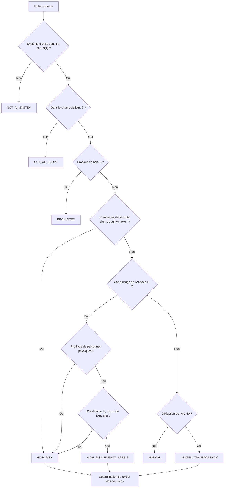
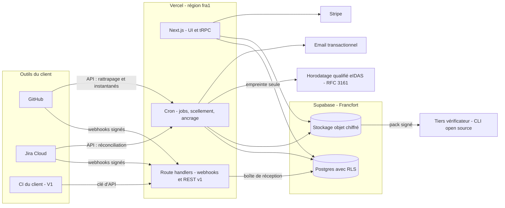
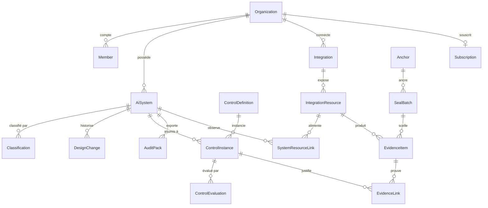
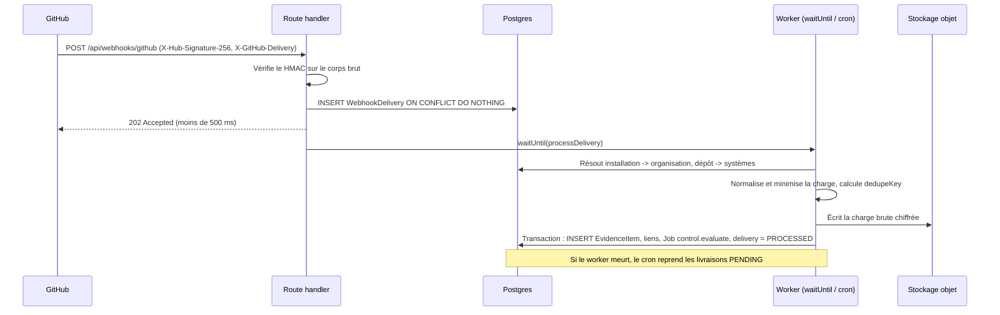
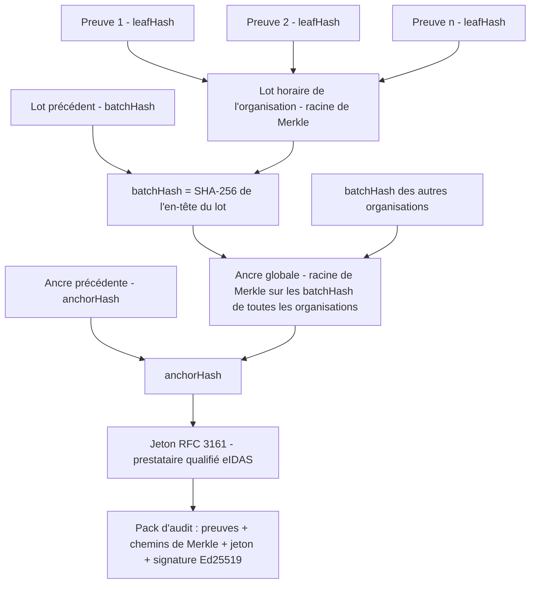

# ProofLayer — Cahier des charges

> Version 1.0 — 10 novembre 2026. Faits réglementaires et prix publics relevés à cette date. Les noms de sociétés des cas d'usage (Talvio, Paylence, Recrutys) sont fictifs.

## 1. Vision & positionnement

### 1.1 Pitch (26 mots)

**ProofLayer branche GitHub et Jira des PME européennes, capture en continu les preuves exigées par l'AI Act et produit un dossier d'audit horodaté, vérifiable sans nous.**

### 1.2 Les 3 jobs-to-be-done prioritaires

| # | Job | Situation déclenchante | Résultat attendu | Alternative actuelle |
|---|---|---|---|---|
| J1 | **Savoir où j'en suis** | Un client grand compte, un investisseur ou le board demande « êtes-vous concernés par l'AI Act ? » | Classification argumentée de chaque système + liste exacte des obligations applicables, signée, en 48 h | Avocat (devis à 5 chiffres, 4 à 6 semaines) ou tableur maison sans valeur probante |
| J2 | **Prouver sans y passer mes sprints** | Il faut démontrer que la revue de code, les tests, la gestion des risques et la supervision humaine sont réellement appliqués | Preuves collectées automatiquement là où le travail se fait, horodatées par un tiers, sans capture d'écran | Dossier Notion/Drive rempli à la main la semaine précédant l'audit |
| J3 | **Rester conforme release après release** | Le système change (modèle, données, périmètre fonctionnel) ou le texte évolue | Alerte quand un contrôle casse, qu'une preuve périme ou qu'une modification fait basculer la classification | Rien : la conformité est une photo prise le jour de l'audit |

### 1.3 Ce que ProofLayer n'est pas

- **Pas un avis juridique.** La classification est une aide à la décision produite par des règles déterministes et signée par un humain du client. La responsabilité de la qualification reste chez lui.
- **Pas un outil de MLOps.** Aucun calcul de dérive, de biais ou d'explicabilité. ProofLayer ingère les *résultats* de ces outils comme preuves.
- **Pas un GRC multi-référentiels.** Ni SOC 2, ni ISO 27001, ni DORA, ni NIS2 avant 100 k€ ARR. Un seul référentiel, traité en profondeur. Table de correspondance ISO/IEC 42001 en V2.
- **Pas pour les fournisseurs de modèles à usage général** (Art. 51 à 55) ni pour le secteur régalien (Annexe III points 6, 7, 8) : ces cas sont classifiés, pas outillés.
- **Pas un organisme notifié.** ProofLayer prépare l'auto-évaluation (Annexe VI), il ne certifie rien et n'affiche jamais le mot « conforme ».
- **Pas un aspirateur de données de production.** Ni entrées/sorties des modèles, ni données de candidats ou d'emprunteurs, ni code source.
- **Pas un générateur de politiques en un clic.** C'est précisément la catégorie « documentation-only » que le produit attaque.
- **Pas d'on-premise** au MVP ni en V1.

### 1.4 Hypothèse de valeur unique que le MVP doit prouver

> Une PME éditrice de logiciel ayant au moins un système relevant de l'Annexe III, qui connecte GitHub et Jira, obtient **en moins de 60 minutes** : (a) une classification signée, (b) **au moins 40 % de ses contrôles applicables évalués automatiquement** à partir de preuves capturées sans saisie, (c) un pack d'audit vérifiable hors ligne par un tiers. Et elle paie **au moins 3 480 €/an** pour que ce pack reste à jour.

Critères de succès mesurés sur les 5 design partners à la fin de la semaine 12 :

| Métrique | Seuil |
|---|---|
| Délai inscription → première preuve capturée | < 15 min (médiane) |
| Part des contrôles applicables évalués automatiquement | ≥ 40 % |
| Design partners ayant transmis un pack à un tiers réel (client, investisseur, auditeur) | ≥ 3 sur 5 |
| Design partners convertis en payant | ≥ 3 sur 5 |

Si le deuxième seuil n'est pas atteint, le différenciateur « compliance-as-code » ne tient pas et le plan de pivot du §11.3 s'applique.

### 1.5 Calage réglementaire (état au 10 novembre 2026)

Ces faits modifient le discours commercial et le périmètre. Ils priment sur toute intuition antérieure.

| Fait | Source | Conséquence produit / discours |
|---|---|---|
| L'échéance du **2 décembre 2027** pour l'Annexe III est une date fixe (le mécanisme conditionnel lié aux normes a été abandonné). Annexe I : 2 août 2028. | Règlement (UE) 2026/1744, adopté le 8 juillet 2026, JOUE du 24 juillet, en vigueur le 27 juillet 2026 ; Art. 113 modifié | La fenêtre est confirmée. Elle peut encore bouger : voir risque R2. |
| **Clause du parc existant** : un système haut risque déjà mis sur le marché avant la date d'application n'est soumis au règlement que si sa conception subit des « modifications importantes » après cette date. | Art. 111(2) | Le discours « tout le monde doit être prêt le 2 décembre 2027 » est faux pour le parc existant. Dans un SaaS en déploiement continu, la modification importante arrive vite : ProofLayer doit tracer les changements de conception (journal des modifications, §3 E2). |
| Pour les PME et les petites entreprises de taille intermédiaire (SMC), l'amende est plafonnée au **plus bas** des deux montants (pourcentage ou forfait). | Art. 99(6) et 99(6a) | Une PME à 8 M€ de chiffre d'affaires risque 240 k€ au titre du plafond de 3 %, pas 15 M€. Ne pas vendre la peur de l'amende. Vendre l'accès au marché : appels d'offres, questionnaires fournisseurs, due diligence. |
| L'évaluation de conformité des systèmes de l'Annexe III points 2 à 8 se fait par **contrôle interne**, sans organisme notifié. | Art. 43(2), Annexe VI | La PME s'auto-déclare, donc elle doit détenir elle-même un dossier de preuves opposable. C'est le cœur du besoin. |
| L'exemption de l'Art. 6(3) se documente avant mise sur le marché et s'enregistre dans la base de données de l'UE (informations allégées). | Art. 6(4), Art. 49(2), Annexe VIII section B | Le « dossier d'exemption » est un livrable MVP. Ce sera probablement le premier usage chez une majorité de prospects. |
| Documentation technique **simplifiée** pour PME et SMC, selon un formulaire de la Commission. | Art. 11(1) | Le générateur Annexe IV adopte ce formulaire comme format de sortie dès sa publication. |
| Lignes directrices de classification (Art. 6) : projet publié le 19 mai 2026, consultation close le 23 juin 2026. | Commission européenne | Moteur de classification versionné. HYPOTHÈSE À VALIDER : statut de la version finale. Test : vérification sur le site de l'AI Office avant le sprint 2. |
| Norme EN 18286:2026 (système de management de la qualité) publiée ; citation au JOUE rapportée en octobre 2026 (décision d'exécution (UE) 2026/2274). Aucune autre norme harmonisée citée. | Sources secondaires, à confirmer sur EUR-Lex | Bibliothèque de contrôles mappée sur le texte du règlement, pas sur les normes. Correspondance EN 18286 en V2. |
| Art. 4 (maîtrise de l'IA) réécrit : « prendre des mesures pour soutenir » au lieu de garantir un niveau. Applicable depuis le 2 février 2025. | Art. 4 modifié | Un seul contrôle, preuve = registre de formation. |
| Art. 50 (transparence) applicable depuis le 2 août 2026. Marquage des contenus synthétiques pour les systèmes antérieurs : 2 décembre 2026. | Art. 50, Art. 111(4) | Seule obligation déjà opposable à la cible. Sert d'accroche immédiate, pas de cœur de produit. |

---

## 2. Personas & cas d'usage

### 2.1 Personas

| | **P1 — Clara, CTO** | **P2 — Mehdi, Head of Risk & Compliance** | **P3 — Sophie, DPO** |
|---|---|---|---|
| Priorité | **Cœur du MVP** | MVP, co-acheteur | **V1** (hors MVP) |
| Entreprise | Talvio, HR-tech, 120 salariés, Nantes. ATS avec score d'adéquation candidat/poste | Paylence, fintech, 260 salariés, Paris. Crédit à la consommation fractionné, score d'octroi interne | Groupe de travail temporaire, 420 salariés, Lille. Utilise un ATS tiers avec tri automatique |
| Rôle AI Act | Fournisseur d'un système haut risque (Annexe III 4(a)) | Fournisseur et déployeur (Annexe III 5(b)) | Déployeur (Art. 26) |
| Équipe | 28 ingénieurs dont 4 ML. GitHub, Jira, Notion. Pas de juriste interne | 45 ingénieurs, 3 personnes en conformité. GitHub, Jira, Confluence. Déjà soumis ACPR et DORA | Pas d'équipe technique. SIRH, suite bureautique, 1 juriste |
| Déclencheur d'achat | Un client du CAC 40 ajoute 30 questions « IA » à son questionnaire fournisseur et conditionne le renouvellement | Audit interne, banque partenaire ou due diligence d'une levée exige la traçabilité du modèle de score | Question du CSE sur l'outil de tri, ou clause AI Act dans un contrat client |
| Ce qu'elle/il achète | Du temps d'ingénieur non gaspillé et une réponse crédible au client | Une piste d'audit opposable, cohérente avec ses autres contrôles | Un inventaire et la preuve d'avoir informé et formé |
| Budget annuel | 3 à 10 k€, signature seule sous 10 k€ | 8 à 25 k€, passe par un achat formel | 2 à 6 k€ |
| Cycle de vente | 2 à 4 semaines | 6 à 10 semaines | 4 à 8 semaines |
| Objections | « On est exemptés par l'Art. 6(3) » ; « l'échéance est en 2027 » ; « je ne donne pas accès à mon GitHub à une startup » | « Vous n'êtes pas ISO 27001 » ; « on a déjà un GRC » ; « que devient la preuve si vous disparaissez ? » | « On est simple utilisateur » ; « notre éditeur s'en occupe » |
| Réponse | Dossier d'exemption signé + GitHub App en lecture seule, périmètre par dépôt | Pack vérifiable sans ProofLayer, horodatage qualifié eIDAS, hébergement UE, DPA | Obligations propres du déployeur (Art. 26) + module V1 |

P3 sert à dimensionner la V1. Le MVP ne lui livre rien : ses preuves ne vivent ni dans GitHub ni dans Jira, et le différenciateur ne s'y exprime pas.

### 2.2 Cas d'usage bout-en-bout

**CU1 — Talvio répond à un appel d'offres grand compte (fournisseur, haut risque).**
Talvio reçoit le 3 mars le questionnaire fournisseur d'un groupe bancaire : preuve de classification, documentation technique, mesures de supervision humaine, gestion des biais. Réponse attendue sous 15 jours. Clara crée un compte, déclare le système « Score d'adéquation candidat » et répond à 11 questions. Résultat : haut risque, Annexe III point 4(a), rôle fournisseur, 37 contrôles applicables. Elle installe la GitHub App sur 3 dépôts (`scoring-api`, `scoring-model`, `ml-pipelines`) et connecte le projet Jira `AIR`. En 12 minutes, le rattrapage sur 90 jours remonte 214 preuves : 100 % des PR fusionnées avec relecture par un tiers, protection de branche active, workflow `eval` exécuté sur chaque release. 19 contrôles s'évaluent seuls, dont 16 passent. Trois échouent : pas de `CODEOWNERS` sur `model/`, deux vulnérabilités critiques ouvertes depuis plus de 30 jours, registre des risques non revu depuis 5 mois. L'équipe corrige en une semaine, dépose la notice d'utilisation et la fiche de données dans `docs/ai/`. Le jour 9, Clara exporte un pack d'audit de 61 pages, signé et horodaté, et joint au questionnaire le lien de vérification. Le client vérifie le pack sans compte ProofLayer.

**CU2 — Paylence prépare sa due diligence de série B (fournisseur et déployeur, haut risque).**
Le fonds mandate un cabinet pour auditer le modèle d'octroi. Mehdi doit prouver que chaque version du modèle déployée depuis 12 mois a été testée, validée par le comité risques et documentée. Le modèle est réentraîné tous les mois. Dans ProofLayer, chaque tag de release du dépôt `credit-score` est relié automatiquement au workflow d'évaluation correspondant, au ticket Jira de validation du comité (transition « Approuvé » horodatée, approbateur nommé) et à la version de la fiche de données. Le contrôle AIA-11-02 montre 12 releases, 12 dossiers complets. Paylence étant aussi déployeur d'un système de l'Annexe III 5(b), l'analyse d'impact sur les droits fondamentaux (Art. 27) est attendue : au MVP, Mehdi la téléverse comme preuve manuelle avec attestation ; le gabarit guidé arrive en V1. Le cabinet reçoit le pack, exécute `npx @prooflayer/verify pack.zip` et constate que les 12 dossiers ont été scellés au fil de l'eau, mois après mois, et non reconstitués la veille.

**CU3 — Recrutys documente son exemption, puis bascule en haut risque (Art. 6(3) puis Annexe III).**
Recrutys, 65 salariés, édite un ATS dont la seule brique d'IA extrait les champs d'un CV et propose des créneaux d'entretien. Le questionnaire conclut : domaine de l'Annexe III point 4(a), mais tâche procédurale étroite au sens de l'Art. 6(3)(a), sans profilage. Le CTO signe le dossier d'exemption, ProofLayer produit les champs de l'Annexe VIII section B pour l'enregistrement dans la base de l'UE. Six contrôles s'appliquent. Quatre mois plus tard, l'équipe produit livre un « score de pertinence » qui classe les candidatures. Lors de la revue trimestrielle du registre, la réponse à la question « le système évalue-t-il ou classe-t-il des personnes ? » change. Le moteur reclassifie en haut risque, 31 contrôles supplémentaires s'ouvrent, une alerte part au CTO et au responsable produit. Recrutys découvre son changement de statut à la livraison de la fonctionnalité, pas lors d'un contrôle.

### 2.3 Matrice obligation → preuve attendue → outil source

| Obligation (AI Act) | Preuve attendue | Où la preuve vit | Capture |
|---|---|---|---|
| Art. 6(3)-(4) — exemption documentée | Évaluation signée : condition (a) à (d) retenue, absence de profilage motivée | ProofLayer | Native |
| Art. 9 — système de gestion des risques | Registre des risques tenu à jour, mesures liées, risque résiduel accepté par un responsable nommé | Jira (tickets étiquetés `ai-risk`) | Automatique |
| Art. 9(6)-(8) — tests avant mise sur le marché | Exécution réussie du workflow d'évaluation sur le commit de release | GitHub Actions | Automatique |
| Art. 10 — gouvernance des données | Fiche de données par jeu (provenance, préparation, biais examinés), revue approuvée | GitHub (`docs/ai/datasheets/`) | Semi-automatique |
| Art. 11 + Annexe IV — documentation technique | Document complet, versionné, rattaché à chaque release | ProofLayer + GitHub | Semi-automatique |
| Art. 12 et 19 — journalisation, rétention ≥ 6 mois | Configuration de journalisation et de rétention versionnée | GitHub (IaC) ; consoles cloud en V2 | Semi-automatique |
| Art. 13 — notice d'utilisation | Notice publiée, versionnée, rubriques 13(3) couvertes | GitHub ; Notion en V1 | Semi-automatique |
| Art. 14 — contrôle humain | Responsable nommé, procédure, test d'interruption | ProofLayer + GitHub | Semi-automatique |
| Art. 15 — exactitude, robustesse, cybersécurité | Relecture obligatoire, checks requis, vulnérabilités traitées dans les délais, détection de secrets | GitHub (protection de branche, PR, alertes) | Automatique |
| Art. 17 — système de management de la qualité | Modèle de PR avec checklist, `CODEOWNERS`, responsabilités nommées | GitHub + ProofLayer | Automatique |
| Art. 18 — conservation 10 ans | Packs d'audit archivés, vérifiables indépendamment | ProofLayer | Native |
| Art. 20 et 73 — actions correctives, incidents graves | Tickets d'incident avec horodatage détection → notification, correctif lié | Jira | Automatique |
| Art. 72 — surveillance après commercialisation | Plan documenté, revue périodique close | GitHub + Jira | Semi-automatique |
| Art. 43, 47, 49 — évaluation, déclaration, enregistrement | Rapport de contrôle interne signé, déclaration UE, accusé d'enregistrement | ProofLayer + téléversement | Manuelle |
| Art. 4 — maîtrise de l'IA | Registre de formation des équipes concernées | SIRH (V2) ; CSV au MVP | Manuelle puis automatique |
| Art. 26 — obligations du déployeur | Notice archivée, supervision affectée, information du CSE et des personnes | SIRH, Notion, téléversement | V1 |
| Art. 27 — analyse d'impact droits fondamentaux | FRIA signée et notifiée | ProofLayer (gabarit V1) | Manuelle puis guidée |

---

## 3. Périmètre fonctionnel

### 3.1 Vue d'ensemble des épics

| ID | Épic | MoSCoW | Phase | Justification (besoin ou obligation) |
|---|---|---|---|---|
| E1 | Onboarding & classification de risque | Must | MVP | Art. 6, Annexe III, Art. 6(3)-(4) ; J1 |
| E2 | Registre des systèmes d'IA | Must | MVP | Art. 49, Annexe VIII ; socle de tout le reste |
| E3 | Connecteur GitHub | Must | MVP | Art. 15, 17, 11 ; source de 9 contrôles automatisés et de 11 semi-automatisés |
| E4 | Connecteur Jira Cloud | Must | MVP | Art. 9, 20, 72, 73 ; source de 6 contrôles automatisés |
| E5 | Preuves manuelles & attestations | Must | MVP | Art. 43, 47, 49 ; tout ce qui ne vit dans aucun outil |
| E6 | Bibliothèque de contrôles & moteur de règles | Must | MVP | Mapping article → contrôle → preuve ; J2 |
| E7 | Dashboard de statut | Must | MVP | J2, J3 |
| E8 | Scellement cryptographique | Must | MVP | Valeur probante ; Art. 18 (conservation), Art. 21 (démonstration à l'autorité) |
| E9 | Générateur de pack d'audit | Must | MVP | Art. 11, 21, 43 ; livrable transmis au tiers |
| E10 | Utilisateurs & rôles (RBAC) | Must | MVP | Séparation des tâches, accès auditeur |
| E11 | Facturation & plans | Must | MVP | Hypothèse de valeur : quelqu'un paie |
| E12 | Alertes & veille réglementaire | Should | MVP (minimal) → V1 | J3 |
| E13 | Evidence API & GitHub Action | Should | V1 | Art. 10, 15 : résultats d'évaluation produits en CI |
| E14 | Documentation technique Annexe IV assistée | Should | V1 | Art. 11(1), formulaire simplifié PME |
| E15 | Connecteurs GitLab et Notion | Should | V1 | Couverture du marché (GitLab fort en DACH), Art. 13 |
| E16 | Module déployeur | Should | V1 | Art. 26, 27, 86 ; persona P3 |
| E17 | Lien de confiance & portail auditeur | Could | V1 | Réduit la friction de transmission du pack |
| E18 | Connecteurs SIRH (Personio, Lucca, PayFit, BambooHR) | Could | V2 | Art. 4, Art. 26(2) |
| E19 | Connecteurs cloud & MLOps (AWS, GCP, MLflow, W&B) | Could | V2 | Art. 12, 19 : preuve de journalisation et de rétention |
| E20 | Correspondances ISO/IEC 42001 et EN 18286 | Could | V2 | Demande des acheteurs grands comptes |
| E21 | SSO SAML, SCIM, API publique en lecture | Could | V1 (SSO) / V2 | Exigence d'achat au-delà de 250 salariés |
| — | On-premise, SOC 2/ISO 27001/DORA, module fournisseur GPAI, tests de modèles, place de marché d'auditeurs, application mobile | **Won't** | Pas avant 100 k€ ARR | Dilution du positionnement |

**Ordre des connecteurs, tranché :** GitHub (MVP), Jira Cloud (MVP), GitLab (V1), Notion (V1), SIRH (V2). GitHub d'abord parce que c'est la source où la preuve est la plus riche et la moins contestable. Jira ensuite parce que les articles 9, 20, 72 et 73 n'ont aucune trace dans un dépôt de code.

### 3.2 Épics du MVP

#### E1 — Onboarding & classification de risque

**En tant que** CTO d'une PME éditrice, **je veux** répondre à un questionnaire court sur chacun de mes systèmes **afin d'**obtenir une classification argumentée, article par article, que je peux signer et opposer à un client.

Critères d'acceptation :
- Le questionnaire compte au plus 12 questions par système, avec branchements. Médiane de complétion inférieure à 6 minutes sur les design partners.
- Le moteur est déterministe (aucun LLM dans la décision) et versionné. Une même série de réponses avec une même version de règles produit toujours le même résultat.
- Le résultat appartient à exactement une catégorie : `NOT_AI_SYSTEM`, `OUT_OF_SCOPE`, `PROHIBITED`, `HIGH_RISK`, `HIGH_RISK_EXEMPT_ART6_3`, `LIMITED_TRANSPARENCY`, `MINIMAL`.
- Chaque résultat affiche la trace de raisonnement : règle déclenchée, réponse qui l'a déclenchée, référence d'article.
- Toute réponse indiquant un profilage de personnes physiques force `HIGH_RISK`, même si une condition de l'Art. 6(3) est remplie.
- Le rôle (fournisseur, déployeur, importateur, distributeur) est déterminé, y compris la bascule en fournisseur de l'Art. 25(1) (marque propre, modification substantielle, changement de finalité).
- La classification est signée par un utilisateur nommé (nom, fonction, date, déclaration). Une classification signée est immuable ; une modification crée une nouvelle version.
- Le jeu de tests couvre au moins 60 cas, dont les exemples du projet de lignes directrices de la Commission (analyse de CV, planification d'entretiens, appariement et classement de candidatures, affectation de tâches selon des traits personnels).

Dépendances : texte de l'Annexe III et de l'Art. 6 ; projet de lignes directrices du 19 mai 2026 ; E2.



#### E2 — Registre des systèmes d'IA

**En tant que** responsable conformité, **je veux** un registre unique de tous les systèmes d'IA que l'entreprise fournit ou utilise **afin de** savoir lesquels sont concernés et de produire les informations d'enregistrement de l'Annexe VIII.

Critères d'acceptation :
- Création d'une fiche en 3 champs obligatoires (nom, finalité prévue, responsable). Les autres champs se complètent plus tard.
- La fiche porte : finalité prévue, rôle, statut du cycle de vie, date de mise sur le marché ou en service, modèles sous-jacents et leur fournisseur, catégories de données, responsable du système, responsable du contrôle humain, ressources liées (dépôts, projets Jira).
- La date de mise sur le marché et le journal des modifications de conception sont conservés : ils fondent l'analyse de l'Art. 111(2).
- Chaque modification de fiche est historisée (qui, quand, avant, après). Toute modification d'un champ utilisé par la classification marque celle-ci « à revoir ».
- Export CSV et JSON du registre. Export des champs de l'Annexe VIII section A ou B selon la classification.
- Le nombre de fiches est illimité sur tous les plans ; seul le nombre de systèmes *surveillés* est limité (E11).

Dépendances : E10.

#### E3 — Connecteur GitHub

**En tant que** CTO, **je veux** installer une GitHub App en lecture seule sur les dépôts que je choisis **afin que** les preuves de mes pratiques d'ingénierie soient capturées sans action de mon équipe.

Critères d'acceptation :
- Installation par le flux GitHub App standard, avec choix des dépôts. Aucune permission d'écriture demandée. Permissions listées au §4.5.1.
- Une installation est liée à une seule organisation ProofLayer. Une tentative de liaison à une seconde organisation est refusée.
- Chaque dépôt est rattaché à un ou plusieurs systèmes, avec filtres de chemins optionnels (`model/**`, `docs/ai/**`).
- Événements traités : PR fusionnée, revue soumise, exécution de workflow terminée, push sur un chemin suivi, release publiée, modification des règles de protection.
- Rattrapage automatique des 90 derniers jours à la première liaison, terminé en moins de 15 minutes pour un dépôt de 500 PR.
- Instantané quotidien : protection de la branche par défaut, alertes de sécurité ouvertes par gravité et ancienneté, présence et empreinte des fichiers suivis.
- Tout webhook est vérifié (HMAC SHA-256) et idempotent : rejouer dix fois la même livraison crée une seule preuve.
- Aucun code source n'est stocké. Pour les fichiers de `docs/ai/**`, le contenu est stocké uniquement si l'administrateur l'active.
- La page Intégrations affiche pour chaque dépôt : dernier événement reçu, dernier instantané, erreurs, bouton de resynchronisation.
- Suspension ou désinstallation de l'App : le connecteur passe en `REVOKED`, une alerte est émise, les preuves déjà capturées restent.

Dépendances : compte GitHub App ; E8 pour le scellement ; §4.5.

#### E4 — Connecteur Jira Cloud

**En tant que** responsable conformité, **je veux** désigner les tickets Jira qui constituent mon registre des risques, mes incidents et mes revues périodiques **afin que** leur cycle de vie serve de preuve.

Critères d'acceptation :
- Connexion par OAuth 2.0 (3LO) Atlassian, portées en lecture seule plus la gestion des webhooks de l'application.
- Quatre correspondances configurables par système, chacune définie par une requête JQL : registre des risques, incidents IA, revues de surveillance, validations de release. Valeurs par défaut proposées (`labels = ai-risk`, `issuetype = "AI Incident"`).
- Prévisualisation du nombre de tickets retournés avant enregistrement d'une correspondance.
- Capture des transitions de statut avec horodatage et auteur, des liens entre tickets, de l'assigné, de la résolution.
- Les jetons d'accès et de rafraîchissement sont chiffrés au repos. La rotation du jeton de rafraîchissement est gérée sans perte de connexion sous appels concurrents.
- Synchronisation par webhooks dynamiques, renouvelés avant leur expiration à 30 jours, doublée d'une réconciliation par interrogation toutes les 15 minutes.
- Révocation côté Atlassian détectée en moins de 30 minutes, avec alerte.

Dépendances : application OAuth déclarée sur la console développeur Atlassian ; E6. Jira Data Center : hors périmètre.

#### E5 — Preuves manuelles & attestations

**En tant que** contributeur, **je veux** déposer un document ou signer une attestation pour un contrôle **afin de** couvrir les obligations qui ne laissent de trace dans aucun outil.

Critères d'acceptation :
- Téléversement d'un fichier (PDF, DOCX, PNG, JPG, MD, CSV ; 25 Mo au plus) rattaché à un ou plusieurs contrôles, avec date de validité obligatoire.
- Attestation : déclaration textuelle signée par un utilisateur nommé, avec sa fonction et une date de validité.
- Une preuve manuelle est marquée « déclarative » partout où elle apparaît, y compris dans le pack.
- Une preuve dont la validité expire fait passer le contrôle en `STALE` et déclenche une alerte 14 jours avant.
- L'empreinte SHA-256 du fichier est calculée côté serveur et scellée comme toute autre preuve.

Dépendances : stockage objet ; E8.

#### E6 — Bibliothèque de contrôles & moteur de règles

**En tant que** fondateur de ProofLayer, **je veux** exprimer chaque obligation sous forme de contrôles testables versionnés dans le dépôt **afin de** faire évoluer le référentiel sans migration ni intervention manuelle chez les clients.

Critères d'acceptation :
- Chaque contrôle est un objet TypeScript validé par schéma Zod : identifiant stable (`AIA-15-02`), référence d'article, énoncé testable, rôles et catégories concernés, types de preuves acceptés, durée de fraîcheur, clé d'évaluateur.
- La bibliothèque MVP contient 37 contrôles (catalogue au §12.3), dont 19 automatisés.
- L'évaluateur est une fonction pure `(contrôle, preuves, date) → { statut, raisons }`. Aucun accès réseau, aucun accès base.
- Statuts possibles : `PASS`, `FAIL`, `PARTIAL`, `STALE`, `MISSING`, `NOT_APPLICABLE`.
- Chaque évaluation est historisée avec les identifiants des preuves utilisées et la version de l'évaluateur.
- La réévaluation est incrémentale : une nouvelle preuve ne recalcule que les contrôles qui acceptent son type, en moins de 5 secondes.
- Un contrôle peut être déclaré non applicable par un administrateur, avec justification obligatoire et historisée.
- Chaque évaluateur automatisé a au moins 4 tests sur jeux de données figés : succès, échec, périmé, absent.
- La publication d'une nouvelle version de la bibliothèque crée les instances manquantes et signale les contrôles modifiés, sans toucher à l'historique.

Dépendances : E1 (catégorie et rôle), E3, E4, E5.

#### E7 — Dashboard de statut

**En tant que** CTO, **je veux** voir par système et par article ce qui est prouvé, ce qui manque et ce qui a régressé **afin de** savoir quoi corriger cette semaine.

Critères d'acceptation :
- Vue organisation : liste des systèmes avec catégorie, nombre de contrôles par statut, date de dernière preuve.
- Vue système : contrôles groupés par article, statut, responsable, date de dernière évaluation, nombre de preuves liées.
- L'indicateur de synthèse s'appelle « couverture de preuve » (contrôles `PASS` / contrôles applicables). Le mot « conforme » n'apparaît nulle part dans l'interface.
- Filtre par statut, article, responsable, source.
- Depuis un contrôle, accès en un clic aux preuves, avec lien vers la source d'origine (PR GitHub, ticket Jira).
- Courbe de couverture sur 90 jours.
- Chargement de la vue système en moins de 1,5 seconde pour 60 contrôles et 5 000 preuves.

Dépendances : E6.

#### E8 — Scellement cryptographique

**En tant que** destinataire d'un pack, **je veux** vérifier sans faire confiance à ProofLayer que les preuves existaient à la date annoncée et n'ont pas été modifiées **afin de** leur accorder une valeur probante.

Critères d'acceptation :
- Toute preuve reçoit une empreinte salée à la capture.
- Les preuves sont scellées par lots au plus tard 60 minutes après leur capture (arbre de Merkle par organisation, lots chaînés).
- Les lots sont ancrés au plus tard toutes les 6 heures par un jeton d'horodatage RFC 3161 émis par un prestataire qualifié eIDAS.
- Pour toute preuve scellée, l'API fournit la preuve d'inclusion jusqu'au jeton d'horodatage.
- La modification en base d'un seul octet d'une preuve scellée est détectée par le job de vérification quotidien et par l'outil de vérification.
- L'effacement d'une preuve (droit à l'effacement) n'invalide ni le lot ni les autres preuves.

Dépendances : contrat avec un prestataire d'horodatage qualifié ; §4.6.

#### E9 — Générateur de pack d'audit

**En tant que** CTO, **je veux** exporter pour un système et une période un dossier complet et signé **afin de** le transmettre à un client, un investisseur ou une autorité.

Critères d'acceptation :
- Le pack est une archive ZIP contenant : `report.pdf` (lisible par un non-technicien), `manifest.json`, `evidence/` (une preuve par fichier JSON, pièces jointes incluses), `proofs/` (preuves d'inclusion, lots, jetons d'horodatage), `VERIFY.md`.
- Le rapport PDF contient : identité du système, classification signée, tableau des contrôles par article avec statut, liste des preuves par contrôle, contrôles en échec ou sans preuve (jamais masqués), méthode de vérification.
- Le manifeste est signé en Ed25519. La clé publique est publiée à une adresse stable.
- Le pack liste les empreintes de toutes les preuves scellées de la période, y compris celles qui ne sont pas divulguées : une omission est visible.
- Génération asynchrone, en moins de 3 minutes pour 2 000 preuves. Notification par email à la fin.
- L'outil `npx @prooflayer/verify pack.zip` valide le pack hors ligne et retourne un code de sortie 0 ou 1.
- Le pack reste vérifiable si ProofLayer cesse d'exister.
- Langue du rapport au choix : français ou anglais.

Dépendances : E6, E8.

#### E10 — Utilisateurs & rôles

**En tant qu'**administrateur, **je veux** inviter mes collègues et un auditeur externe avec des droits distincts **afin de** séparer qui configure, qui contribue et qui consulte.

Critères d'acceptation :
- Quatre rôles : `owner` (tout, dont facturation et suppression), `admin` (configuration, intégrations, signature), `contributor` (preuves manuelles, commentaires, assignations), `auditor` (lecture seule, téléchargement des packs).
- Utilisateurs illimités sur tous les plans.
- Invitation par email, expirant après 7 jours.
- Double authentification TOTP obligatoire pour `owner` et `admin`.
- Toute action d'écriture est inscrite au journal d'audit (acteur, action, cible, date). Le journal est consultable et exportable par `owner` et `admin`.
- Un test automatisé vérifie pour chaque procédure de l'API qu'un rôle insuffisant reçoit une erreur `FORBIDDEN`.

Dépendances : aucune.

#### E11 — Facturation & plans

**En tant que** `owner`, **je veux** souscrire et gérer mon abonnement en autonomie **afin de** ne dépendre de personne pour démarrer.

Critères d'acceptation :
- Essai de 14 jours sans carte, toutes fonctions du plan Growth, limité à 1 système surveillé.
- Trois plans (§6.1), facturation annuelle ou mensuelle, paiement par carte ou prélèvement SEPA via Stripe Checkout. Factures conformes (TVA intracommunautaire, autoliquidation).
- La limite de systèmes surveillés est appliquée côté serveur. Au dépassement, l'ajout est bloqué avec proposition de changement de plan ; rien n'est supprimé.
- À l'expiration de l'essai ou en cas d'impayé : lecture seule pendant 30 jours, capture suspendue, export des packs existants toujours possible.
- Portail client Stripe pour le moyen de paiement, les factures et la résiliation.
- Les webhooks Stripe sont vérifiés et idempotents.

Dépendances : compte Stripe, entité juridique, CGV.

#### E12 — Alertes & veille réglementaire (version minimale au MVP)

**En tant que** responsable d'un contrôle, **je veux** être prévenu quand il régresse ou qu'un texte change **afin d'**agir avant qu'un tiers ne le constate.

Critères d'acceptation MVP :
- Email immédiat au responsable quand un contrôle passe de `PASS` à `FAIL`.
- Résumé quotidien (au plus un email par jour et par utilisateur) : preuves expirant sous 14 jours, connecteurs en erreur, classifications à revoir.
- Fil de veille dans l'application : entrées rédigées et publiées manuellement par ProofLayer, chacune avec source, date d'effet et contrôles concernés. Email aux administrateurs à chaque publication.
- Préférences de notification par utilisateur.

Critères d'acceptation V1 : surveillance automatisée des sources officielles (EUR-Lex, AI Office, autorités nationales), résumé assisté par LLM avec validation humaine avant publication, notifications Slack et Teams.

Dépendances : E6, service d'email transactionnel.

### 3.3 Épics V1 et V2

| Épic | Récit utilisateur | Critères d'acceptation clés | Dépendances |
|---|---|---|---|
| E13 — Evidence API & GitHub Action (V1, mois 4) | En tant qu'ingénieur ML, je veux pousser depuis ma CI un rapport d'évaluation (exactitude, écarts entre groupes) afin qu'il serve de preuve pour les Art. 10 et 15. | `POST /api/v1/evidence` authentifié par clé d'API ; schémas typés `eval_report@1` et `custom@1` ; action GitHub publiée ; rejet au-delà de 256 Ko ; idempotence par clé fournie. | E6, E8 |
| E14 — Annexe IV assistée (V1, mois 5) | En tant que CTO, je veux un brouillon de documentation technique pré-rempli à partir du registre et des preuves afin de ne rédiger que ce qui manque. | 9 rubriques de l'Annexe IV ; format du formulaire simplifié de l'Art. 11(1) dès publication ; passages rédigés par LLM marqués comme tels jusqu'à validation par un utilisateur nommé ; aucune rubrique validée automatiquement. | E2, E6, API Claude, §8.1 |
| E15 — GitLab et Notion (V1, mois 5-6) | En tant que CTO sur GitLab, je veux la même couverture que sur GitHub. En tant que responsable conformité, je veux que mes procédures Notion servent de preuve. | GitLab.com par OAuth, webhooks de groupe, parité sur les 9 contrôles automatisés GitHub ; Notion : pages et bases désignées, empreinte et date de dernière modification, détection de changement. GitLab auto-hébergé : V2. | E6 |
| E16 — Module déployeur (V1, mois 6) | En tant que DPO d'une entreprise utilisatrice, je veux la liste de mes obligations de l'Art. 26 et un gabarit de FRIA afin de prouver ma diligence. | 9 contrôles déployeur (§12.3 pack D) ; fiche fournisseur par système tiers ; gabarit FRIA (Art. 27) aligné sur le modèle de l'AI Office ; note d'information du CSE générée. | E1, E5 |
| E17 — Lien de confiance (V1, mois 6) | En tant que CTO, je veux partager un lien en lecture seule vers un pack afin d'éviter l'envoi d'une archive. | Lien à jeton, expirant, révocable ; vérification du pack exécutée dans le navigateur du destinataire ; journal des consultations. | E9 |
| E21a — SSO (V1) | En tant qu'acheteur, je veux que mes équipes se connectent avec notre fournisseur d'identité. | OIDC Google et Microsoft sur Growth ; SAML et SCIM sur Scale. | E10 |
| E18 — SIRH (V2) | En tant que DPO, je veux que les formations suivies remontent seules. | Personio, Lucca, PayFit, BambooHR ; seules données lues : identifiant, service, formations suivies et dates. | E16 |
| E19 — Cloud & MLOps (V2) | En tant que CTO, je veux prouver la rétention de mes journaux sans capture d'écran. | AWS (CloudTrail, CloudWatch) et GCP en lecture ; MLflow et Weights & Biases : exécutions et métriques rattachées à une release. | E13 |
| E20 — ISO/IEC 42001 et EN 18286 (V2) | En tant que responsable qualité, je veux réutiliser mes preuves pour une certification. | Table de correspondance contrôle ProofLayer ↔ clause ; pack par référentiel. | E6 |

---

## 4. Architecture technique

### 4.1 Vue d'ensemble

Un monolithe Next.js déployé sur Vercel (région Francfort), une base Postgres chez Supabase (Francfort) qui sert à la fois de base métier, de file de jobs et de boîte de réception des webhooks, un stockage objet chiffré, et un prestataire d'horodatage qualifié. Aucun autre composant ne voit de preuve.

Trois principes structurants :

1. **La base est la seule source de vérité transactionnelle.** Un webhook est écrit dans la boîte de réception avant tout traitement. La preuve et l'accusé de traitement sont validés dans la même transaction.
2. **Une preuve ne se modifie pas.** La table des preuves est en ajout seul, protégée par trigger, scellée par lots et ancrée chez un tiers.
3. **La preuve survit à ProofLayer.** Un pack exporté se vérifie hors ligne avec un outil open source, sans appel à nos serveurs.



### 4.2 Choix de stack

| Couche | Choix | Justification |
|---|---|---|
| Framework | Next.js (App Router), TypeScript strict | Un dépôt et un déploiement pour l'interface, l'API et les webhooks. C'est la stack sur laquelle Claude Code produit le moins d'erreurs. |
| API interne | tRPC v11 + Zod | Types de bout en bout sans génération de code. Un développeur seul ne maintient pas un contrat OpenAPI pour son propre front. |
| API externe | REST versionné `/api/v1`, décrit en OpenAPI 3.1 | Webhooks entrants et Evidence API sont consommés par des tiers, donc contrat explicite. |
| Base de données | Postgres chez Supabase, région Francfort | Base, stockage objet et sauvegardes chez un seul sous-traitant situé en UE. Postgres sert aussi de file de jobs. |
| ORM | Prisma 7+ avec adaptateur `pg` | Schéma lisible et migrations versionnées. Le SQL brut reste utilisé pour RLS, triggers et verrouillage de la file. |
| Authentification | Better Auth (organisations, 2FA, SSO) | Auth.js est en maintenance depuis son rattachement à Better Auth en septembre 2025. Clerk stocke les identités aux États-Unis, sans option de résidence UE d'après les comparatifs consultés, ce qui disqualifie un outil de conformité européen. Better Auth écrit dans notre Postgres. |
| Jobs | Tables `Job` et `WebhookDelivery`, drainées par Vercel Cron et `waitUntil` | Pas de double écriture entre une file externe et la base, pas de sous-traitant supplémentaire. Inngest passe à 99 $/mois au-delà de 50 000 exécutions, seuil atteint vers 6 clients (3 000 événements par client et par mois, 3 exécutions par événement). |
| Hébergement | Vercel Pro, fonctions épinglées à `fra1` | Zéro exploitation. Rien de spécifique à Vercel hors cron et `waitUntil` : la sortie vers des conteneurs reste ouverte. |
| Stockage objet | Supabase Storage (API S3), bucket privé | Charges brutes, pièces jointes, packs. Chiffrement applicatif par organisation avant écriture. |
| Horodatage | Prestataire qualifié eIDAS en RFC 3161, Certigna en premier choix | Présomption légale d'exactitude de la date et d'intégrité des données (eIDAS Art. 41(2)), reconnue dans les 27 États membres. |
| PDF | `@react-pdf/renderer` | JavaScript pur, pas de Chromium à embarquer en serverless. |
| Email | Resend | 3 000 emails/mois gratuits. HYPOTHÈSE À VALIDER : région d'envoi UE. Test : lecture de la documentation au sprint 1 ; repli sur Brevo ou Scaleway TEM. |
| Paiement | Stripe Billing, Checkout, prélèvement SEPA | Standard du marché, TVA gérée. |
| Monitoring | Sentry en région UE avec nettoyage des données personnelles ; Better Stack pour la disponibilité | Plans gratuits suffisants au MVP. |
| Analytique produit | PostHog Cloud UE | Entonnoir d'activation. Aucune donnée de preuve n'y transite. |
| Interface | Tailwind, shadcn/ui, next-intl (FR et EN) | Composants accessibles par défaut, deux langues dès le sprint 1. |
| Tests | Vitest (unitaires), Playwright (3 parcours critiques) | Le moteur de règles et la cryptographie sont testés à 100 % des branches. |
| CI/CD | GitHub Actions, prévisualisations Vercel | Lint, types, tests, validation du schéma à chaque PR. |

### 4.3 Modèle de données

#### 4.3.1 Entités et relations



#### 4.3.2 Schéma Prisma

Schéma validé avec le validateur Prisma 8.1 (29 modèles, 15 énumérations). Les tables `User`, `Session`, `Account`, `Organization`, `Member` et `Invitation` sont gérées par Better Auth : les régénérer avec son CLI plutôt que les éditer à la main.

```prisma
// schema.prisma — ProofLayer, modèle de données MVP
// Convention : toute table métier porte orgId (isolation RLS, voir §4.3.3).

// Prisma 7+ : les URL de connexion vivent dans prisma.config.ts (migrations)
// et dans l'adaptateur passé à PrismaClient (exécution), plus dans ce fichier.

generator client {
  provider = "prisma-client"
  output   = "../src/generated/prisma"
}

datasource db {
  provider = "postgresql"
}

// ───────────── Identité et organisation (tables gérées par Better Auth) ─────────────

model User {
  id               String    @id
  email            String    @unique
  name             String
  emailVerified    Boolean   @default(false)
  twoFactorEnabled Boolean   @default(false)
  locale           String    @default("fr")
  createdAt        DateTime  @default(now())
  updatedAt        DateTime  @updatedAt
  sessions         Session[]
  accounts         Account[]
  members          Member[]
}

model Session {
  id                   String   @id
  userId               String
  token                String   @unique
  expiresAt            DateTime
  activeOrganizationId String?
  ipAddress            String?
  userAgent            String?
  createdAt            DateTime @default(now())
  user                 User     @relation(fields: [userId], references: [id], onDelete: Cascade)

  @@index([userId])
}

model Account {
  id          String   @id
  userId      String
  providerId  String // "credential", "google", "microsoft"
  accountId   String
  password    String? // hachage, jamais en clair
  accessToken String?
  createdAt   DateTime @default(now())
  user        User     @relation(fields: [userId], references: [id], onDelete: Cascade)

  @@unique([providerId, accountId])
}

model Organization {
  id                String              @id
  name              String
  slug              String              @unique
  country           String              @default("FR")
  employeeBand      String? // "50-249", "250-749" : détermine le statut PME / SMC
  createdAt         DateTime            @default(now())
  members           Member[]
  invitations       Invitation[]
  systems           AiSystem[]
  integrations      Integration[]
  evidenceItems     EvidenceItem[]
  sealBatches       SealBatch[]
  auditPacks        AuditPack[]
  apiKeys           ApiKey[]
  subscription      Subscription?
  encryptionKey     OrgEncryptionKey?
}

enum OrgRole {
  owner
  admin
  contributor
  auditor
}

model Member {
  id             String       @id
  organizationId String
  userId         String
  role           OrgRole
  createdAt      DateTime     @default(now())
  organization   Organization @relation(fields: [organizationId], references: [id], onDelete: Cascade)
  user           User         @relation(fields: [userId], references: [id], onDelete: Cascade)

  @@unique([organizationId, userId])
  @@index([userId])
}

model Invitation {
  id             String       @id
  organizationId String
  email          String
  role           OrgRole
  status         String       @default("pending")
  expiresAt      DateTime
  inviterId      String
  organization   Organization @relation(fields: [organizationId], references: [id], onDelete: Cascade)

  @@index([organizationId, email])
}

// ───────────── Registre et classification ─────────────

enum AiActRole {
  PROVIDER
  DEPLOYER
  IMPORTER
  DISTRIBUTOR
}

enum RiskTier {
  UNCLASSIFIED
  NOT_AI_SYSTEM
  OUT_OF_SCOPE
  PROHIBITED
  HIGH_RISK
  HIGH_RISK_EXEMPT_ART6_3
  LIMITED_TRANSPARENCY
  MINIMAL
}

enum SystemStatus {
  DESIGN
  DEVELOPMENT
  PRODUCTION
  RETIRED
}

model AiSystem {
  id                   String               @id @default(cuid())
  orgId                String
  name                 String
  slug                 String
  intendedPurpose      String // finalité prévue, Art. 3(12)
  description          String?
  role                 AiActRole            @default(PROVIDER)
  status               SystemStatus         @default(DEVELOPMENT)
  riskTier             RiskTier             @default(UNCLASSIFIED) // dénormalisé depuis la classification courante
  annexIIIPoints       String[] // ex. ["4(a)"]
  placedOnMarketAt     DateTime? // base de l'analyse Art. 111(2)
  ownerUserId          String
  oversightOwnerUserId String? // responsable du contrôle humain, Art. 14
  vendorName           String? // rôle déployeur : fournisseur tiers
  models               Json // [{ name, provider, version, isGpai }]
  dataCategories       String[]
  monitored            Boolean              @default(false) // compte dans la limite du plan
  classificationStale  Boolean              @default(false)
  createdAt            DateTime             @default(now())
  updatedAt            DateTime             @updatedAt
  archivedAt           DateTime?
  org                  Organization         @relation(fields: [orgId], references: [id], onDelete: Cascade)
  classifications      Classification[]
  designChanges        DesignChange[]
  controlInstances     ControlInstance[]
  resourceLinks        SystemResourceLink[]
  auditPacks           AuditPack[]

  @@unique([orgId, slug])
  @@index([orgId, riskTier])
}

enum ClassificationStatus {
  DRAFT
  SIGNED
  SUPERSEDED
}

model Classification {
  id                 String               @id @default(cuid())
  orgId              String
  systemId           String
  rulesetVersion     String // ex. "2026.11.0"
  answers            Json // réponses brutes au questionnaire
  tier               RiskTier
  role               AiActRole
  annexIIIPoints     String[]
  art63Conditions    String[] // sous-ensemble de ["a","b","c","d"]
  involvesProfiling  Boolean              @default(false)
  reasoning          Json // trace : [{ ruleId, answerKey, articleRef, outcome }]
  status             ClassificationStatus @default(DRAFT)
  signedByUserId     String?
  signedByTitle      String?
  signedAt           DateTime?
  signatureStatement String?
  createdAt          DateTime             @default(now())
  system             AiSystem             @relation(fields: [systemId], references: [id], onDelete: Cascade)

  @@index([orgId, systemId, createdAt(sort: Desc)])
}

model DesignChange {
  id            String   @id @default(cuid())
  orgId         String
  systemId      String
  occurredAt    DateTime
  summary       String
  isSignificant Boolean? // appréciation Art. 111(2) et Art. 3(23), null = à qualifier
  evidenceId    String? // release ou PR à l'origine
  qualifiedBy   String?
  createdAt     DateTime @default(now())
  system        AiSystem @relation(fields: [systemId], references: [id], onDelete: Cascade)

  @@index([orgId, systemId, occurredAt(sort: Desc)])
}

// ───────────── Bibliothèque de contrôles (globale, sans orgId) ─────────────

enum AutomationLevel {
  AUTOMATED
  SEMI_AUTOMATED
  MANUAL
}

model ControlDefinition {
  id             String            @id @default(cuid())
  key            String // "AIA-15-02"
  libraryVersion String // "2026.11.0"
  articleRef     String // "Art. 15(1)"
  pack           String // "A", "B", "C", "D"
  title          Json // { fr, en }
  statement      Json // énoncé testable { fr, en }
  appliesToRoles AiActRole[]
  appliesToTiers RiskTier[]
  automation     AutomationLevel
  evidenceKinds  String[] // types de preuves acceptés
  freshnessDays  Int? // durée de validité d'une preuve, null = sans péremption
  evaluatorKey   String // clé de la fonction d'évaluation
  params         Json // seuils : { minApprovals: 1, windowDays: 90 }
  deprecatedAt   DateTime?
  instances      ControlInstance[]

  @@unique([key, libraryVersion])
  @@index([libraryVersion, pack])
}

enum ControlStatus {
  PASS
  FAIL
  PARTIAL
  STALE
  MISSING
  NOT_APPLICABLE
}

model ControlInstance {
  id              String              @id @default(cuid())
  orgId           String
  systemId        String
  definitionId    String
  status          ControlStatus       @default(MISSING)
  ownerUserId     String?
  notApplicable   Boolean             @default(false)
  naJustification String?
  lastEvaluatedAt DateTime?
  createdAt       DateTime            @default(now())
  system          AiSystem            @relation(fields: [systemId], references: [id], onDelete: Cascade)
  definition      ControlDefinition   @relation(fields: [definitionId], references: [id])
  evaluations     ControlEvaluation[]
  evidenceLinks   EvidenceLink[]

  @@unique([systemId, definitionId])
  @@index([orgId, systemId, status])
}

model ControlEvaluation {
  id                String          @id @default(cuid())
  orgId             String
  controlInstanceId String
  status            ControlStatus
  reasons           Json // [{ code, message: { fr, en }, evidenceIds }]
  evidenceIds       String[]
  evaluatorVersion  String
  evaluatedAt       DateTime        @default(now())
  controlInstance   ControlInstance @relation(fields: [controlInstanceId], references: [id], onDelete: Cascade)

  @@index([controlInstanceId, evaluatedAt(sort: Desc)])
  @@index([orgId, evaluatedAt])
}

// ───────────── Intégrations ─────────────

enum IntegrationProvider {
  GITHUB
  JIRA
  GITLAB
  NOTION
  API
}

enum IntegrationStatus {
  ACTIVE
  ERROR
  SUSPENDED
  REVOKED
}

model Integration {
  id                    String                @id @default(cuid())
  orgId                 String
  provider              IntegrationProvider
  externalAccountId     String // installation_id GitHub, cloudId Jira
  externalAccountName   String
  status                IntegrationStatus     @default(ACTIVE)
  credentialsCiphertext Bytes? // AES-256-GCM sous la clé de l'organisation ; null pour GitHub
  scopes                String[]
  lastEventAt           DateTime?
  lastSyncAt            DateTime?
  lastError             String?
  createdByUserId       String
  createdAt             DateTime              @default(now())
  org                   Organization          @relation(fields: [orgId], references: [id], onDelete: Cascade)
  resources             IntegrationResource[]

  @@unique([provider, externalAccountId]) // un compte externe ne se lie qu'à une organisation
  @@index([orgId])
}

model IntegrationResource {
  id            String               @id @default(cuid())
  orgId         String
  integrationId String
  kind          String // "github_repo", "jira_query"
  externalId    String
  name          String
  config        Json // { defaultBranch, trackedPaths } ou { jql, purpose }
  syncCursor    String?
  lastSnapshotAt DateTime?
  integration   Integration          @relation(fields: [integrationId], references: [id], onDelete: Cascade)
  systemLinks   SystemResourceLink[]
  evidenceItems EvidenceItem[]

  @@unique([integrationId, kind, externalId])
  @@index([orgId])
}

model SystemResourceLink {
  systemId   String
  resourceId String
  orgId      String
  pathGlobs  String[]
  system     AiSystem            @relation(fields: [systemId], references: [id], onDelete: Cascade)
  resource   IntegrationResource @relation(fields: [resourceId], references: [id], onDelete: Cascade)

  @@id([systemId, resourceId])
  @@index([resourceId])
}

enum DeliveryStatus {
  PENDING
  PROCESSING
  PROCESSED
  IGNORED
  FAILED
}

// Boîte de réception des webhooks. Table système : pas d'orgId à l'insertion, pas de RLS.
model WebhookDelivery {
  id                String              @id @default(cuid())
  provider          IntegrationProvider
  deliveryId        String // X-GitHub-Delivery, X-Atlassian-Webhook-Identifier
  eventType         String
  externalAccountId String
  payload           Json
  payloadSha256     String
  status            DeliveryStatus      @default(PENDING)
  attempts          Int                 @default(0)
  nextAttemptAt     DateTime            @default(now())
  lastError         String?
  receivedAt        DateTime            @default(now())
  processedAt       DateTime?

  @@unique([provider, deliveryId]) // idempotence
  @@index([status, nextAttemptAt])
}

enum JobStatus {
  QUEUED
  RUNNING
  DONE
  FAILED
}

model Job {
  id          String    @id @default(cuid())
  type        String // "github.backfill", "control.evaluate", "seal.org", "pack.build"
  orgId       String?
  payload     Json
  dedupeKey   String?   @unique
  status      JobStatus @default(QUEUED)
  runAt       DateTime  @default(now())
  attempts    Int       @default(0)
  maxAttempts Int       @default(8)
  lockedAt    DateTime?
  lastError   String?
  createdAt   DateTime  @default(now())
  finishedAt  DateTime?

  @@index([status, runAt])
}

// ───────────── Preuves et scellement ─────────────

enum EvidenceSource {
  GITHUB
  JIRA
  GITLAB
  NOTION
  MANUAL
  API
  SYSTEM
}

enum CaptureMethod {
  WEBHOOK
  BACKFILL
  SNAPSHOT
  UPLOAD
  ATTESTATION
  API
}

// Table en ajout seul. Seules colonnes modifiables : sealBatchId, leafIndex,
// et à l'effacement payload, salt, actor, redactedAt (trigger §4.3.3).
model EvidenceItem {
  id               String               @id @default(cuid())
  orgId            String
  kind             String // "github.pull_request.merged", "jira.issue.transitioned"
  schemaVersion    Int                  @default(1)
  source           EvidenceSource
  capturedVia      CaptureMethod
  resourceId       String?
  sourceRef        String // identifiant stable côté source
  sourceUrl        String?
  dedupeKey        String // ex. "gh:pr:{repoId}:{number}:merged"
  occurredAt       DateTime // horodatage de la source
  capturedAt       DateTime             @default(now()) // horodatage ProofLayer
  summary          String
  actor            Json? // { login, displayName } : donnée personnelle, effaçable
  payload          Json? // charge normalisée et minimisée ; null après effacement
  contentSha256    Bytes // SHA-256 du JSON canonique (RFC 8785) de payload
  salt             Bytes? // 32 octets aléatoires ; null après effacement
  leafHash         Bytes // SHA-256(0x00 || salt || enveloppe canonique)
  rawObjectKey     String? // charge brute chiffrée en stockage objet
  attachmentKey    String?
  attachmentSha256 Bytes?
  attachmentMime   String?
  declarative      Boolean              @default(false) // preuve manuelle ou attestation
  validUntil       DateTime?
  createdByUserId  String?
  sealBatchId      String?
  leafIndex        Int?
  redactedAt       DateTime?
  org              Organization         @relation(fields: [orgId], references: [id], onDelete: Cascade)
  resource         IntegrationResource? @relation(fields: [resourceId], references: [id])
  sealBatch        SealBatch?           @relation(fields: [sealBatchId], references: [id])
  links            EvidenceLink[]

  @@unique([orgId, dedupeKey])
  @@index([orgId, kind, occurredAt(sort: Desc)])
  @@index([orgId, resourceId, occurredAt(sort: Desc)])
  @@index([orgId, sealBatchId])
  @@index([orgId, validUntil])
}

model EvidenceLink {
  evidenceId        String
  controlInstanceId String
  orgId             String
  linkedBy          String          @default("rule") // "rule" ou identifiant d'utilisateur
  createdAt         DateTime        @default(now())
  evidence          EvidenceItem    @relation(fields: [evidenceId], references: [id], onDelete: Cascade)
  controlInstance   ControlInstance @relation(fields: [controlInstanceId], references: [id], onDelete: Cascade)

  @@id([evidenceId, controlInstanceId])
  @@index([controlInstanceId])
}

model SealBatch {
  id              String         @id @default(cuid())
  orgId           String
  seq             Int // numérotation continue par organisation
  leafCount       Int
  merkleRoot      Bytes
  prevBatchHash   Bytes // 32 octets nuls pour seq = 1
  batchHash       Bytes // SHA-256 de l'en-tête canonique du lot
  sealedAt        DateTime       @default(now())
  anchorId        String?
  anchorLeafIndex Int?
  org             Organization   @relation(fields: [orgId], references: [id], onDelete: Cascade)
  anchor          Anchor?        @relation(fields: [anchorId], references: [id])
  evidenceItems   EvidenceItem[]

  @@unique([orgId, seq])
  @@index([anchorId])
}

// Ancre globale, commune à toutes les organisations. Publique par construction.
model Anchor {
  id             String      @id @default(cuid())
  seq            Int         @unique
  batchCount     Int
  merkleRoot     Bytes // racine sur les batchHash des lots de la fenêtre
  prevAnchorHash Bytes
  anchorHash     Bytes // empreinte soumise au prestataire d'horodatage
  tsaName        String
  tsaPolicyOid   String
  tsaToken       Bytes // TimeStampToken DER, RFC 3161
  tsaGenTime     DateTime
  createdAt      DateTime    @default(now())
  batches        SealBatch[]
}

model SigningKey {
  kid       String    @id // "pl-2026-11"
  algorithm String    @default("Ed25519")
  publicKey Bytes
  createdAt DateTime  @default(now())
  retiredAt DateTime?
}

enum PackStatus {
  QUEUED
  BUILDING
  READY
  FAILED
}

model AuditPack {
  id                String       @id @default(cuid())
  orgId             String
  systemId          String
  requestedByUserId String
  periodStart       DateTime
  periodEnd         DateTime
  language          String       @default("fr")
  status            PackStatus   @default(QUEUED)
  objectKey         String?
  manifestSha256    Bytes?
  signature         Bytes?
  signingKid        String?
  evidenceCount     Int          @default(0)
  lastAnchorSeq     Int?
  shareTokenHash    String?      @unique // lien de confiance, V1
  createdAt         DateTime     @default(now())
  org               Organization @relation(fields: [orgId], references: [id], onDelete: Cascade)
  system            AiSystem     @relation(fields: [systemId], references: [id], onDelete: Cascade)

  @@index([orgId, systemId, createdAt(sort: Desc)])
}

// ───────────── Transverse ─────────────

// Journal d'audit applicatif, en ajout seul.
model AuditLog {
  id          String   @id @default(cuid())
  orgId       String
  actorType   String // "user", "system", "api_key"
  actorId     String?
  action      String // "classification.sign", "integration.connect", "evidence.redact"
  targetType  String
  targetId    String
  metadata    Json
  ipAddress   String?
  createdAt   DateTime @default(now())

  @@index([orgId, createdAt(sort: Desc)])
  @@index([orgId, targetType, targetId])
}

model Notification {
  id        String    @id @default(cuid())
  orgId     String
  userId    String
  type      String // "control.failed", "evidence.expiring", "integration.error", "regulatory.update"
  payload   Json
  readAt    DateTime?
  emailedAt DateTime?
  createdAt DateTime  @default(now())

  @@index([orgId, userId, readAt])
}

model RegulatoryUpdate {
  id                 String   @id @default(cuid())
  publishedAt        DateTime @default(now())
  effectiveDate      DateTime?
  title              Json // { fr, en }
  summary            Json
  sourceUrl          String
  impactedControlKeys String[]
  severity           String // "info", "action_required"
  libraryVersion     String? // version de bibliothèque qui intègre le changement
}

enum Plan {
  TRIAL
  STARTER
  GROWTH
  SCALE
}

model Subscription {
  id                    String       @id @default(cuid())
  orgId                 String       @unique
  plan                  Plan         @default(TRIAL)
  status                String       @default("trialing") // miroir du statut Stripe
  stripeCustomerId      String?      @unique
  stripeSubscriptionId  String?      @unique
  monitoredSystemsLimit Int          @default(1)
  trialEndsAt           DateTime?
  currentPeriodEnd      DateTime?
  org                   Organization @relation(fields: [orgId], references: [id], onDelete: Cascade)
}

model ApiKey {
  id              String       @id @default(cuid())
  orgId           String
  name            String
  prefix          String // "pl_live_a1b2" : affiché, non secret
  hashedKey       String       @unique // SHA-256 de la clé complète
  scopes          String[] // ["evidence:write"]
  createdByUserId String
  lastUsedAt      DateTime?
  expiresAt       DateTime?
  revokedAt       DateTime?
  createdAt       DateTime     @default(now())
  org             Organization @relation(fields: [orgId], references: [id], onDelete: Cascade)

  @@index([orgId])
}

// Clé de chiffrement de données par organisation, enveloppée par la clé maîtresse.
// Sa destruction rend illisibles les jetons et les charges brutes de l'organisation.
model OrgEncryptionKey {
  orgId      String       @id
  wrappedDek Bytes
  kekId      String
  createdAt  DateTime     @default(now())
  rotatedAt  DateTime?
  org        Organization @relation(fields: [orgId], references: [id], onDelete: Cascade)
}
```

#### 4.3.3 Isolation, immutabilité et client par organisation

Le rôle Postgres utilisé à l'exécution n'est ni propriétaire des tables ni doté de `BYPASSRLS`. Les migrations tournent sous un rôle distinct.

```sql
-- 1. Isolation par organisation. À répéter pour chaque table portant "orgId".
ALTER TABLE "EvidenceItem" ENABLE ROW LEVEL SECURITY;
ALTER TABLE "EvidenceItem" FORCE ROW LEVEL SECURITY;

CREATE POLICY tenant_isolation ON "EvidenceItem"
  USING ("orgId" = current_setting('app.org_id', true))
  WITH CHECK ("orgId" = current_setting('app.org_id', true));

-- 2. Table en ajout seul : pas de suppression, mises à jour limitées au scellement et à l'effacement.
CREATE OR REPLACE FUNCTION evidence_guard() RETURNS trigger LANGUAGE plpgsql AS $$
BEGIN
  IF TG_OP = 'DELETE' THEN
    -- Seule la purge complète d'une organisation, lancée par le rôle propriétaire, peut supprimer.
    IF current_setting('app.purge_org', true) = OLD."orgId" THEN
      RETURN OLD;
    END IF;
    RAISE EXCEPTION 'EvidenceItem est en ajout seul';
  END IF;

  IF NEW."leafHash" IS DISTINCT FROM OLD."leafHash"
     OR NEW."contentSha256" IS DISTINCT FROM OLD."contentSha256"
     OR NEW."occurredAt" IS DISTINCT FROM OLD."occurredAt"
     OR NEW."capturedAt" IS DISTINCT FROM OLD."capturedAt"
     OR NEW."kind" IS DISTINCT FROM OLD."kind"
     OR NEW."sourceRef" IS DISTINCT FROM OLD."sourceRef"
     OR NEW."orgId" IS DISTINCT FROM OLD."orgId" THEN
    RAISE EXCEPTION 'champ scellé non modifiable';
  END IF;

  IF OLD."sealBatchId" IS NOT NULL
     AND NEW."sealBatchId" IS DISTINCT FROM OLD."sealBatchId" THEN
    RAISE EXCEPTION 'preuve déjà scellée';
  END IF;

  IF NEW."payload" IS DISTINCT FROM OLD."payload" AND NEW."payload" IS NOT NULL THEN
    RAISE EXCEPTION 'payload : seule la mise à NULL (effacement) est autorisée';
  END IF;

  RETURN NEW;
END $$;

CREATE TRIGGER evidence_guard
  BEFORE UPDATE OR DELETE ON "EvidenceItem"
  FOR EACH ROW EXECUTE FUNCTION evidence_guard();

-- 3. File de jobs : prise d'un lot sans contention entre exécutions concurrentes.
UPDATE "Job" SET status = 'RUNNING', "lockedAt" = now(), attempts = attempts + 1
WHERE id IN (
  SELECT id FROM "Job"
  WHERE status = 'QUEUED' AND "runAt" <= now()
  ORDER BY "runAt"
  LIMIT 20
  FOR UPDATE SKIP LOCKED
)
RETURNING *;
```

```ts
// src/server/db.ts
import { PrismaPg } from "@prisma/adapter-pg";
import { PrismaClient } from "@/generated/prisma/client";

const adapter = new PrismaPg({ connectionString: process.env.DATABASE_URL! });
export const prisma = new PrismaClient({ adapter });

/**
 * Client restreint à une organisation. Chaque requête s'exécute dans une transaction
 * qui positionne app.org_id, lu par les politiques RLS. Tout code métier passe par
 * forOrg() ; l'usage direct de `prisma` est réservé aux tables système et interdit par lint ailleurs.
 */
export function forOrg(orgId: string) {
  return prisma.$extends({
    query: {
      $allModels: {
        async $allOperations({ args, query }) {
          const [, result] = await prisma.$transaction([
            prisma.$executeRaw`SELECT set_config('app.org_id', ${orgId}, TRUE)`,
            query(args),
          ]);
          return result;
        },
      },
    },
  });
}
```

#### 4.3.4 Index critiques

| Index | Requête servie | Risque si absent |
|---|---|---|
| `EvidenceItem (orgId, dedupeKey)` unique | Idempotence : webhook et rattrapage produisent la même clé | Preuves en double, couverture faussée |
| `EvidenceItem (orgId, kind, occurredAt desc)` | Évaluation d'un contrôle sur une fenêtre glissante | Balayage complet à chaque réévaluation |
| `EvidenceItem (orgId, sealBatchId)` | Sélection des preuves non scellées (`sealBatchId IS NULL`) | Le scellement horaire ralentit avec le volume |
| `WebhookDelivery (provider, deliveryId)` unique | Rejet des rejeux | Double traitement |
| `WebhookDelivery (status, nextAttemptAt)` et `Job (status, runAt)` | Drainage des files | Latence de traitement |
| `ControlInstance (orgId, systemId, status)` | Dashboard | Vue système au-delà de 1,5 s |
| `ControlEvaluation (controlInstanceId, evaluatedAt desc)` | Historique et courbe de couverture | Tri en mémoire |
| `Integration (provider, externalAccountId)` unique | Résolution installation → organisation ; empêche la liaison croisée | Fuite entre organisations |
| `SealBatch (orgId, seq)` unique | Continuité de la chaîne | Chaîne ambiguë, vérification impossible |

### 4.4 Design de l'API

**Décision :** tRPC pour l'application (backend-for-frontend), REST versionné pour tout ce qui est appelé par un tiers. Les deux partagent la même couche de services ; aucune logique métier ne vit dans un routeur.

#### 4.4.1 Authentification et autorisation

| Surface | Authentification | Autorisation |
|---|---|---|
| tRPC `/api/trpc/*` | Cookie de session Better Auth (`HttpOnly`, `Secure`, `SameSite=Lax`) | Rôle du membre dans l'organisation active, vérifié par middleware |
| REST `/api/v1/*` | `Authorization: Bearer pl_live_…` ; seule l'empreinte SHA-256 de la clé est stockée | Portées de la clé (`evidence:write`, `systems:read`, `packs:read`) |
| Webhooks entrants | Signature du fournisseur (HMAC ou JWT) | Résolution de l'organisation par le compte externe |
| Cron `/api/cron/*` | En-tête `Authorization: Bearer $CRON_SECRET` | — |
| Vérification publique | Aucune | Données publiques par construction (ancres, clés) |

```ts
// src/server/trpc.ts
import { initTRPC, TRPCError } from "@trpc/server";
import type { OrgRole } from "@/generated/prisma/client";
import type { Context } from "./context"; // { session: Session | null }
import { forOrg, prisma } from "./db";

const t = initTRPC.context<Context>().create();

export const orgProcedure = t.procedure.use(async ({ ctx, next }) => {
  const orgId = ctx.session?.activeOrganizationId;
  if (!ctx.session || !orgId) throw new TRPCError({ code: "UNAUTHORIZED" });

  const member = await prisma.member.findUnique({
    where: { organizationId_userId: { organizationId: orgId, userId: ctx.session.userId } },
  });
  if (!member) throw new TRPCError({ code: "FORBIDDEN" });

  return next({ ctx: { ...ctx, orgId, role: member.role, db: forOrg(orgId) } });
});

export const withRole = (...allowed: OrgRole[]) =>
  orgProcedure.use(({ ctx, next }) => {
    if (!allowed.includes(ctx.role)) throw new TRPCError({ code: "FORBIDDEN" });
    return next();
  });

export const adminProcedure = withRole("owner", "admin");
export const writeProcedure = withRole("owner", "admin", "contributor");
```

#### 4.4.2 Routeurs tRPC

| Routeur | Procédures | Rôle minimal en écriture |
|---|---|---|
| `org` | `get`, `update`, `members.list`, `members.invite`, `members.setRole`, `members.remove` | `admin` |
| `system` | `list`, `get`, `create`, `update`, `archive`, `setMonitored`, `designChanges.list`, `designChanges.qualify` | `admin` |
| `classification` | `draft`, `saveAnswers`, `compute`, `sign`, `history` | `admin` |
| `control` | `listBySystem`, `get`, `assignOwner`, `setNotApplicable`, `evaluations` | `contributor` (assignation), `admin` (non applicable) |
| `evidence` | `list`, `get`, `proof`, `createUploadUrl`, `registerUpload`, `attest`, `redact` | `contributor` ; `admin` pour `redact` |
| `integration` | `list`, `github.installUrl`, `github.listRepos`, `jira.authorizeUrl`, `jira.previewQuery`, `resource.link`, `resource.unlink`, `resync`, `disconnect` | `admin` |
| `dashboard` | `orgSummary`, `systemSummary`, `coverageTimeline` | lecture |
| `pack` | `create`, `list`, `get`, `downloadUrl` | `admin` pour `create` ; `auditor` peut télécharger |
| `notification` | `list`, `markRead`, `preferences.get`, `preferences.set` | tout membre |
| `regulatory` | `feed` | lecture |
| `billing` | `status`, `checkoutUrl`, `portalUrl` | `owner` |
| `audit` | `list`, `export` | `admin` |

#### 4.4.3 API REST v1

Versionnement par préfixe d'URL. Une version n'est jamais cassée ; les ajouts sont rétrocompatibles ; une `v2` cohabite 12 mois avec la `v1` avant retrait. Limite de débit : 600 requêtes par minute et par clé, réponse `429` avec `Retry-After`.

```yaml
openapi: 3.1.0
info:
  title: ProofLayer API
  version: "1.0"
servers:
  - url: https://app.prooflayer.eu/api/v1
security:
  - apiKey: []
paths:
  /evidence:
    post:
      summary: Dépose une preuve depuis un pipeline CI (V1)
      operationId: createEvidence
      parameters:
        - name: Idempotency-Key
          in: header
          required: true
          schema: { type: string, maxLength: 128 }
      requestBody:
        required: true
        content:
          application/json:
            schema: { $ref: "#/components/schemas/EvidenceInput" }
      responses:
        "201": { description: Preuve créée, content: { application/json: { schema: { $ref: "#/components/schemas/EvidenceReceipt" } } } }
        "200": { description: Preuve déjà enregistrée sous cette clé d'idempotence }
        "401": { description: Clé absente ou invalide }
        "413": { description: Charge supérieure à 256 Ko }
        "422": { description: Charge non conforme au schéma déclaré }
  /systems/{systemId}/status:
    get:
      summary: Statut des contrôles d'un système (V1)
      operationId: getSystemStatus
      parameters:
        - { name: systemId, in: path, required: true, schema: { type: string } }
      responses:
        "200": { description: Statuts par contrôle }
  /packs/{packId}/download:
    get:
      summary: Redirige vers une URL signée de téléchargement, valable 5 minutes
      operationId: downloadPack
      parameters:
        - { name: packId, in: path, required: true, schema: { type: string } }
      responses:
        "302": { description: Redirection vers l'archive }
  /anchors/{seq}:
    get:
      summary: Ancre publique et son jeton d'horodatage
      operationId: getAnchor
      security: []
      parameters:
        - { name: seq, in: path, required: true, schema: { type: integer, minimum: 1 } }
      responses:
        "200": { description: Ancre, content: { application/json: { schema: { $ref: "#/components/schemas/Anchor" } } } }
components:
  securitySchemes:
    apiKey: { type: http, scheme: bearer, bearerFormat: "pl_live_<32 caractères>" }
  schemas:
    EvidenceInput:
      type: object
      required: [systemSlug, schema, occurredAt, summary, data]
      properties:
        systemSlug: { type: string, example: score-adequation-candidat }
        schema: { type: string, enum: ["eval_report@1", "custom@1"] }
        occurredAt: { type: string, format: date-time }
        summary: { type: string, maxLength: 280, example: "Évaluation v2.14.0 : AUC 0,871, écart de sélection F/H 0,03" }
        sourceUrl: { type: string, format: uri }
        commitSha: { type: string, pattern: "^[0-9a-f]{40}$" }
        data: { type: object, description: "Conforme au schéma déclaré, 256 Ko au plus" }
    EvidenceReceipt:
      type: object
      properties:
        id: { type: string }
        leafHash: { type: string, description: "Empreinte de feuille, hexadécimal" }
        capturedAt: { type: string, format: date-time }
        sealedBy: { type: string, format: date-time, description: "Date limite de scellement" }
    Anchor:
      type: object
      properties:
        seq: { type: integer }
        anchorHash: { type: string }
        merkleRoot: { type: string }
        prevAnchorHash: { type: string }
        batchCount: { type: integer }
        tsaName: { type: string }
        tsaGenTime: { type: string, format: date-time }
        tsaToken: { type: string, contentEncoding: base64, description: "TimeStampToken DER (RFC 3161)" }
```

Autres points d'entrée HTTP, hors versionnement : `POST /api/webhooks/github`, `POST /api/webhooks/jira`, `POST /api/webhooks/stripe`, `GET /api/integrations/github/callback`, `GET /api/integrations/jira/callback`, `GET /.well-known/prooflayer-keys.json`, `GET /api/cron/{drain,snapshot,seal,anchor,digest,verify}`.

### 4.5 Stratégie d'intégration

#### 4.5.1 GitHub

**Mode :** GitHub App, pas d'OAuth App. Les jetons d'installation expirent au bout d'une heure et sont émis à la demande à partir de la clé privée de l'App : aucun jeton de longue durée n'est stocké. Le client choisit les dépôts.

| Permission (lecture seule) | Usage | Contrôles |
|---|---|---|
| Metadata | Obligatoire ; liste des dépôts | — |
| Pull requests | PR fusionnées, revues, auteurs | AIA-15-02 |
| Administration | Protection de branche, rulesets | AIA-15-01, AIA-15-03 |
| Checks, Actions, Commit statuses | Exécutions de workflows et résultats | AIA-09-04, AIA-15-03, AIA-15-04 |
| Contents | Fichiers suivis uniquement (`docs/ai/**`, `CODEOWNERS`, modèle de PR), tags et releases | AIA-10-01, AIA-11-02, AIA-13-01, AIA-17-02 |
| Dependabot alerts, Code scanning alerts, Secret scanning alerts | Alertes ouvertes par gravité et ancienneté | AIA-15-05, AIA-15-06 |

`Contents` est la permission la plus sensible et la première objection en vente. Trois engagements, vérifiables par le client : seuls les chemins déclarés sont lus ; chaque appel à l'API GitHub est inscrit dans un journal d'accès consultable dans l'application ; aucun contenu de fichier n'est stocké sans activation explicite par dépôt. Une seconde App sans `Contents` (couverture réduite) est envisagée en V1 si l'objection bloque plus d'une vente sur cinq.

**Événements souscrits :** `pull_request`, `pull_request_review`, `workflow_run`, `check_suite`, `push`, `release`, `branch_protection_rule`, `repository_ruleset`, `repository`, `installation`, `installation_repositories`, `dependabot_alert`, `code_scanning_alert`, `secret_scanning_alert`.

**Flux d'installation :**
1. `integration.github.installUrl` renvoie `https://github.com/apps/prooflayer/installations/new?state=<jeton>`. Le `state` est un JWT signé, valable 10 minutes, qui porte `orgId` et `userId`.
2. GitHub redirige vers `/api/integrations/github/callback?installation_id=…&state=…`.
3. Le callback vérifie le `state`, puis vérifie auprès de l'API GitHub que l'utilisateur connecté a bien accès à cette installation avant de créer la ligne `Integration`. Sans cette vérification, n'importe qui peut lier à son organisation l'installation d'un tiers en devinant un `installation_id`.
4. Un job `github.backfill` est créé par dépôt lié.

**Réception d'un webhook :**



```ts
// src/app/api/webhooks/github/route.ts
import { createHash, createHmac, timingSafeEqual } from "node:crypto";
import { waitUntil } from "@vercel/functions";
import { prisma } from "@/server/db";
import { processDelivery } from "@/server/ingest/process-delivery";

export const runtime = "nodejs";
export const preferredRegion = "fra1";

export async function POST(req: Request): Promise<Response> {
  const raw = Buffer.from(await req.arrayBuffer()); // corps brut : requis pour le HMAC
  const signature = req.headers.get("x-hub-signature-256") ?? "";
  const deliveryId = req.headers.get("x-github-delivery");
  const eventType = req.headers.get("x-github-event");
  if (!deliveryId || !eventType) return new Response("bad request", { status: 400 });

  const expected =
    "sha256=" + createHmac("sha256", process.env.GITHUB_WEBHOOK_SECRET!).update(raw).digest("hex");
  const a = Buffer.from(signature);
  const b = Buffer.from(expected);
  if (a.length !== b.length || !timingSafeEqual(a, b)) {
    return new Response("invalid signature", { status: 401 });
  }

  const payload = JSON.parse(raw.toString("utf8"));

  // Idempotence : la contrainte unique (provider, deliveryId) absorbe les rejeux.
  const { count } = await prisma.webhookDelivery.createMany({
    data: [
      {
        provider: "GITHUB",
        deliveryId,
        eventType,
        externalAccountId: String(payload.installation?.id ?? ""),
        payload,
        payloadSha256: createHash("sha256").update(raw).digest("hex"),
      },
    ],
    skipDuplicates: true,
  });

  if (count === 1) waitUntil(processDelivery("GITHUB", deliveryId));
  return new Response(null, { status: 202 });
}
```

**Idempotence à trois niveaux :**

| Niveau | Clé | Effet |
|---|---|---|
| Livraison | `(provider, deliveryId)` | Un rejeu du fournisseur est ignoré |
| Preuve | `(orgId, dedupeKey)`, par exemple `gh:pr:{repoId}:{number}:merged` | Webhook, rattrapage et réconciliation convergent vers une seule preuve |
| Job | `dedupeKey`, par exemple `eval:{controlInstanceId}` | Une rafale d'événements déclenche une seule réévaluation |

**Limites de débit :** 5 000 requêtes par heure et par installation au minimum. Le rattrapage utilise GraphQL (PR, revues et checks en une requête, pages de 50 : 500 PR coûtent 10 requêtes). Chaque réponse met à jour un compteur par installation ; sous 500 requêtes restantes, les jobs de rattrapage de cette installation sont replanifiés à l'heure de réinitialisation et seul le trafic temps réel continue. Les instantanés quotidiens utilisent les requêtes conditionnelles (`If-None-Match`), qui ne consomment pas de quota si rien n'a changé.

**Cycle de vie :** `installation.deleted` et `installation.suspend` passent l'intégration en `REVOKED` ou `SUSPENDED` ; `installation_repositories.removed` désactive les ressources concernées ; `repository.renamed` met à jour le nom sans casser les clés de déduplication, qui reposent sur l'identifiant numérique du dépôt.

#### 4.5.2 Jira Cloud

**Mode :** OAuth 2.0 (3LO). Portées : `read:jira-work`, `read:jira-user`, `manage:jira-webhook`, `offline_access`.

1. Redirection vers `https://auth.atlassian.com/authorize` avec `audience=api.atlassian.com`, `state` signé et `prompt=consent`.
2. Échange du code sur `https://auth.atlassian.com/oauth/token`, puis `GET https://api.atlassian.com/oauth/token/accessible-resources` pour obtenir le `cloudId`.
3. Tous les appels passent par `https://api.atlassian.com/ex/jira/{cloudId}/rest/api/3/…`. Aucune URL fournie par le client n'est appelée : pas de surface SSRF.

**Jetons :** jeton d'accès d'une heure, jeton de rafraîchissement rotatif (chaque rafraîchissement invalide le précédent). Les deux sont chiffrés en AES-256-GCM sous la clé de l'organisation. Le rafraîchissement se fait sous `SELECT … FOR UPDATE` de la ligne `Integration` : deux jobs concurrents ne peuvent pas consommer le même jeton, ce qui déconnecterait le client.

**Webhooks :** les webhooks enregistrés par API expirent au bout de 30 jours et sont limités à 5 par application et par utilisateur sur un site. Conséquences de conception :
- Un seul webhook par site, filtré par `project IN (…)` sur les projets utiles. Les requêtes JQL des correspondances sont évaluées de notre côté.
- À réception, un job `jira.issue.sync` relit le ticket avec son historique (`expand=changelog`) et teste son appartenance à chaque correspondance par une recherche `key = X AND (<jql>)`.
- Un job hebdomadaire prolonge le webhook (`PUT /rest/api/3/webhook/refresh`).
- Une réconciliation toutes les 15 minutes interroge `(<jql>) AND updated >= "-20m"`. Elle rattrape tout webhook perdu ; les webhooks ne servent qu'à réduire la latence.
- Idempotence sur l'en-tête `X-Atlassian-Webhook-Identifier`, stable entre les tentatives.

HYPOTHÈSE À VALIDER : format exact de l'authentification des webhooks d'une application OAuth 2.0 (JWT signé avec le secret client, d'après la documentation secondaire consultée). Test : enregistrer un webhook de test au premier jour du sprint 4 et inspecter l'en-tête `Authorization`.

#### 4.5.3 Règles communes à tout connecteur

- Un connecteur implémente une interface unique : `handleWebhook`, `backfill`, `snapshot`, `healthCheck`, et une liste de normaliseurs `(événement brut) → EvidenceItem[]`.
- Un normaliseur est une fonction pure, testée sur des charges réelles anonymisées. Il applique une liste blanche de champs : ce qui n'est pas listé n'est pas stocké.
- Réessais : 8 tentatives, attente exponentielle avec aléa (30 s, 1 min, 2 min… plafonnée à 1 h). Au-delà : statut `FAILED`, alerte Sentry, connecteur en `ERROR` visible du client.
- Aucun secret dans les journaux. Les charges brutes ne vont jamais dans Sentry.

### 4.6 Modèle de signature cryptographique des preuves

#### 4.6.1 Décision

**Arbre de Merkle par lot horaire et par organisation, lots chaînés entre eux, racine globale ancrée toutes les 6 heures par un jeton d'horodatage RFC 3161 émis par un prestataire qualifié eIDAS. Manifeste de pack signé en Ed25519. Pas de blockchain.**

| Option | Verdict | Raison |
|---|---|---|
| Chaîne de hachage simple | Rejetée | Chaque insertion doit verrouiller la tête de chaîne : point de contention sous rafale de webhooks. Preuve d'inclusion linéaire. |
| **Merkle par lot + chaîne de lots + RFC 3161** | **Retenue** | Insertion sans verrou, preuve d'inclusion logarithmique, divulgation sélective, un seul jeton d'horodatage pour tous les clients. |
| Jeton RFC 3161 par preuve | Rejetée | De l'ordre de 0,10 à 0,40 € le jeton qualifié en pack prépayé : 3 000 preuves par client et par mois coûteraient plus que l'abonnement. |
| Blockchain publique | Rejetée | Aucune présomption légale en droit de l'UE, là où l'horodatage qualifié en a une. Objection immédiate d'un acheteur conformité. |
| Signature seule par ProofLayer | Insuffisante | Prouve l'origine, pas la date : nous pourrions antidater. Le tiers horodateur retire cette possibilité. |

#### 4.6.2 Construction



1. **Capture.** `contentSha256 = SHA-256(JCS(payload))`, où JCS est la canonicalisation JSON de la RFC 8785. Un sel aléatoire de 32 octets est tiré. `leafHash = SHA-256(0x00 ‖ sel ‖ JCS(enveloppe))`, l'enveloppe étant `{ v, org, id, kind, sourceRef, occurredAt, capturedAt, contentSha256, attachmentSha256 }`.
2. **Scellement horaire, par organisation.** Les preuves non scellées sont triées par `(capturedAt, id)`. Racine de Merkle selon la RFC 6962 (préfixe `0x00` pour les feuilles, `0x01` pour les nœuds, ce qui bloque les attaques par seconde préimage). `batchHash = SHA-256(JCS({ v, org, seq, leafCount, merkleRoot, prevBatchHash, sealedAt }))`.
3. **Ancrage global, toutes les 6 heures et à la demande lors d'un export.** Racine de Merkle sur les `batchHash` de tous les lots créés depuis la dernière ancre. `anchorHash = SHA-256(JCS({ v, seq, merkleRoot, batchCount, prevAnchorHash }))`. Requête RFC 3161 dont l'empreinte est `anchorHash`. Le prestataire ne reçoit qu'une empreinte de 32 octets.
4. **Export.** Le pack contient, pour chaque preuve divulguée : la charge, le sel, le chemin de Merkle jusqu'à la racine du lot, l'en-tête du lot, le chemin jusqu'à la racine de l'ancre, l'en-tête de l'ancre, le jeton d'horodatage. Pour chaque preuve non divulguée de la période : son `leafHash` seul. Le manifeste est signé en Ed25519.

```ts
// src/server/seal/merkle.ts — arbre de Merkle selon la RFC 6962, §2.1
import { createHash } from "node:crypto";

const sha256 = (...parts: Uint8Array[]): Buffer => {
  const h = createHash("sha256");
  for (const p of parts) h.update(p);
  return h.digest();
};

export const leafHash = (salt: Uint8Array, canonicalEnvelope: Uint8Array): Buffer =>
  sha256(Uint8Array.of(0x00), salt, canonicalEnvelope);

const nodeHash = (left: Uint8Array, right: Uint8Array): Buffer =>
  sha256(Uint8Array.of(0x01), left, right);

/** Plus grande puissance de 2 strictement inférieure à n (n >= 2). */
const split = (n: number): number => {
  let k = 1;
  while (k * 2 < n) k *= 2;
  return k;
};

export function merkleRoot(leaves: Uint8Array[]): Buffer {
  if (leaves.length === 0) return sha256();
  if (leaves.length === 1) return Buffer.from(leaves[0]!);
  const k = split(leaves.length);
  return nodeHash(merkleRoot(leaves.slice(0, k)), merkleRoot(leaves.slice(k)));
}

/** Chemin d'audit de la feuille `index`, du bas vers le haut. */
export function inclusionProof(leaves: Uint8Array[], index: number): Buffer[] {
  if (leaves.length <= 1) return [];
  const k = split(leaves.length);
  return index < k
    ? [...inclusionProof(leaves.slice(0, k), index), merkleRoot(leaves.slice(k))]
    : [...inclusionProof(leaves.slice(k), index - k), merkleRoot(leaves.slice(0, k))];
}

export function verifyInclusion(
  leaf: Uint8Array,
  index: number,
  treeSize: number,
  proof: Uint8Array[],
  root: Uint8Array,
): boolean {
  const recompute = (i: number, n: number, path: Uint8Array[]): Buffer => {
    if (n === 1) return Buffer.from(leaf);
    const k = split(n);
    const sibling = path[path.length - 1];
    if (!sibling) throw new Error("preuve trop courte");
    const rest = path.slice(0, -1);
    return i < k
      ? nodeHash(recompute(i, k, rest), sibling)
      : nodeHash(sibling, recompute(i - k, n - k, rest));
  };
  try {
    return index >= 0 && index < treeSize && recompute(index, treeSize, proof).equals(Buffer.from(root));
  } catch {
    return false;
  }
}
```

#### 4.6.3 Vérification par un tiers

`npx @prooflayer/verify pack.zip` exécute, hors ligne :

1. Signature Ed25519 du manifeste, avec la clé publique épinglée dans l'outil (et non téléchargée, pour qu'une compromission DNS ne suffise pas).
2. Recalcul de `contentSha256` et de `leafHash` pour chaque preuve divulguée.
3. Inclusion de chaque feuille dans la racine de son lot ; recalcul du `batchHash` ; continuité de la chaîne de lots (`seq` sans trou, `prevBatchHash` cohérent).
4. Inclusion de chaque `batchHash` dans la racine de son ancre ; recalcul de l'`anchorHash`.
5. Jeton RFC 3161 : l'empreinte horodatée est bien l'`anchorHash`, la signature remonte à un certificat de prestataire qualifié présent dans la liste de confiance de l'UE, date extraite.
6. Recensement : nombre de feuilles de la période, nombre de feuilles divulguées, écart affiché.

Sortie : « 214 preuves vérifiées, scellées entre le 4 décembre 2026 et le 3 mars 2027, 0 altération, 12 preuves de la période non divulguées ». Le fichier `VERIFY.md` du pack décrit la même vérification avec `openssl ts -verify`, sans notre outil.

#### 4.6.4 Ce que le scellement prouve, et ce qu'il ne prouve pas

- **Prouvé :** le contenu d'une preuve existait au plus tard à la date du jeton et n'a pas changé depuis ; aucune preuve n'a été retirée d'un lot ; l'ordre des lots est intact.
- **Non prouvé :** que l'événement s'est bien produit dans l'outil source. ProofLayer l'atteste en tant que capteur. Mitigation : capture directe par API auprès de la source (jamais par dépôt du client), URL de la source dans chaque preuve pour contre-vérification, charge brute conservée.
- **Fenêtre non couverte :** jusqu'à 60 minutes entre capture et scellement, jusqu'à 6 heures avant ancrage par le tiers. Elle est documentée dans le rapport. Un export déclenche un ancrage immédiat.
- **Preuves manuelles :** scellées comme les autres, mais marquées déclaratives. Le scellement date le dépôt, pas la véracité du document.

#### 4.6.5 Effacement, clés, longue durée

- **Droit à l'effacement.** L'effacement d'une preuve met à `NULL` la charge, l'acteur et le sel, et supprime la charge brute. Le `leafHash` reste : l'arbre demeure vérifiable. Sans le sel, l'empreinte ne peut pas être rapprochée d'un contenu deviné.
- **Clé de signature des packs.** Ed25519, identifiant `pl-AAAA-MM`. Au MVP : variable d'environnement sensible Vercel. En V1 : clé non exportable dans un KMS situé en UE. Rotation annuelle ; les clés retirées restent publiées pour vérifier les anciens packs.
- **Jetons d'horodatage.** 4 ancres par jour plus les ancrages à la demande : environ 1 500 à 2 000 jetons par an, quel que soit le nombre de clients. Un pack prépayé de 2 000 jetons qualifiés coûte environ 330 € par an.
- **Longue durée.** L'Art. 18 impose 10 ans de conservation, plus que la validité d'un certificat d'horodatage. En V2, les ancres sont ré-horodatées avant l'expiration du certificat du prestataire (principe de l'horodatage d'archive). Les packs exportés restent sous la responsabilité de conservation du client, qui porte l'obligation légale.

### 4.7 Sécurité

**Chiffrement.** TLS 1.2 au minimum partout, HSTS avec préchargement. Disques chiffrés par l'hébergeur (AES-256). Au-dessus : chiffrement applicatif en enveloppe pour les jetons OAuth, les charges brutes et les pièces jointes. Chaque organisation a sa clé de données (AES-256-GCM), elle-même chiffrée par une clé maîtresse. Détruire la clé d'une organisation rend ses données illisibles, sauvegardes comprises.

**Secrets.** Variables d'environnement sensibles Vercel, distinctes par environnement. Aucune clé dans le dépôt (détection de secrets et protection à l'envoi activées). Clé privée de la GitHub App, secret de webhook, secret Atlassian, clé de signature et clé maîtresse : rotation annuelle documentée dans un runbook, rotation immédiate sur soupçon.

**Isolation entre organisations.** Trois couches : client Prisma restreint par `forOrg()`, politiques RLS Postgres, test automatisé qui tente pour chaque procédure de lire une ressource d'une autre organisation et attend un refus. Ce test bloque la CI.

**Comptes.** Mots de passe hachés par Better Auth (scrypt par défaut), 2FA obligatoire pour `owner` et `admin`, sessions révocables, verrouillage progressif après échecs, notification par email à chaque nouvel appareil.

**Menaces principales et réponses.**

| Menace | Réponse |
|---|---|
| Fuite entre organisations | RLS forcé, test d'étanchéité en CI, contrainte d'unicité sur le compte externe |
| Vol de jetons OAuth | Aucun jeton GitHub stocké ; jetons Jira chiffrés par organisation ; portées en lecture seule |
| Webhook forgé ou rejoué | Signature vérifiée sur le corps brut en temps constant ; idempotence par identifiant de livraison |
| Falsification de preuves par un initié ou après compromission de la base | Trigger d'immutabilité, rôle applicatif sans droit de suppression, scellement ancré chez un tiers, vérification quotidienne de toute la chaîne |
| Liaison frauduleuse d'une installation GitHub | Vérification côté GitHub que l'utilisateur a accès à l'installation avant liaison |
| Fichier malveillant téléversé | Liste blanche de types, taille plafonnée, stockage hors domaine applicatif, jamais d'exécution ni de rendu côté serveur ; analyse antivirus en V1 |
| Compromission d'une dépendance | Versions verrouillées, mises à jour automatisées revues, `npm audit` bloquant en CI, pas de script d'installation exécuté en CI |

**RGPD dès la conception.**
- ProofLayer est sous-traitant pour les données contenues dans les preuves (noms, identifiants et emails des développeurs et relecteurs), responsable de traitement pour les comptes et la facturation.
- Minimisation par liste blanche de champs dans chaque normaliseur. Aucune donnée de personnes concernées par les systèmes d'IA du client (candidats, emprunteurs) n'entre dans le produit.
- Aucun indicateur par personne. ProofLayer mesure des processus, pas des individus : pas de classement de relecteurs, pas de statistique par développeur. C'est une condition d'acceptation par un comité social et économique en France ou un Betriebsrat en Allemagne.
- Effacement d'une preuve sans rupture de chaîne (§4.6.5). Export complet et suppression de compte en libre-service.
- Rétention : durée du contrat ; 30 jours de lecture seule après résiliation ; purge à 90 jours, sauvegardes comprises par destruction de clé.
- Toutes les données de preuve restent à Francfort. Liste des sous-traitants au §8.2.

**Sauvegardes.** Sauvegardes quotidiennes de l'hébergeur, plus un export nocturne chiffré vers un second fournisseur en UE. Restauration testée avant le premier client payant, puis chaque trimestre. Récupération à l'instant près activée en V1.

### 4.8 Scalabilité

Hypothèse de charge par client : 3 000 preuves par mois, 10 dépôts, 2 systèmes surveillés.

| | 5 clients (MVP) | 500 clients | 5 000 clients |
|---|---|---|---|
| Preuves par mois | 15 000 | 1,5 million | 15 millions |
| Preuves cumulées sur 12 mois | 180 000 | 18 millions | 180 millions |
| Webhooks en pointe | < 1/s | 20/s | 200/s |

**Ce qui casse, dans l'ordre :**

| Rang | Point de rupture | Seuil estimé | Mitigation |
|---|---|---|---|
| 1 | Connexions Postgres saturées par les fonctions serverless en rafale | 100 à 200 clients | Pooler en mode transaction dès le jour 1 ; le handler de webhook fait une seule insertion ; taille de pool plafonnée par fonction |
| 2 | Drainage des jobs par cron à la minute | 300 à 500 clients | Worker permanent (conteneur à Francfort ou Paris) consommant la même table `Job` ; aucune réécriture puisque la file est déjà dans Postgres |
| 3 | Réévaluation des contrôles | 500 clients | Déjà incrémentale et dédupliquée ; passage à une évaluation par fenêtre glissante matérialisée |
| 4 | Taille de la table des preuves | 20 à 50 millions de lignes | Partitionnement mensuel par `capturedAt` ; charges JSON déplacées vers le stockage objet au-delà de 90 jours, la base ne gardant que métadonnées et empreintes |
| 5 | Génération des packs | 1 000 clients | Déjà asynchrone ; passage sur le worker permanent, diffusion en flux de l'archive |
| 6 | Quotas GitHub lors des rattrapages simultanés | Pic d'inscriptions | Budget par installation, file par installation |
| 7 | Coût d'hébergement serverless | 2 000 clients | Migration de l'ingestion vers des conteneurs ; l'interface reste sur Vercel |

Ce qui ne casse pas : l'horodatage (4 jetons par jour quel que soit le volume), l'authentification, la facturation.

**Décisions prises dès le MVP pour ne pas réécrire :** file dans Postgres derrière une interface `enqueue()`, clés de déduplication stables, charges brutes hors base, `orgId` sur toute table, aucun état en mémoire dans les fonctions.

---

## 5. UX/UI

### 5.1 Parcours critique : de l'inscription au premier export

Objectif chiffré : première preuve capturée en moins de 15 minutes, premier pack exporté en moins de 60 minutes.

| # | Écran | Contenu | Action principale | Sortie |
|---|---|---|---|---|
| 1 | Inscription | Email et mot de passe, ou Google. Nom de l'entreprise. Rien d'autre. | « Créer mon espace » | Organisation créée, essai de 14 jours démarré |
| 2 | Premier système | Trois champs : nom, finalité prévue (exemple en texte d'aide : « Classe les candidatures par adéquation au poste pour les recruteurs de nos clients »), responsable (prérempli). | « Qualifier ce système » | Fiche créée, questionnaire ouvert |
| 3 | Questionnaire | Une question par écran, 12 au plus. Barre de progression. Sous chaque question : « Pourquoi cette question ? » avec l'article concerné et deux exemples. Enregistrement automatique. | « Suivant » | Réponses enregistrées |
| 4 | Résultat | Catégorie, point de l'Annexe III, rôle, trace de raisonnement, nombre de contrôles applicables, échéance. | « Signer la classification » | Classification signée, contrôles instanciés |
| 5 | Connexion GitHub | Tableau des permissions demandées, toutes en lecture, avec l'usage de chacune. Rappel : aucun code stocké. | « Installer la GitHub App » | Retour depuis GitHub, installation liée |
| 6 | Liaison des dépôts | Liste des dépôts de l'installation, cases à cocher, système cible, filtres de chemins optionnels. | « Lancer la capture » | Rattrapage de 90 jours démarré |
| 7 | Capture en direct | Compteur de preuves qui monte, par type. Contrôles qui passent de « en attente » à leur statut, un par un. | « Voir le dashboard » | Premier moment de valeur |
| 8 | Dashboard système | Couverture de preuve, contrôles par article, trois premières actions recommandées. Bandeau : « Connectez Jira pour évaluer 6 contrôles de plus ». | « Exporter un pack » | — |
| 9 | Export | Période, langue, aperçu du sommaire. Génération en arrière-plan. | « Générer » | Archive téléchargeable, commande de vérification affichée |

Règle de conception du parcours : aucune étape ne demande une information que ProofLayer peut déduire. Le rôle, le point de l'Annexe III et la liste des contrôles sont des résultats, pas des champs.

### 5.2 Principes de design

- **Ton d'un outil d'ingénierie.** Phrases affirmatives, chacune rattachée à un numéro d'article cliquable qui ouvre le texte. Aucun vocabulaire de cabinet.
- **Jamais « conforme ».** L'interface parle de preuve présente, absente, périmée ou en échec. Aucun « score de conformité » : l'indicateur est la couverture de preuve, et il est toujours accompagné du nombre de contrôles en échec.
- **Densité élevée.** Tableaux triables et filtrables, une action principale par écran, aucune carte décorative. Référence visuelle : Linear et GitHub, pas un site vitrine.
- **Six statuts, pas un de plus.** Chacun porte une icône, un libellé et une couleur. L'information n'est jamais portée par la couleur seule.
- **Preuve capturée et preuve déclarée ne se ressemblent pas.** Une preuve manuelle porte la mention « déclaratif » dans chaque liste, chaque détail et chaque export.
- **Transparence sur ce qui est lu.** Tout appel de ProofLayer aux outils du client figure dans un journal d'accès consultable.
- **États vides utiles.** Un contrôle sans preuve indique quelle preuve est attendue, d'où elle sera tirée et ce qu'il faut faire pour qu'elle apparaisse.
- **Accessibilité WCAG 2.2 niveau AA.** Navigation complète au clavier, contraste minimal de 4,5:1, focus visible, respect de `prefers-reduced-motion`, composants Radix. Audit automatisé (axe) en CI sur les cinq écrans du §5.3.
- **Deux langues.** Français et anglais dans l'interface et dans les packs. Dates en toutes lettres à l'écran, ISO 8601 en UTC dans les exports.
- **Sortie toujours visible.** L'export du registre et des packs est accessible à tout moment, y compris en essai expiré.

### 5.3 Les cinq écrans du MVP

#### Écran A — Résultat de classification

```text
┌────────────────────────────────────────────────────────────────────────────┐
│ Registre / Score d'adéquation candidat / Classification                    │
├────────────────────────────────────────────────────────────────────────────┤
│ HAUT RISQUE        Annexe III, point 4(a) : recrutement et sélection       │
│ Rôle : fournisseur                               Règles v2026.11.0         │
│                                                                            │
│ Pourquoi ce résultat                                                       │
│  1. Système d'IA au sens de l'Art. 3(1)     « infère un score à partir… »  │
│  2. Aucune pratique de l'Art. 5                                            │
│  3. Cas d'usage de l'Annexe III 4(a)        « évalue des candidats »       │
│  4. Profilage de personnes physiques : oui  → Art. 6(3) inapplicable       │
│                                                                            │
│ Ce que cela implique                                                       │
│  37 contrôles applicables, dont 19 évaluables automatiquement              │
│  Application : 2 décembre 2027       Évaluation : contrôle interne         │
│                                                                            │
│ [ Signer la classification ]  [ Modifier mes réponses ]  [ Note en PDF ]   │
└────────────────────────────────────────────────────────────────────────────┘
```

- **Composants :** bandeau de catégorie, trace de raisonnement (liste ordonnée, chaque ligne dépliable vers la question et l'article), bloc d'implications, barre d'actions.
- **Données :** `Classification.tier`, `annexIIIPoints`, `role`, `reasoning`, `rulesetVersion` ; décompte des `ControlDefinition` applicables.
- **Actions :** signer (ouvre une fenêtre : nom, fonction, déclaration « J'atteste l'exactitude des réponses fournies », confirmation par mot de passe) ; modifier ; télécharger la note.
- **Variantes :** pour `HIGH_RISK_EXEMPT_ART6_3`, un encart rappelle l'obligation de documenter et d'enregistrer, et propose « Générer le dossier d'exemption ». Pour `PROHIBITED`, pas de signature : message d'arrêt et recommandation de consulter un avocat.

#### Écran B — Fiche système

```text
┌────────────────────────────────────────────────────────────────────────────┐
│ Score d'adéquation candidat              HAUT RISQUE · 4(a) · Fournisseur  │
│ En production depuis le 14/03/2025       Responsable : C. Martin           │
├──────────────┬─────────────────────────────────────────────────────────────┤
│ Vue          │ Finalité prévue                                             │
│ Contrôles 37 │  Classe les candidatures par adéquation au poste…           │
│ Preuves  214 │ Modèles          gradient boosting v2.14 (interne)          │
│ Sources    4 │                  claude-sonnet (Anthropic, GPAI) : résumé   │
│ Changements  │ Données          CV, offres, décisions passées des clients  │
│ Packs      2 │ Contrôle humain  S. Ferrand, procédure v3                   │
│ Historique   │ Sources liées    scoring-api · scoring-model · ml-pipelines │
│              │                  Jira AIR (risques, incidents)              │
│              │                                                             │
│              │ ⚠ Classification à revoir : « Modèles » modifié le 02/03    │
│              │ [ Revoir la classification ]                                │
└──────────────┴─────────────────────────────────────────────────────────────┘
```

- **Composants :** en-tête d'identité, navigation latérale par onglet, champs éditables en place, encart d'alerte de reclassification.
- **Données :** `AiSystem`, classification courante, ressources liées, compteurs.
- **Actions :** modifier un champ (historisé), lier ou délier une source, qualifier une modification de conception (significative ou non, avec motif), archiver, activer la surveillance.
- **État vide :** fiche non classifiée → une seule action, « Qualifier ce système ».

#### Écran C — Dashboard système

```text
┌────────────────────────────────────────────────────────────────────────────┐
│ Score d'adéquation candidat                           [ Exporter un pack ] │
│ Couverture de preuve  24 / 37      En échec 3    Périmés 2    Sans preuve 8│
│ ▁▂▂▃▄▅▅▆▆▇  90 derniers jours                 Dernière preuve : il y a 4 min│
├────────────────────────────────────────────────────────────────────────────┤
│ Filtres : [Statut ▾] [Article ▾] [Responsable ▾] [Source ▾]                │
├───────────┬──────────────────────────────────────────┬────────┬────────────┤
│ Art. 9    │ Gestion des risques                      │ 3 / 4  │            │
│ AIA-09-01 │ Registre des risques tenu                │ ✔ OK   │ Jira · 14  │
│ AIA-09-02 │ Registre revu sous 90 jours              │ ✖ Échec│ Jira · 0   │
│ AIA-09-03 │ Mesures et risque résiduel accepté       │ ✔ OK   │ Jira · 9   │
│ AIA-09-04 │ Tests avant mise sur le marché           │ ✔ OK   │ GitHub · 6 │
│ Art. 15   │ Exactitude, robustesse, cybersécurité    │ 4 / 6  │            │
│ AIA-15-01 │ Relecture obligatoire avant fusion       │ ✔ OK   │ GitHub · 1 │
│ AIA-15-05 │ Vulnérabilités critiques traitées        │ ✖ Échec│ GitHub · 2 │
│ …                                                                          │
└───────────┴──────────────────────────────────────────┴────────┴────────────┘
```

- **Composants :** bandeau de synthèse à quatre compteurs, courbe de couverture, barre de filtres, tableau groupé par article avec lignes repliables.
- **Données :** `ControlInstance` et dernier `ControlEvaluation`, nombre de preuves liées, source dominante, responsable.
- **Actions :** ouvrir un contrôle, assigner un responsable, filtrer, exporter.
- **États :** chargement par squelette de tableau ; connecteur en erreur → bandeau en tête avec lien vers la page Intégrations ; aucun connecteur → les contrôles automatisés affichent « Connectez GitHub pour évaluer ».

#### Écran D — Détail d'un contrôle et de ses preuves

```text
┌────────────────────────────────────────────────────────────────────────────┐
│ AIA-15-02 · Art. 15(1), Art. 17(1)(b)                    ✔ OK · Automatisé │
│ 100 % des PR fusionnées sur 90 jours sont approuvées par un relecteur      │
│ distinct de l'auteur.                               Responsable : C. Martin│
├────────────────────────────────────────────────────────────────────────────┤
│ Dernière évaluation : aujourd'hui 10:42 · 87 PR examinées, 87 approuvées   │
│ Historique : ✔✔✔✔✖✔✔✔✔✔✔✔  (12 semaines)                                   │
├────────────────────────────────────────────────────────────────────────────┤
│ Preuves (87)                                             [ Ajouter ]       │
│ PR #1482 « Recalibrage du seuil »    fusionnée 07/03  ✔ scellée  ↗ GitHub  │
│ PR #1479 « Mise à jour des features » fusionnée 06/03 ✔ scellée  ↗ GitHub  │
│ PR #1475 « Correctif encodage »      fusionnée 05/03  ◷ en attente         │
│ …                                                                          │
├────────────────────────────────────────────────────────────────────────────┤
│ Preuve sélectionnée : PR #1482                                             │
│ Auteur : a.durand   Approbation : m.leroy (07/03 09:12)   Checks : 5 / 5   │
│ Empreinte : 9f3a…c21e   Lot n° 2 114   Ancre n° 388, horodatée 07/03 12:00 │
│ [ Voir la preuve d'inclusion ]  [ Télécharger le JSON ]                    │
└────────────────────────────────────────────────────────────────────────────┘
```

- **Composants :** en-tête du contrôle (énoncé, articles, niveau d'automatisation), résumé de la dernière évaluation avec ses raisons, frise d'historique, liste paginée de preuves, panneau de détail.
- **Données :** `ControlDefinition`, `ControlEvaluation.reasons`, `EvidenceItem` liés, état de scellement, lot et ancre.
- **Actions :** ouvrir la source, voir la preuve d'inclusion, ajouter une preuve manuelle ou une attestation, déclarer le contrôle non applicable (justification obligatoire), commenter.
- **États :** contrôle en échec → les raisons sont listées avec les preuves fautives en tête ; contrôle sans preuve → description de la preuve attendue et de la convention à suivre.

#### Écran E — Export du pack d'audit

```text
┌────────────────────────────────────────────────────────────────────────────┐
│ Nouveau pack d'audit · Score d'adéquation candidat                         │
├────────────────────────────────────────────────────────────────────────────┤
│ Période      [ 04/12/2026 ] → [ 03/03/2027 ]                               │
│ Langue       (•) Français   ( ) English                                    │
│ Contenu      ☑ Classification signée      ☑ Contrôles et statuts           │
│              ☑ Preuves et pièces jointes  ☑ Preuves d'intégrité            │
│                                                                            │
│ Aperçu       37 contrôles · 214 preuves · 3 en échec · 8 sans preuve       │
│              Les contrôles en échec et sans preuve figurent dans le pack.  │
│                                                                            │
│ [ Générer le pack ]                                                        │
├────────────────────────────────────────────────────────────────────────────┤
│ Packs précédents                                                           │
│ 03/03/2027  214 preuves  signé pl-2026-11  [ Télécharger ] [ Vérifier ]    │
│ 15/01/2027  131 preuves  signé pl-2026-11  [ Télécharger ] [ Vérifier ]    │
└────────────────────────────────────────────────────────────────────────────┘
```

- **Composants :** formulaire de périmètre, aperçu chiffré, liste des packs.
- **Données :** décomptes sur la période, `AuditPack` existants.
- **Actions :** générer (asynchrone, notification à la fin), télécharger, copier la commande de vérification.
- **Règle non négociable :** aucune option ne permet d'exclure les contrôles en échec. Un pack qui masque ses faiblesses détruit la valeur de tous les autres.

---

## 6. Modèle économique

### 6.1 Grille tarifaire

| | **Starter** | **Growth** | **Scale** |
|---|---|---|---|
| Prix annuel HT | 3 480 € | 8 280 € | 17 880 € |
| Équivalent mensuel | 290 € | 690 € | 1 490 € |
| Mensuel sans engagement | 349 € | 829 € | — |
| Systèmes surveillés | 1 | 5 | 20 |
| Registre et classification | Illimités | Illimités | Illimités |
| Utilisateurs | Illimités | Illimités | Illimités |
| Packs d'audit | Illimités | Illimités | Illimités |
| Connecteurs | GitHub, Jira | Tous | Tous |
| Dépôts liés | 10 | Illimités | Illimités |
| Evidence API, lien de confiance (V1) | — | Oui | Oui |
| SSO | — | OIDC | SAML et SCIM |
| Contrôles personnalisés, ISO/IEC 42001 (V2) | — | — | Oui |
| Support | Email, 48 h ouvrées | Email, 24 h ouvrées, 1 h de mise en route | Canal dédié, revue trimestrielle |
| Système surveillé supplémentaire | — | 100 €/mois | 75 €/mois |

**L'unité de valeur est le système surveillé**, pas l'utilisateur : la conformité s'améliore quand toute l'équipe a accès, et le périmètre réglementaire croît avec le nombre de systèmes.

**Ce qui déclenche le passage au plan supérieur :**
- Starter → Growth : deuxième système à surveiller, onzième dépôt, besoin de GitLab, de Notion ou du SSO.
- Growth → Scale : sixième système, SAML exigé par la DSI, contrôles personnalisés.

**Essai :** 14 jours, sans carte, 1 système surveillé. **Design partners :** Growth à moitié prix la première année (4 140 €).

### 6.2 Justification du prix

Coût total la première année pour une PME de 120 salariés ayant un système haut risque :

| Option | Coût la première année | Ce qui reste à faire |
|---|---|---|
| Cabinet d'avocats et tableur | 15 à 40 k€ d'honoraires, plus 10 à 15 jours d'ingénieur de collecte de preuves. HYPOTHÈSE À VALIDER en entretien (§11.2). | Tout refaire à chaque évolution du système |
| Vanta ou Drata avec module IA | 24 à 45 k$ pour 25 à 100 salariés, tarification à l'effectif, AI Act en supplément d'un socle SOC 2 ou ISO (estimation de source secondaire, avril 2026) | Acheter un référentiel dont la PME n'a pas besoin |
| IBM watsonx.governance | À partir de 3 500 $/mois, soit 42 k$/an | Projet d'intégration |
| Complaion, Reggy, Kertos, heyData | Prix non publics. HYPOTHÈSE À VALIDER : 3 à 12 k€/an. Test : question posée aux prospects ayant reçu un devis. | Collecter et téléverser les preuves à la main |
| **ProofLayer Starter** | **3 480 €** | Rédiger ce qui ne vit dans aucun outil |

Trois arguments, dans cet ordre :
1. **Le premier appel d'offres rembourse l'année.** 10 jours d'ingénieur à 500 € évités, c'est 5 000 €.
2. **Signature sans achat formel.** À 3 480 €, un CTO signe seul. Au-dessus de 10 k€, le cycle double.
3. **Prix publics.** Aucun concurrent PME n'affiche les siens. Les afficher est un avantage d'acquisition.

### 6.3 Métriques unitaires cibles

| Métrique | Cible à 12 mois | Calcul et hypothèses |
|---|---|---|
| Revenu annuel moyen par client | 6 140 € | Mix du §6.4 |
| Marge brute | 85 % | Infrastructure, frais de paiement, horodatage |
| Coût d'acquisition, dépenses seules | 470 € | 6 540 € (outils 1 440 €, événements 1 500 €, commissions partenaires 3 600 €) pour 14 clients |
| Coût d'acquisition, temps du fondateur inclus | 3 200 € | Plus 95 jours de vente valorisés 400 €/jour |
| Valeur vie client | 15 700 € | 6 140 € × 85 % × 3 ans (horizon plafonné par prudence ; un taux d'attrition de 20 %/an donnerait 5 ans) |
| Ratio valeur vie / coût d'acquisition chargé | 4,9 | — |
| Délai de récupération | 7 mois en marge, immédiat en trésorerie | Facturation annuelle d'avance |
| Attrition annuelle en nombre de clients | < 20 % | HYPOTHÈSE À VALIDER : risque de résiliation une fois l'échéance passée. Parade : valeur continue (J3). |
| Rétention nette du revenu | 110 % | Ajout de systèmes, passage Starter → Growth |

### 6.4 Premier 100 k€ ARR

**Composition visée, 17 clients :**

| Segment | Clients | Prix annuel | ARR |
|---|---|---|---|
| Design partners convertis (Growth à −50 %) | 3 | 4 140 € | 12 420 € |
| Starter | 7 | 3 480 € | 24 360 € |
| Growth | 6 | 8 280 € | 49 680 € |
| Scale | 1 | 17 880 € | 17 880 € |
| **Total** | **17** | | **104 340 €** |

**Entonnoir pour les 14 clients hors design partners, sur les mois 4 à 12 :**

| Canal | Entrée | Taux | Sortie |
|---|---|---|---|
| Prospection sortante | 500 comptes contactés | 9 % de rendez-vous → 45 ; 45 % en essai → 20 ; 30 % signent | **6 clients** |
| Classifieur gratuit et SEO | 1 200 classifications terminées | 5 % demandent un essai → 60 ; 40 % dans la cible → 24 ; 25 % signent | **6 clients** |
| Partenaires | 5 partenaires actifs, 3 recommandations chacun → 15 | 20 % signent | **3 clients** |
| | | **Total** | **15 clients** |

Tous ces taux sont des hypothèses. Le premier à mesurer est le passage du rendez-vous à l'essai avec connexion GitHub : c'est lui qui dit si l'objection « accès au dépôt » est levée.

---

## 7. Go-to-market

### 7.1 Client idéal

| Critère | Valeur |
|---|---|
| Activité | Éditeur de logiciel B2B dont une fonctionnalité en production relève de l'Annexe III |
| Secteurs, par ordre de priorité | HR-tech (ATS, évaluation, appariement, gestion des effectifs) ; fintech (crédit à la consommation, paiement fractionné, score) ; edtech (évaluation, surveillance d'examen) ; assurtech (tarification santé et vie) |
| Taille | 50 à 250 salariés, dont au moins 10 ingénieurs |
| Géographie | France, Belgique, Pays-Bas d'abord ; Allemagne, Autriche, Suisse à partir du mois 7 |
| Maturité technique | GitHub et Jira ; intégration continue en place ; un CTO ou VP Engineering identifiable |
| Signal commercial | Au moins un client de plus de 1 000 salariés, ou une levée de fonds en cours |
| Absence qui qualifie | Pas de responsable de la gouvernance de l'IA, pas de GRC en place |
| Exclusions | Moins de 30 salariés (pas de budget) ; plus de 500 (achat formel, GRC existant) ; secteur public ; fournisseurs de modèles |

HYPOTHÈSE À VALIDER : 250 à 400 sociétés correspondent en France, 1 500 à 2 500 dans l'UE. Test : constitution de la liste à partir des annuaires sectoriels pendant le sprint 0 ; si moins de 150 comptes français sont identifiés, élargir aux déployeurs dès la V1.

### 7.2 Trois canaux d'acquisition

**Canal 1 — Prospection sortante sur signal, menée par le fondateur.**
- Liste de 300 comptes construite à partir des annuaires de France Digitale, du Lab RH, de France FinTech et des offres d'emploi publiées.
- Signaux de priorité : offre d'emploi citant l'AI Act ou l'IA responsable ; page produit vantant un « score », un « matching » ou un « tri » par IA ; levée récente ; logos de grands comptes.
- Message : jamais « êtes-vous conformes ? ». À la place : « D'après votre page produit, votre fonctionnalité X relève probablement de l'Annexe III point 4(a). Voici le raisonnement en deux minutes », avec un lien vers le classifieur prérempli.
- Cadence : 15 comptes par semaine, trois contacts chacun (LinkedIn, email, email), une demi-journée par semaine.
- Mesure : taux de rendez-vous de 9 %. Sous 5 % après 100 comptes, changer le message avant de changer la cible.

**Canal 2 — Outil gratuit et contenu.**
- Classifieur public sans compte : résultat à l'écran, note PDF contre une adresse email professionnelle.
- Gabarits ouverts sur GitHub (`prooflayer/ai-act-templates`) : dossier d'exemption Art. 6(3), documentation technique Annexe IV, fiche de données, notice d'utilisation. Les développeurs y renvoient, ce qui construit les liens entrants.
- Une page par cas d'usage de l'Annexe III, avec la classification commentée d'un produit type.
- En V1 : « scan de préparation », une GitHub App qui évalue 9 contrôles sur un dépôt en cinq minutes et livre un rapport.
- Mesure : 1 200 classifications terminées en 9 mois, 5 % de demandes d'essai.

**Canal 3 — Prescripteurs.**
- Cibles : DPO externalisés, cabinets d'avocats spécialisés de moins de 20 personnes, consultants ISO 27001 et ISO 42001.
- Offre : 20 % de commission récurrente pendant 12 mois, ou remise de revente de 25 %. Compte partenaire gratuit. Espace multi-clients en V1.
- Tactique : un webinaire commun par mois, le partenaire apporte la lecture juridique, ProofLayer la démonstration.
- Mesure : 5 partenaires actifs au mois 9, 3 recommandations qualifiées chacun.

### 7.3 Partenariats stratégiques

| Type | Ce qu'ils y gagnent | Ce que ProofLayer y gagne | Première action |
|---|---|---|---|
| Cabinets d'avocats spécialisés | Un outil pour industrialiser leurs missions ; ils gardent la qualification juridique et la FRIA | Crédibilité, prescription, relecture du moteur de classification | 10 cabinets contactés au sprint 0 ; un cabinet relit les 60 cas de test contre visibilité |
| DPO freelance et externalisés | Une offre AI Act sans développer d'outil | Accès à des dizaines de PME par prescripteur | Présentation dans les réseaux professionnels de DPO |
| Éditeurs d'outils de test et d'évaluation de modèles | Leurs résultats deviennent des preuves opposables | Couverture des Art. 10 et 15 sans construire de tests | Intégration par l'Evidence API en V1, avec un éditeur européen en premier |
| Intégrateurs et cabinets de conseil en données | Un livrable de conformité à joindre à leurs projets | Clients finaux équipés dès la livraison | Offre « pack de livraison » en V1 |
| Associations (France Digitale, Hub France IA, Numeum, équivalents allemands) | Du contenu pratique pour leurs membres | Audience qualifiée | Un atelier « classifiez votre produit en 30 minutes » par trimestre |

### 7.4 Contenu & SEO

Volumes de recherche à mesurer avant de prioriser ; l'ordre ci-dessous suit l'intention d'achat.

| # | Requête cible | Intention | Format |
|---|---|---|---|
| 1 | logiciel conformité AI Act / EU AI Act compliance software | Achat | Page de comparaison honnête : tableur, cabinet, GRC, ProofLayer |
| 2 | AI Act PME obligations | Découverte qualifiée | Guide pilier et classifieur intégré |
| 3 | AI Act annexe III | Qualification | Guide point par point avec exemples de produits |
| 4 | AI Act article 6 paragraphe 3 exemption | Qualification, forte urgence | Gabarit de dossier d'exemption téléchargeable |
| 5 | système IA haut risque recrutement | Cas d'usage HR-tech | Page cas d'usage avec classification commentée |
| 6 | AI Act scoring crédit | Cas d'usage fintech | Page cas d'usage |
| 7 | documentation technique annexe IV modèle | Exécution | Gabarit Markdown ouvert sur GitHub |
| 8 | AI Act 2 décembre 2027 | Actualité | Page calendrier tenue à jour à chaque évolution |
| 9 | obligations déployeur AI Act article 26 | Cas déployeur (V1) | Liste de contrôle |
| 10 | analyse d'impact droits fondamentaux modèle | Exécution | Gabarit de FRIA |

Rythme tenable seul : un guide pilier par mois, deux pages cas d'usage, un gabarit. Chaque contenu se termine par le classifieur, pas par une demande de démonstration.

### 7.5 Design partners : recruter les 5 premiers

- **Profil exigé :** un système de l'Annexe III en production ; GitHub et Jira ; une échéance datée dans les 6 mois (appel d'offres, audit, levée) ; un CTO qui s'engage personnellement.
- **Offre :** gratuit pendant les 12 semaines du pilote, puis Growth à moitié prix la première année, prix garanti la deuxième.
- **Contrepartie :** 30 minutes par semaine, connexion réelle de GitHub et Jira sous 2 semaines, une citation et un logo si le pilote réussit, deux mises en relation.
- **Recrutement :** 40 prises de contact dans le réseau direct et les communautés de CTO → 12 entretiens (ceux du test H1, §11.2) → 5 engagements de pilote signés avant la première ligne de code, dont au moins 3 assortis d'une lettre d'intention au prix public (test H3).
- **Règle de remplacement :** un partenaire qui n'a pas connecté GitHub deux semaines après l'ouverture de l'accès est remplacé. Un partenaire inactif coûte plus qu'il n'apprend.
- **Répartition :** 3 HR-tech, 1 fintech, 1 cas d'exemption Art. 6(3), pour éprouver les trois cas d'usage du §2.2.

---

## 8. Conformité de ProofLayer lui-même

### 8.1 ProofLayer est-il un système d'IA au sens de l'AI Act ?

| Version | Analyse | Conclusion |
|---|---|---|
| **MVP** | Le moteur de classification et le moteur de règles appliquent des règles définies uniquement par des personnes physiques, de façon déterministe. Le considérant 12 exclut ces systèmes de la définition de l'Art. 3(1). Aucun modèle n'intervient. | **Pas un système d'IA.** Aucune obligation au titre du règlement. |
| **V1** (rédaction assistée de l'Annexe IV, résumé de veille) | L'intégration d'un modèle à usage général fait de ProofLayer le fournisseur d'un système d'IA. Aucun cas de l'Annexe III ne correspond : le point 8(a) vise l'assistance aux autorités judiciaires, pas l'aide à la conformité d'une entreprise. Aucune pratique de l'Art. 5. | **Système d'IA à risque minimal**, soumis à l'Art. 50 pour la partie générative et à l'Art. 4. |

Obligations à tenir à partir de la V1 :
- **Art. 50(1) :** l'utilisateur est informé qu'un passage est produit par une IA, au moment où il le voit.
- **Art. 50(2) :** le texte généré est marqué de façon lisible par machine (métadonnée de provenance dans le document et dans le manifeste du pack) tant qu'un humain ne l'a pas validé et repris à son compte.
- **Art. 4 :** mesures de maîtrise de l'IA pour toute personne de ProofLayer opérant ces fonctions, consignées.
- **Art. 25 et 53 :** les obligations du fournisseur du modèle restent chez lui ; conserver sa documentation et ses conditions d'usage.

Trois règles de conception en découlent : aucun LLM dans une décision de classification ou d'évaluation de contrôle ; aucun texte généré validé automatiquement ; fonctions génératives désactivables par organisation.

**Mise en pratique :** ProofLayer s'enregistre dans son propre registre, se classe avec son propre moteur et publie son propre pack. C'est la démonstration commerciale la plus crédible, et elle ne coûte rien.

### 8.2 RGPD, hébergement, contrat de sous-traitance

**Qualification.** Sous-traitant (Art. 28 RGPD) pour les données personnelles contenues dans les preuves : identifiants, noms et emails des salariés du client qui apparaissent dans les PR, revues et tickets. Responsable de traitement pour les comptes, la facturation et la prospection.

**Sous-traitants ultérieurs :**

| Fournisseur | Rôle | Données | Localisation |
|---|---|---|---|
| Supabase | Base, stockage objet, sauvegardes | Toutes les données de preuve et de compte | Francfort |
| Vercel | Exécution du code | Transit uniquement, pas de stockage de preuves | Francfort (`fra1`) |
| Stripe | Paiement, facturation | Contact de facturation, moyen de paiement | UE et États-Unis |
| Resend (ou repli européen) | Emails transactionnels | Adresse, contenu des notifications (jamais de charge de preuve) | À confirmer |
| Sentry | Suivi d'erreurs | Traces techniques nettoyées des données personnelles | Région UE |
| PostHog | Analytique d'usage | Événements d'interface pseudonymisés | Région UE |
| Anthropic (V1, optionnel) | Fonctions génératives | Extraits de fiche et de preuves, hors données personnelles, si l'organisation l'active | À préciser au DPA |

Le prestataire d'horodatage ne reçoit que des empreintes de 32 octets : il n'est pas sous-traitant de données personnelles.

**Transferts.** Les données de preuve sont stockées en UE, mais plusieurs fournisseurs ont une maison mère américaine. Encadrement par le Data Privacy Framework et les clauses contractuelles types. L'objection « Cloud Act » sera posée par les acheteurs conformité : en V1, la clé maîtresse de chiffrement passe dans un KMS d'un fournisseur européen, de sorte qu'aucun fournisseur américain ne détient à la fois les données et les clés. En V2, option d'hébergement chez un fournisseur européen pour le plan Scale.

**Documents.** Contrat de sous-traitance avec annexe des mesures techniques et organisationnelles, liste des sous-traitants ultérieurs avec préavis de 30 jours avant changement, registre des traitements (Art. 30), procédure de notification de violation (information du client sans délai, pour lui permettre de tenir ses 72 heures).

### 8.3 À avoir en place avant le premier client payant

| Élément | Détail | Échéance |
|---|---|---|
| Entité juridique et assurance | SAS ; responsabilité civile professionnelle et cyber | Avant le sprint 6 |
| Conditions générales | SaaS B2B ; plafond de responsabilité ; mention explicite que le service n'est pas un conseil juridique ; réversibilité ; disponibilité visée 99,5 % | Sprint 6 |
| Contrat de sous-traitance | Art. 28 RGPD, annexes, sous-traitants ultérieurs | Sprint 6 |
| Politique de confidentialité, mentions légales | Analytique sans cookie pour éviter le bandeau | Sprint 6 |
| Centre de confiance public | Architecture, chiffrement, sous-traitants, sauvegardes, politique de divulgation de vulnérabilités, `security.txt` | Sprint 6 |
| Restauration testée | Restauration complète sur un environnement vierge, chronométrée | Sprint 6 |
| Runbook d'incident | Détection, confinement, notification, retour d'expérience | Sprint 6 |
| Comptes d'administration durcis | Clé matérielle sur GitHub, Vercel, Supabase, Stripe, bureau d'enregistrement du domaine | Sprint 1 |
| Questionnaire de sécurité prérempli | Réponses types aux 50 questions les plus fréquentes | Sprint 6 |
| Test d'intrusion ciblé | Application et API, par un prestataire | Avant l'ouverture générale, pas avant les pilotes |
| ISO 27001, SOC 2 | **Non.** Politiques alignées publiées ; certification visée après 150 k€ ARR | — |

---

## 9. Roadmap de développement avec Claude Code

### 9.1 Règles de travail

- **Six sprints de deux semaines.** Chaque sprint se termine par une démonstration enregistrée de 5 minutes, envoyée aux design partners.
- **Estimations en jours de développement assisté**, sur la base de 10 jours pleins par sprint. Le fondateur vend aussi : chaque sprint désigne un ticket reportable (marqué ◇) qui saute en premier.
- **Une session Claude Code par ticket**, ouverte sur une branche dédiée. Le ticket est collé tel quel, suivi du prompt-type s'il y en a un. Claude Code écrit les tests avant le code pour tout ce qui touche à la classification, aux règles, à la cryptographie et à l'isolation.
- **Definition of Done commune à tous les sprints :** types et lint sans erreur ; tests verts ; test d'étanchéité entre organisations vert ; migration réversible ; déployé en prévisualisation ; aucune chaîne en dur hors fichiers de traduction ; entrée au journal d'audit pour toute action d'écriture ; `CLAUDE.md` mis à jour si une convention change.

Contenu initial de `CLAUDE.md`, à la racine du dépôt :

```markdown
# ProofLayer — contexte pour Claude Code

## Produit
SaaS de conformité à l'AI Act (règlement UE 2024/1689, modifié par 2026/1744).
Capture des preuves depuis GitHub et Jira, les scelle, exporte un pack vérifiable.
Spécification de référence : docs/cahier-des-charges.md. Ne jamais contredire ce document sans le signaler.

## Stack
Next.js App Router, TypeScript strict, tRPC v11, Zod, Prisma 7+ (adaptateur pg), Postgres (Supabase, Francfort),
Better Auth, Tailwind + shadcn/ui, next-intl (fr, en), Vitest, Playwright.

## Règles non négociables
1. Tout accès aux données métier passe par `forOrg(orgId)`. `prisma` direct est réservé à src/server/system/.
2. `EvidenceItem` est en ajout seul. Aucune mise à jour hors scellement et effacement.
3. Aucune logique métier dans un routeur tRPC ni dans un route handler : elle vit dans src/server/services/.
4. Normaliseurs, évaluateurs et moteur de classification sont des fonctions pures, sans accès réseau ni base.
5. Aucun LLM dans une décision de classification ou d'évaluation.
6. Aucune chaîne visible en dur : tout passe par messages/{fr,en}.json.
7. Le mot « conforme » n'apparaît jamais dans l'interface. On parle de preuve présente, absente, périmée, en échec.
8. Aucun secret, aucun jeton, aucune charge brute dans les journaux ni dans Sentry.

## Méthode
- Tests d'abord pour : classification, règles, cryptographie, isolation, webhooks.
- Une migration par changement de schéma, avec son retour arrière.
- Avant de terminer : `pnpm typecheck && pnpm lint && pnpm test`.
- En cas de doute sur une obligation légale, citer l'article et s'arrêter pour demander.

## Arborescence
src/app/                 routes, pages, route handlers
src/server/services/     logique métier
src/server/connectors/   github/, jira/ : webhooks, rattrapage, normaliseurs
src/server/rules/        bibliothèque de contrôles et évaluateurs
src/server/classify/     moteur de classification et jeux de tests
src/server/seal/         Merkle, lots, ancrage RFC 3161
src/server/system/       jobs, boîte de réception, cron
packages/verify/         outil de vérification open source
```

### 9.2 Sprint 0 — Validation, avant toute ligne de code (2 semaines)

**Objectif :** décider de construire ou non. Les trois tests sont décrits au §11.2.

**Critères de passage, tous requis :** 8 interlocuteurs sur 20 ont reçu une demande AI Act d'un tiers dans les 12 derniers mois ; 35 % des contrôles au moins sont couverts par extraction manuelle chez 3 sociétés ; 3 lettres d'intention signées au prix public.

Si un critère manque : pas de sprint 1, application du §11.3.

### 9.3 Sprint 1 — Socle (semaines 1 et 2)

**Objectif démontrable :** je crée un compte et une organisation, j'invite un collègue avec un rôle, et je prouve en direct qu'une organisation ne peut pas lire les données d'une autre. Tout tourne à Francfort.

**Tickets :**

**PL-101 — Initialiser le dépôt et la CI** (0,5 j)
En tant que développeur, je veux un dépôt prêt à livrer afin que chaque PR soit vérifiée automatiquement.
- [ ] Next.js App Router, TypeScript strict, pnpm, ESLint, Prettier, Vitest, Playwright installés
- [ ] GitHub Actions exécute typecheck, lint, tests et validation du schéma Prisma sur chaque PR
- [ ] Protection de la branche principale : une relecture et les checks verts obligatoires

**PL-102 — Base de données et migration initiale** (1 j)
En tant que développeur, je veux le schéma du §4.3.2 déployé afin de construire dessus.
- [ ] Projet Supabase créé en région Francfort, pooler en mode transaction configuré
- [ ] Migration initiale générée à partir du schéma, appliquée, réversible
- [ ] Rôle applicatif sans `BYPASSRLS`, distinct du rôle de migration
- [ ] Script de données de démonstration (organisation Talvio, 2 systèmes)

**PL-103 — Authentification et double facteur** (1,5 j)
En tant qu'utilisateur, je veux me connecter par email et mot de passe ou par Google afin d'accéder à mon espace.
- [ ] Inscription, vérification d'email, connexion, réinitialisation, déconnexion
- [ ] Connexion Google en OIDC
- [ ] 2FA TOTP avec codes de secours ; obligatoire à la première connexion pour `owner` et `admin`
- [ ] Sessions listées et révocables depuis le profil

**PL-104 — Organisations, invitations, rôles** (1,5 j)
En tant qu'administrateur, je veux inviter mes collègues avec un rôle afin de répartir les droits.
- [ ] Création d'organisation à l'inscription ; changement d'organisation active
- [ ] Invitation par email, expirant à 7 jours, révocable
- [ ] Quatre rôles `owner`, `admin`, `contributor`, `auditor` appliqués par `withRole`
- [ ] Un test paramétré vérifie le refus de chaque procédure pour chaque rôle insuffisant

**PL-105 — Isolation entre organisations** (1,5 j)
En tant que client, je veux la garantie qu'aucune autre organisation ne lit mes données.
- [ ] `forOrg()` implémenté ; règle de lint interdisant `prisma` hors `src/server/system/`
- [ ] Politiques RLS activées et forcées sur toute table portant `orgId`
- [ ] Test d'étanchéité : pour chaque modèle, une lecture et une écriture croisées échouent
- [ ] Le test échoue si une nouvelle table avec `orgId` n'a pas de politique

**PL-106 — Journal d'audit applicatif** (0,5 j)
En tant qu'administrateur, je veux la trace de toute action d'écriture afin de savoir qui a fait quoi.
- [ ] Fonction `audit(ctx, action, cible, métadonnées)` appelée par tout service qui écrit
- [ ] Table en ajout seul ; page de consultation filtrable ; export CSV

**PL-107 — File de jobs dans Postgres** (1 j)
En tant que développeur, je veux exécuter des traitements différés fiables sans service externe.
- [ ] `enqueue(type, payload, { runAt, dedupeKey })` et registre de gestionnaires typés
- [ ] Prise de lot par `FOR UPDATE SKIP LOCKED` ; réessais exponentiels plafonnés à 8
- [ ] Route cron protégée, appelée chaque minute ; exécution immédiate par `waitUntil`
- [ ] Un job repris après arrêt brutal du worker s'exécute une seule fois avec effet

**PL-108 — Déploiement et observabilité** (1 j)
En tant que fondateur, je veux un environnement de production sûr dès le premier jour.
- [ ] Vercel Pro, fonctions épinglées à `fra1`, variables sensibles par environnement
- [ ] Sentry en région UE avec suppression des données personnelles ; surveillance de disponibilité
- [ ] Clé matérielle activée sur GitHub, Vercel, Supabase et le bureau d'enregistrement
- [ ] En-têtes de sécurité (CSP, HSTS, `frame-ancestors`)

**PL-109 — Coque d'application et traductions** (1 j)
En tant qu'utilisateur, je veux une navigation cohérente en français ou en anglais.
- [ ] Mise en page, navigation, composants shadcn/ui, six badges de statut
- [ ] next-intl configuré ; aucune chaîne en dur (règle de lint)
- [ ] Audit axe sans erreur sur la coque

**PL-110 ◇ — `CLAUDE.md` et gabarits** (0,5 j)
En tant que développeur, je veux que Claude Code connaisse les conventions du projet.
- [ ] `CLAUDE.md` du §9.1 en place ; gabarit de PR avec liste de contrôle ; `CODEOWNERS`
- [ ] Ce cahier des charges versionné dans `docs/`

**Prompt-type — PL-105 :**

```text
Implémente l'isolation entre organisations décrite au §4.3.3 du cahier des charges.

Contrat :
- src/server/db.ts exporte `prisma` et `forOrg(orgId: string)`.
- `forOrg` enveloppe chaque opération dans une transaction qui exécute d'abord
  SELECT set_config('app.org_id', <orgId>, TRUE).
- Une migration SQL active et force RLS sur chaque table portant une colonne "orgId",
  avec une politique USING et WITH CHECK sur "orgId" = current_setting('app.org_id', true).
- WebhookDelivery, Job, ControlDefinition, Anchor, SigningKey et RegulatoryUpdate sont des tables système, sans RLS.

Écris d'abord tests/isolation.test.ts :
1. Crée deux organisations A et B avec une ligne dans chaque table métier.
2. Pour chaque modèle, vérifie que forOrg(A) ne lit aucune ligne de B, et qu'une écriture avec orgId = B échoue.
3. Interroge information_schema : toute table ayant une colonne "orgId" doit avoir RLS forcé, sinon le test échoue.

Ajoute une règle ESLint qui interdit l'import de `prisma` en dehors de src/server/system/ et de src/server/db.ts.
Ne modifie pas le schéma Prisma. Termine par pnpm typecheck && pnpm test.
```

**Definition of Done du sprint :** DoD commune, plus : le test d'étanchéité est obligatoire dans la CI ; un compte créé en production peut inviter un second utilisateur.

**Risque principal :** RLS contourné par le rôle de connexion (propriétaire des tables ou `BYPASSRLS`). **Mitigation :** rôle applicatif dédié créé au ticket PL-102, et le test d'étanchéité tourne avec ce rôle, pas avec le rôle de migration.

### 9.4 Sprint 2 — Registre et classification (semaines 3 et 4)

**Objectif démontrable :** j'ajoute « Score d'adéquation candidat », je réponds à 11 questions, j'obtiens « haut risque, Annexe III 4(a), fournisseur, 37 contrôles », je signe, je télécharge la note.

**Tickets :**

**PL-201 — Registre des systèmes d'IA** (1,5 j)
En tant que responsable conformité, je veux un registre de mes systèmes afin de savoir lesquels sont concernés.
- [ ] Création en 3 champs ; fiche complète éditable en place
- [ ] Toute modification est historisée (avant, après, auteur, date)
- [ ] Modifier un champ utilisé par la classification marque celle-ci « à revoir »
- [ ] Journal des modifications de conception avec qualification « significative ou non »
- [ ] Export CSV et JSON

**PL-202 — Moteur de classification** (2 j)
En tant que CTO, je veux une classification déterministe et expliquée afin de pouvoir la défendre.
- [ ] Arbre de décision du §3.2 E1 implémenté en fonction pure, versionné `2026.11.0`
- [ ] Sortie : catégorie, rôle, points de l'Annexe III, conditions de l'Art. 6(3), profilage, trace de raisonnement
- [ ] Le profilage force `HIGH_RISK` quelle que soit la condition de l'Art. 6(3)
- [ ] Bascule en fournisseur selon l'Art. 25(1) traitée
- [ ] 60 cas de test au moins, dont les exemples des lignes directrices ; 100 % des branches couvertes

**PL-203 — Questionnaire** (1,5 j)
En tant qu'utilisateur, je veux répondre vite et comprendre chaque question.
- [ ] 12 questions au plus, une par écran, branchements, retour arrière, enregistrement automatique
- [ ] Chaque question affiche l'article concerné et deux exemples
- [ ] Reprise d'un questionnaire interrompu

**PL-204 — Résultat, signature, note PDF** (1 j)
En tant que CTO, je veux signer la classification afin de l'opposer à un tiers.
- [ ] Écran A du §5.3
- [ ] Signature : nom, fonction, déclaration, confirmation par mot de passe ; classification signée immuable
- [ ] Note de classification en PDF, française ou anglaise, avec trace de raisonnement et version des règles

**PL-205 — Dossier d'exemption Art. 6(3)** (1 j)
En tant que CTO d'un système exempté, je veux le dossier exigé par l'Art. 6(4) afin de documenter ma position.
- [ ] Document généré : condition retenue, justification rédigée par l'utilisateur, motivation de l'absence de profilage
- [ ] Champs de l'Annexe VIII section B exportés
- [ ] Contrôle AIA-06-02 satisfait par le dossier signé

**PL-206 — Bibliothèque de contrôles v1** (1,5 j)
En tant que fondateur, je veux les 37 contrôles du §12.3 en code afin de les versionner.
- [ ] Un fichier TypeScript par pack, validé par schéma Zod
- [ ] Titres et énoncés en français et en anglais
- [ ] Commande de synchronisation vers `ControlDefinition`, idempotente
- [ ] Un test vérifie l'unicité des clés et la présence d'un évaluateur pour chaque contrôle

**PL-207 — Instanciation des contrôles** (0,5 j)
En tant qu'utilisateur, je veux voir mes contrôles dès la signature.
- [ ] À la signature, création des `ControlInstance` selon catégorie et rôle
- [ ] Une reclassification ajoute les contrôles manquants et marque les autres non applicables, sans rien supprimer

**PL-208 ◇ — Classifieur public** (1 j)
En tant que prospect, je veux classer mon système sans créer de compte.
- [ ] Même moteur, page publique, résultat à l'écran
- [ ] Note PDF envoyée contre une adresse professionnelle ; consentement explicite à être recontacté
- [ ] Lien partageable avec réponses préremplies

**Prompt-type — PL-202 :**

```text
Implémente le moteur de classification de l'AI Act en fonction pure.

Signature :
  classify(answers: Answers, ruleset = "2026.11.0"): ClassificationResult

Answers (Zod) : isAiSystem, inScope, prohibitedPractices: string[], annexISafetyComponent,
  annexIIIPoints: string[] (ex. "4(a)"), performsProfiling, art63Conditions: ("a"|"b"|"c"|"d")[],
  interactsWithPersons, generatesSyntheticContent, developsSystem, ownBrand,
  substantialModification, changedPurpose.

ClassificationResult : { tier, role, annexIIIPoints, art63Conditions, involvesProfiling,
  reasoning: { ruleId, answerKey, articleRef, outcome }[] }

Règles, dans cet ordre, la première qui conclut s'arrête :
 R1 !isAiSystem → NOT_AI_SYSTEM (Art. 3(1), considérant 12)
 R2 !inScope → OUT_OF_SCOPE (Art. 2)
 R3 prohibitedPractices non vide → PROHIBITED (Art. 5)
 R4 annexISafetyComponent → HIGH_RISK (Art. 6(1))
 R5 annexIIIPoints non vide ET performsProfiling → HIGH_RISK (Art. 6(3) dernier alinéa)
 R6 annexIIIPoints non vide ET art63Conditions vide → HIGH_RISK (Art. 6(2))
 R7 annexIIIPoints non vide ET art63Conditions non vide → HIGH_RISK_EXEMPT_ART6_3 (Art. 6(3), 6(4))
 R8 interactsWithPersons OU generatesSyntheticContent → LIMITED_TRANSPARENCY (Art. 50)
 R9 sinon → MINIMAL
Rôle : PROVIDER si developsSystem, ownBrand, substantialModification ou changedPurpose (Art. 25(1)) ; sinon DEPLOYER.

Chaque règle évaluée ajoute une entrée à `reasoning`, y compris celles qui ne concluent pas.
Écris d'abord src/server/classify/cases.ts : 60 cas nommés avec résultat attendu, dont
l'analyseur de CV (exempt, condition a), la planification d'entretiens (exempt), le classement
de candidatures (haut risque), l'affectation de tâches selon des traits personnels (haut risque),
le score de crédit (haut risque, 5(b)), la détection de fraude financière (hors 5(b)).
Aucun accès réseau, aucune date système, aucun aléa. Couverture de branches à 100 %.
```

**Definition of Done du sprint :** DoD commune, plus : les 60 cas passent ; un avocat partenaire a relu les 60 cas et leurs résultats attendus ; la note PDF est lisible par un non-technicien.

**Risque principal :** une classification erronée livrée à un client engage la crédibilité du produit. **Mitigation :** relecture juridique externe des cas de test avant la fin du sprint ; version des règles imprimée sur chaque note ; signature par le client obligatoire, jamais par ProofLayer.

### 9.5 Sprint 3 — Connecteur GitHub (semaines 5 et 6)

**Objectif démontrable :** j'installe la GitHub App sur 2 dépôts ; en moins de 15 minutes, les PR fusionnées, les règles de protection, les exécutions de workflows et les fichiers de `docs/ai/` des 90 derniers jours apparaissent comme preuves.

**Tickets :**

**PL-301 — GitHub App et flux d'installation** (1 j)
En tant qu'administrateur, je veux installer l'App sur les dépôts de mon choix.
- [ ] App créée avec les permissions et événements du §4.5.1
- [ ] `state` signé, valable 10 minutes
- [ ] Le callback vérifie auprès de GitHub que l'utilisateur a accès à l'installation
- [ ] Une installation déjà liée à une autre organisation est refusée

**PL-302 — Réception des webhooks** (1 j)
En tant que système, je veux recevoir les événements GitHub de façon fiable.
- [ ] Route du §4.5.1 : HMAC sur le corps brut, comparaison en temps constant
- [ ] Insertion idempotente dans `WebhookDelivery` ; réponse 202 en moins de 500 ms
- [ ] Reprise par cron des livraisons en attente
- [ ] Tests : signature invalide → 401 ; dix rejeux → une seule ligne

**PL-303 — Liaison des dépôts aux systèmes** (1 j)
En tant qu'administrateur, je veux rattacher chaque dépôt à un système.
- [ ] Liste des dépôts de l'installation ; rattachement à un ou plusieurs systèmes
- [ ] Filtres de chemins optionnels ; chemins suivis par défaut (`docs/ai/**`, `CODEOWNERS`, gabarit de PR)
- [ ] Ajout et retrait de dépôts côté GitHub répercutés

**PL-304 — Magasin de preuves** (1,5 j)
En tant que système, je veux enregistrer chaque preuve de façon immuable.
- [ ] `createEvidence()` : canonicalisation RFC 8785, `contentSha256`, sel, `leafHash`
- [ ] Unicité `(orgId, dedupeKey)` ; un doublon est ignoré sans erreur
- [ ] Charge brute chiffrée par organisation, écrite en stockage objet
- [ ] Trigger d'immutabilité du §4.3.3 ; test : une mise à jour d'un champ scellé échoue

**PL-305 — Normaliseurs GitHub** (2 j)
En tant que système, je veux transformer les événements en preuves minimisées.
- [ ] Types : `github.pull_request.merged`, `github.review.submitted`, `github.workflow_run.completed`, `github.branch_protection.snapshot`, `github.file.snapshot`, `github.release.published`, `github.security_alerts.snapshot`
- [ ] Liste blanche de champs par type ; aucun contenu de diff, aucun corps de PR
- [ ] Fonctions pures testées sur des charges réelles anonymisées, 3 par type

**PL-306 — Rattrapage de 90 jours** (1,5 j)
En tant qu'utilisateur, je veux de la valeur dès la connexion.
- [ ] Job par dépôt, GraphQL, pages de 50, curseur persistant, reprise après échec
- [ ] Budget de quota par installation ; pause sous 500 requêtes restantes
- [ ] 500 PR rattrapées en moins de 15 minutes

**PL-307 ◇ — Instantanés quotidiens** (1 j)
En tant que système, je veux constater chaque jour l'état des protections et des alertes.
- [ ] Protection de la branche par défaut, alertes de sécurité par gravité et ancienneté, fichiers suivis
- [ ] Requêtes conditionnelles ; une preuve n'est créée que si l'état a changé ou si 24 heures sont passées

**PL-308 — Page Intégrations et journal d'accès** (1 j)
En tant qu'administrateur, je veux voir ce que ProofLayer lit et si tout fonctionne.
- [ ] État par dépôt : dernier événement, dernier instantané, erreurs, resynchronisation
- [ ] Journal des appels à l'API GitHub : date, point d'entrée, dépôt
- [ ] Désinstallation et suspension gérées, avec alerte

**Prompt-type — PL-305 :**

```text
Implémente le normaliseur de l'événement GitHub `pull_request` (action "closed", merged = true).

Signature (fonction pure) :
  normalizePullRequestMerged(payload: unknown, ctx: { orgId, resourceId }): EvidenceInput[]

EvidenceInput :
  kind: "github.pull_request.merged"
  source: "GITHUB", capturedVia: "WEBHOOK" | "BACKFILL"
  sourceRef: `${repo.id}#${pull_request.number}`
  sourceUrl: pull_request.html_url
  dedupeKey: `gh:pr:${repo.id}:${pull_request.number}:merged`
  occurredAt: pull_request.merged_at
  summary: `PR #${number} fusionnée dans ${base.ref}`
  actor: { login: pull_request.user.login }
  payload: { number, title, baseRef, headSha, mergeCommitSha, mergedAt, author, mergedBy,
             changedFiles, labels: string[], draft }

Contraintes :
- Valide l'entrée avec un schéma Zod ; une charge invalide renvoie [] et journalise un avertissement sans la charge.
- Liste blanche stricte : ni body, ni diff, ni commentaires, ni adresses email.
- Renvoie [] si merged est faux ou si base.ref n'est pas la branche par défaut du dépôt.
- Le même normaliseur sert au rattrapage GraphQL : écris l'adaptateur fromGraphQL(node) qui produit la même sortie,
  et un test qui prouve que webhook et GraphQL donnent le même dedupeKey et le même payload pour une même PR.

Tests : 3 charges réelles anonymisées dans tests/fixtures/github/, plus les cas merged = false, branche non défaut, charge tronquée.
```

**Definition of Done du sprint :** DoD commune, plus : le rattrapage d'un dépôt réel d'un design partner réussit ; aucune charge brute n'apparaît dans les journaux ; le journal d'accès est visible du client.

**Risque principal :** l'objection « accès en lecture au contenu du dépôt » bloque l'installation chez les design partners. **Mitigation :** montrer le journal d'accès et la liste blanche de chemins dès l'écran d'installation ; mesurer le taux de refus sur les 5 partenaires ; au-delà de 1 refus sur 5, planifier l'App sans `Contents` en V1.

### 9.6 Sprint 4 — Moteur de règles, dashboard, Jira (semaines 7 et 8)

**Objectif démontrable :** le dashboard de Talvio affiche 19 contrôles évalués automatiquement, avec leurs preuves ; un ticket de risque clos dans Jira fait passer un contrôle au vert en moins d'une minute.

**Tickets :**

**PL-401 — Moteur d'évaluation** (1,5 j)
En tant que système, je veux évaluer chaque contrôle à partir des preuves disponibles.
- [ ] `evaluate(definition, evidence[], now)` pur ; six statuts ; raisons structurées bilingues
- [ ] Réévaluation incrémentale déclenchée par preuve nouvelle, dédupliquée par contrôle
- [ ] Passage quotidien pour la péremption
- [ ] Historisation de chaque évaluation avec les preuves utilisées

**PL-402 — Évaluateurs GitHub et internes** (1,5 j)
En tant qu'utilisateur, je veux que mes pratiques d'ingénierie soient jugées automatiquement.
- [ ] 9 évaluateurs GitHub (AIA-09-04, 11-02, 15-01 à 15-06, 17-02)
- [ ] 4 évaluateurs internes (AIA-06-01, 06-02, 17-03, 17-04)
- [ ] Au moins 4 tests par évaluateur : succès, échec, périmé, absent

**PL-403 — Connexion Jira** (1 j)
En tant qu'administrateur, je veux connecter Jira en lecture seule.
- [ ] Flux OAuth 2.0 (3LO), `state` signé, récupération du `cloudId`
- [ ] Jetons chiffrés par organisation ; rafraîchissement sous verrou de ligne
- [ ] Test : deux rafraîchissements concurrents n'invalident pas la connexion

**PL-404 — Correspondances, synchronisation, évaluateurs Jira** (2 j)
En tant que responsable conformité, je veux désigner mes tickets de risques et d'incidents.
- [ ] Quatre correspondances JQL par système, avec prévisualisation du nombre de tickets
- [ ] Webhook unique par site, prolongé chaque semaine ; réconciliation toutes les 15 minutes
- [ ] Preuves `jira.issue.snapshot` et `jira.issue.transitioned` avec historique de statuts
- [ ] 6 évaluateurs (AIA-09-01, 09-02, 09-03, 20-01, 72-02, 73-01) et leurs tests

**PL-405 — Preuves manuelles et attestations** (1 j)
En tant que contributeur, je veux déposer ce qui ne vit dans aucun outil.
- [ ] Téléversement direct vers le stockage par URL signée ; types et taille contrôlés côté serveur
- [ ] Attestation signée avec fonction et date de validité
- [ ] Mention « déclaratif » partout ; expiration → `STALE`

**PL-406 — Dashboard** (1,5 j)
En tant que CTO, je veux voir ce qui est prouvé et ce qui manque.
- [ ] Écran C du §5.3 ; vue organisation
- [ ] Filtres, courbe de couverture sur 90 jours
- [ ] Vue système chargée en moins de 1,5 s avec 60 contrôles et 5 000 preuves

**PL-407 — Détail d'un contrôle** (1 j)
En tant que responsable d'un contrôle, je veux comprendre pourquoi il échoue.
- [ ] Écran D du §5.3, sans la partie scellement (sprint 5)
- [ ] Raisons de l'évaluation, preuves fautives en tête, lien vers la source
- [ ] Assignation, non-applicabilité justifiée, commentaires

**PL-408 ◇ — Alertes par email** (0,5 j)
En tant que responsable, je veux être prévenu d'une régression.
- [ ] Email immédiat sur passage de `PASS` à `FAIL`
- [ ] Résumé quotidien, un email au plus par utilisateur ; préférences

**Prompt-type — PL-402 :**

```text
Implémente l'évaluateur du contrôle AIA-15-02 :
« 100 % des PR fusionnées sur la fenêtre sont approuvées par un relecteur distinct de l'auteur. »

Signature (fonction pure, aucun accès base ni réseau) :
  evaluatePeerReview(params: { windowDays: number; minApprovals: number },
                     evidence: Evidence[], now: Date): Evaluation

Entrées : preuves de types github.pull_request.merged et github.review.submitted,
  reliées par payload.number et resourceId.
Evaluation : { status, reasons: { code, message: { fr, en }, evidenceIds }[], evidenceIds }

Règles :
- Fenêtre = [now - windowDays, now], sur occurredAt de la PR.
- Une approbation compte si state = "APPROVED", si son auteur diffère de l'auteur de la PR,
  et si elle est antérieure à mergedAt.
- Aucune PR dans la fenêtre → MISSING, code NO_MERGED_PR.
- Toutes les PR ont >= minApprovals approbations valides → PASS.
- Sinon FAIL, avec une raison par PR fautive (code UNREVIEWED_PR), limitée à 20, et le décompte total.
- La preuve la plus récente a plus de freshnessDays → STALE.

Tests (Vitest), jeux figés dans tests/fixtures/rules/aia-15-02/ :
succès à 87 PR ; échec avec 2 PR auto-approuvées ; approbation postérieure à la fusion ;
aucune PR ; fenêtre vide mais PR anciennes ; PR dont l'auteur est un robot (à compter comme les autres).
Enregistre l'évaluateur sous la clé "github.peerReview" dans le registre des évaluateurs.
```

**Definition of Done du sprint :** DoD commune, plus : la couverture automatique réelle est mesurée chez chaque design partner et consignée ; aucun évaluateur sans ses 4 tests.

**Risque principal :** la couverture automatique mesurée est très inférieure aux 40 % visés, parce que les équipes n'étiquettent pas leurs tickets et n'ont pas de `docs/ai/`. **Mitigation :** livrer avec le connecteur un guide de conventions de dix lignes et un dépôt de gabarits ; mesurer à la semaine 8, pas à la semaine 12 ; sous 25 %, déclencher la revue du §11.3.

### 9.7 Sprint 5 — Scellement et pack d'audit (semaines 9 et 10)

**Objectif démontrable :** j'exporte un pack ; sur une machine sans accès à ProofLayer, `npx @prooflayer/verify pack.zip` répond « 214 preuves vérifiées, 0 altération ». Je modifie un octet d'une preuve : la vérification échoue.

**Tickets :**

**PL-501 — Scellement par lots** (1,5 j)
En tant que système, je veux sceller les preuves chaque heure.
- [ ] Module Merkle du §4.6.2 avec tests de propriété (toute feuille de tout arbre de 1 à 257 feuilles se vérifie ; toute altération échoue)
- [ ] Job horaire par organisation : tri, racine, chaînage, écriture en une transaction
- [ ] `seq` continu sous exécutions concurrentes (verrou consultatif par organisation)

**PL-502 — Ancrage et horodatage RFC 3161** (1,5 j)
En tant que tiers, je veux une date attestée par un prestataire qualifié.
- [ ] Ancre globale toutes les 6 heures et à la demande
- [ ] Client RFC 3161 : requête, vérification de la réponse (empreinte, statut, signature), stockage du jeton
- [ ] Prestataire configurable ; prestataire gratuit non qualifié en développement
- [ ] Échec du prestataire : nouvel essai, alerte après 2 heures, aucun lot perdu

**PL-503 — Preuve d'inclusion et vérification quotidienne** (1 j)
En tant qu'utilisateur, je veux voir qu'une preuve est scellée.
- [ ] `evidence.proof` renvoie le chemin jusqu'au jeton
- [ ] Écran D complété : empreinte, lot, ancre, date du jeton
- [ ] Job quotidien qui revérifie toute la chaîne et alerte à la moindre incohérence

**PL-504 — Générateur de pack** (2 j)
En tant que CTO, je veux un dossier complet et signé.
- [ ] Archive du §3.2 E9 : rapport PDF, manifeste, preuves, preuves d'intégrité, `VERIFY.md`
- [ ] Contrôles en échec et sans preuve toujours présents
- [ ] Empreintes de toutes les feuilles de la période, divulguées ou non
- [ ] Signature Ed25519 ; clés publiques publiées
- [ ] Génération asynchrone, moins de 3 minutes pour 2 000 preuves, notification

**PL-505 — Outil de vérification open source** (1,5 j)
En tant que destinataire, je veux vérifier sans compte et sans réseau.
- [ ] Paquet `@prooflayer/verify`, licence MIT, sans dépendance à nos serveurs
- [ ] Les six étapes du §4.6.3 ; code de sortie 0 ou 1 ; sortie lisible et sortie JSON
- [ ] Clés publiques et certificats du prestataire d'horodatage épinglés dans le paquet

**PL-506 — Gabarits Annexe IV et déclaration UE** (1 j)
En tant que CTO, je veux un point de départ pour ma documentation technique.
- [ ] Gabarit des 9 rubriques de l'Annexe IV prérempli depuis le registre
- [ ] Gabarit de déclaration UE de conformité (Annexe V)
- [ ] Les deux joints au pack ; rubriques non remplies signalées

**PL-507 — Effacement compatible avec le scellement** (0,5 j)
En tant qu'administrateur, je veux effacer une preuve contenant une donnée personnelle.
- [ ] `evidence.redact` met à `NULL` charge, acteur et sel, supprime la charge brute, journalise
- [ ] Le lot et les autres preuves se vérifient toujours

**PL-508 ◇ — Page publique de vérification** (1 j)
En tant que destinataire non technique, je veux vérifier en déposant le fichier.
- [ ] Vérification exécutée dans le navigateur ; le pack ne quitte pas le poste
- [ ] Résultat en clair, avec le détail des six étapes

**Prompt-type — PL-502 :**

```text
Implémente le client d'horodatage RFC 3161 dans src/server/seal/tsa.ts.

API :
  requestTimestamp(digest: Uint8Array /* SHA-256, 32 octets */, tsa: TsaConfig): Promise<TimestampResult>
  verifyTimestamp(token: Uint8Array, digest: Uint8Array, trustAnchors: X509[]): VerifiedTimestamp

TsaConfig : { name, url, policyOid?, auth?: { type: "basic", user, pass }, timeoutMs }
TimestampResult : { token: Uint8Array /* TimeStampToken DER */, genTime: Date, serial: string, policyOid: string }

Exigences :
- Construis le TimeStampReq avec pkijs/asn1js : version 1, messageImprint (SHA-256, digest),
  nonce aléatoire de 8 octets, certReq = true.
- POST application/timestamp-query ; attends application/timestamp-reply.
- Rejette si : PKIStatus différent de granted ou grantedWithMods ; messageImprint différent de l'empreinte envoyée ;
  nonce différent ; signature CMS invalide ; certificat signataire sans usage étendu id-kp-timeStamping.
- verifyTimestamp ne fait aucun appel réseau : chaîne de certificats fournie en paramètre.
- Aucune donnée autre que l'empreinte ne quitte le serveur.

Tests : jeton réel d'un prestataire de test enregistré dans tests/fixtures/tsa/ ; empreinte altérée → rejet ;
nonce altéré → rejet ; réponse en statut rejection → erreur typée ; délai dépassé → erreur typée réessayable.
Puis écris le job seal.anchor : racine de Merkle sur les batchHash sans ancre, triés par octets,
calcul de anchorHash selon le §4.6.2, appel du client, écriture de Anchor et mise à jour des lots en une transaction.
```

**Definition of Done du sprint :** DoD commune, plus : un pack réel vérifié sur une machine tierce ; une altération d'un octet détectée ; contrat signé avec un prestataire d'horodatage qualifié ; l'outil de vérification publié.

**Risque principal :** l'encodage ASN.1 et la validation de la chaîne de certificats du jeton consomment plus que prévu. **Mitigation :** valider le jeton produit avec `openssl ts -verify` dès le premier jour ; si le blocage dépasse 2 jours, livrer le pack avec la procédure `openssl` documentée et reporter la vérification du jeton par l'outil au sprint 6. Le scellement et la signature, eux, ne se reportent pas.

### 9.8 Sprint 6 — Facturation, durcissement, ouverture des pilotes (semaines 11 et 12)

**Objectif démontrable :** un design partner s'inscrit, connecte ses outils, souscrit par Stripe et exporte un pack sans mon intervention.

**Tickets :**

**PL-601 — Abonnement Stripe** (1,5 j)
En tant qu'`owner`, je veux souscrire en autonomie.
- [ ] Trois plans, annuel et mensuel, carte et prélèvement SEPA, essai de 14 jours sans carte
- [ ] Webhooks Stripe vérifiés et idempotents ; `Subscription` synchronisée
- [ ] Portail client ; factures avec TVA correcte

**PL-602 — Limites de plan et lecture seule** (1 j)
En tant que fondateur, je veux que les limites soient appliquées côté serveur.
- [ ] Limite de systèmes surveillés et de dépôts ; dépassement bloqué avec proposition de plan
- [ ] Essai expiré ou impayé : lecture seule, capture suspendue, export toujours possible

**PL-603 ◇ — Fil de veille réglementaire** (0,5 j)
En tant qu'administrateur, je veux savoir quand le texte change.
- [ ] Entrées publiées par ProofLayer depuis un fichier versionné ; contrôles concernés liés
- [ ] Email aux administrateurs à chaque publication

**PL-604 — Mise en route guidée** (1 j)
En tant que nouvel utilisateur, je veux savoir quoi faire ensuite.
- [ ] Liste de mise en route en 5 étapes ; états vides du §5.2
- [ ] Écran 7 du parcours : capture en direct

**PL-605 — Durcissement** (1,5 j)
En tant que client, je veux un service qui résiste aux attaques courantes.
- [ ] Limitation de débit sur l'authentification, les webhooks et l'API
- [ ] Revue selon l'OWASP ASVS niveau 1, écarts corrigés ou consignés
- [ ] Audit des dépendances bloquant en CI ; détection de secrets à l'envoi

**PL-606 — Pages légales et centre de confiance** (1 j)
En tant qu'acheteur, je veux les documents contractuels et de sécurité.
- [ ] Conditions générales, contrat de sous-traitance, politique de confidentialité, mentions légales
- [ ] Centre de confiance du §8.3 ; `security.txt`
- [ ] Pack d'audit de ProofLayer sur lui-même, public

**PL-607 — Réversibilité** (1 j)
En tant qu'`owner`, je veux partir avec mes données.
- [ ] Export complet : registre, classifications, preuves, packs
- [ ] Suppression de l'organisation : purge programmée, clé de chiffrement détruite, confirmation par email

**PL-608 — Mesure de l'entonnoir** (0,5 j)
En tant que fondateur, je veux mesurer l'hypothèse de valeur.
- [ ] Événements : inscription, classification signée, connecteur lié, première preuve, premier pack
- [ ] Délai inscription → première preuve et part de contrôles automatiques par organisation

**PL-609 — Exploitation** (1 j)
En tant que fondateur seul, je veux être alerté avant le client.
- [ ] Alertes : file de jobs en retard, ancre manquée, connecteur en erreur, taux d'erreur
- [ ] Runbook d'incident ; restauration complète testée et chronométrée

**PL-610 — Ouverture aux design partners** (1 j)
En tant que design partner, je veux être accompagné au démarrage.
- [ ] 5 sessions de mise en route d'une heure, enregistrées
- [ ] Relevé des quatre métriques du §1.4 pour chaque partenaire

**Prompt-type — PL-601 :**

```text
Implémente la route POST /api/webhooks/stripe et la synchronisation de l'abonnement.

Contrat :
- Lis le corps brut, vérifie la signature avec stripe.webhooks.constructEvent et STRIPE_WEBHOOK_SECRET.
  Signature invalide → 400.
- Idempotence : insère event.id dans WebhookDelivery (provider STRIPE à ajouter à l'énumération,
  avec sa migration). Un événement déjà vu → 200 sans traitement.
- Événements traités : checkout.session.completed, customer.subscription.created,
  customer.subscription.updated, customer.subscription.deleted, invoice.payment_failed.
- Pour chacun, relis l'abonnement auprès de Stripe (ne fais pas confiance à l'ordre d'arrivée)
  et écris Subscription : plan (d'après le price id → table de correspondance en configuration),
  status, currentPeriodEnd, monitoredSystemsLimit (STARTER 1, GROWTH 5, SCALE 20).
- orgId vient de subscription.metadata.orgId, posé à la création de la session Checkout.
  Absent → erreur consignée, 200 renvoyé, alerte Sentry.
- Un passage à past_due ou canceled déclenche le mode lecture seule (service billing.enforce).

Tests avec des événements Stripe figés : parcours essai → payant ; changement de plan ;
impayé ; résiliation ; événement rejoué ; événements reçus dans le désordre.
```

**Definition of Done du sprint :** DoD commune, plus : un paiement réel encaissé ; les éléments du §8.3 en place ; restauration testée ; les 5 partenaires ont un compte actif.

**Risque principal :** le temps de mise en route des partenaires déborde sur le développement. **Mitigation :** les sessions sont planifiées dès le sprint 4 sur les semaines 11 et 12 ; les tickets ◇ du sprint sautent en premier.

### 9.9 Après le MVP

| Période | Livraisons | Critère de sortie |
|---|---|---|
| Mois 4 | Evidence API et GitHub Action (E13) ; SSO OIDC ; corrections issues des pilotes | 3 partenaires convertis ; un rapport d'évaluation poussé depuis une CI réelle |
| Mois 5 | Annexe IV assistée (E14) ; GitLab (E15) ; clé maîtresse en KMS européen ; récupération à l'instant près | Premier client hors réseau direct |
| Mois 6 | Notion (E15) ; module déployeur (E16) ; lien de confiance (E17) ; veille automatisée (E12) | 8 clients payants ; test d'intrusion passé |
| Mois 7 à 9 | SAML et SCIM ; espace partenaire multi-clients ; scan de préparation ; ouverture Allemagne | 50 k€ ARR |
| Mois 10 à 12 | SIRH (E18) ; cloud et MLOps (E19) ; correspondance ISO/IEC 42001 (E20) ; worker permanent ; ré-horodatage d'archive | 100 k€ ARR |

---

## 10. Estimation budgétaire

Hypothèses : 1 $ = 0,87 € (HYPOTHÈSE À VALIDER : taux du jour du premier paiement) ; prix publics relevés en novembre 2026, à revérifier sur les pages des fournisseurs avant engagement ; hors rémunération du fondateur.

### 10.1 Coût de Claude Code par sprint

| Scénario | Jours actifs par sprint | Coût par sprint | Sur 6 sprints |
|---|---|---|---|
| Bas | 10 | 130 $ ≈ 113 € | 780 $ ≈ 679 € |
| Haut | 14 | 182 $ ≈ 158 € | 1 092 $ ≈ 950 € |

Base : 13 $ par jour actif. En rythme mensuel (22 jours actifs) : 286 $, soit 249 €. Les sprints 3 et 5 (connecteurs, cryptographie) consommeront plus que la médiane : prévoir le scénario haut pour ces deux-là.

### 10.2 Infrastructure mensuelle par phase

| Poste | MVP, mois 1 à 2 | MVP, mois 3 | V1, mois 4 à 6 | V2, mois 7 à 12 |
|---|---|---|---|---|
| Vercel Pro (20 $ par siège, crédit d'usage inclus) | 17,40 € | 17,40 € | 17,40 € | 40,00 € |
| Supabase Pro (25 $) | 21,75 € | 21,75 € | 21,75 € | 21,75 € |
| Supabase, récupération à l'instant près (100 $) | — | — | 87,00 € | 87,00 € |
| Supabase, capacité de calcul supérieure (60 $) | — | — | — | 52,20 € |
| Worker permanent | — | — | — | 15,00 € |
| Horodatage qualifié (pack annuel de 2 000 jetons) | — | 27,50 € | 27,50 € | 27,50 € |
| KMS européen | — | — | 5,00 € | 5,00 € |
| Export nocturne chez un second fournisseur | — | — | 5,00 € | 5,00 € |
| Sentry (gratuit puis Team, 26 $) | 0 € | 0 € | 22,62 € | 22,62 € |
| Resend (gratuit puis Pro, 20 $) | 0 € | 0 € | 17,40 € | 17,40 € |
| PostHog, supervision (plans gratuits puis 20 €) | 0 € | 0 € | 0 € | 20,00 € |
| API Claude pour les fonctions du produit | — | — | 40,00 € | 100,00 € |
| Domaine et messagerie | 7,00 € | 7,00 € | 7,00 € | 7,00 € |
| **Infrastructure** | **46 €** | **74 €** | **251 €** | **420 €** |
| Claude Code (249 €) | 249 € | 249 € | 249 € | 249 € |
| **Total mensuel** | **295 €** | **322 €** | **499 €** | **669 €** |

Le budget de 250 à 350 € par mois tient pendant tout le MVP. Il est dépassé à partir de la V1, au moment où les premiers abonnements le financent : un seul abonnement Starter couvre sept mois de ce total.

### 10.3 Services tiers et frais hors infrastructure

| Poste | Nature | Montant sur 12 mois |
|---|---|---|
| Création de la SAS | Ponctuel | 400 € |
| Conditions générales, contrat de sous-traitance, confidentialité, revus par un avocat | Ponctuel | 2 500 € |
| Test d'intrusion ciblé | Ponctuel | 3 500 € |
| Dépôt de marque, 2 classes | Ponctuel | 230 € |
| Expert-comptable (120 €/mois) | Récurrent | 1 440 € |
| Compte bancaire professionnel (15 €/mois) | Récurrent | 180 € |
| Responsabilité civile professionnelle et cyber (100 €/mois dès le mois 4) | Récurrent | 900 € |
| Outils de prospection (160 €/mois dès le mois 4) | Récurrent | 1 440 € |
| Événements et déplacements | Récurrent | 1 500 € |
| Commissions partenaires (20 % sur 3 clients) | Variable | 3 600 € |
| Frais de paiement (1,5 % de l'ARR facturé) | Variable | 1 565 € |
| OAuth GitHub et Atlassian, GitHub, Linear | — | 0 € |

Les montants ponctuels et récurrents de ce tableau sont des estimations à confirmer par devis.

### 10.4 Total jusqu'à 100 k€ ARR

| Catégorie | Montant sur 12 mois |
|---|---|
| Dépenses ponctuelles (capex) | 6 630 € |
| Infrastructure | 3 441 € |
| Claude Code | 2 986 € |
| Autres frais récurrents et variables | 10 625 € |
| **Total** | **23 682 €** |

Soit environ 24 k€ pour atteindre 104 k€ d'ARR, dont la plus grande part est facturée d'avance. Le vrai coût est ailleurs : douze mois de revenus du fondateur. C'est ce poste qui dimensionne la trésorerie personnelle nécessaire, et c'est lui qui rend le sprint 0 non négociable.

---

## 11. Risques & anti-fragilité

### 11.1 Cinq risques majeurs

| # | Risque | Probabilité | Impact | Mitigation concrète |
|---|---|---|---|---|
| R1 | **Marché : l'urgence est diluée.** Report à décembre 2027, clause du parc existant (Art. 111(2)), amendes plafonnées pour les PME. Les prospects remettent l'achat au second semestre 2027. | Élevée | Élevé | Vendre sur le déclencheur commercial (questionnaire fournisseur, appel d'offres, due diligence), jamais sur la date. Ne cibler que les éditeurs qui vendent à des grands comptes. Prix d'entrée signable par un CTO seul. Accroche sur ce qui s'applique déjà : Art. 50 et Art. 4. Indicateur d'alerte : moins de 8 interlocuteurs sur 20 avec un déclencheur réel au sprint 0. |
| R2 | **Réglementaire : nouvel assouplissement ou gabarits gratuits de la Commission.** Formulaire simplifié de l'Art. 11(1), modèle de FRIA, modèle de surveillance après commercialisation banalisent la partie documentaire. | Moyenne | Moyen | ProofLayer est la couche de preuve, pas la couche documentaire : adopter chaque gabarit officiel comme format de sortie dans le mois. Bibliothèque de contrôles versionnée, moteur de classification versionné. Une évolution du texte est un contenu d'acquisition, pas une menace. |
| R3 | **Concurrence : Vanta et Drata descendent en gamme, Complaion ajoute des connecteurs.** Ils ont des centaines d'intégrations et des moyens sans commune mesure. | Élevée | Élevé | Ne pas jouer la largeur. Trois avantages qu'un généraliste ne copiera pas vite : pack vérifiable sans l'éditeur avec horodatage qualifié eIDAS et vérificateur open source ; prix publics ; profondeur sur trois cas d'usage (points 4, 5(b), 3 de l'Annexe III). Faire du format de pack un standard ouvert documenté. |
| R4 | **Technique : la preuve automatique couvre moins que promis.** GitHub prouve bien les Art. 15 et 17, mal les Art. 9, 10 et 14. Les équipes n'étiquettent pas leurs tickets. | Moyenne à élevée | Élevé | Mesurer la couverture réelle chez les partenaires à la semaine 8. Conventions de dépôt et gabarits livrés avec le connecteur. Evidence API dès le mois 4 pour les résultats d'évaluation. Seuil d'arrêt : moins de 25 % de couverture automatique médiane. |
| R5 | **Exécution : un fondateur seul.** Vente, support et développement en concurrence ; crédibilité d'un outil de conformité sans certification ; dépendance à une personne. | Élevée | Élevé | La preuve survit à ProofLayer : c'est la réponse à l'objection de pérennité. Refus de tout développement sur mesure. Répartition fixe après le MVP : trois jours de produit, deux jours de vente. Prescripteurs pour la crédibilité. Chercher un associé commercial ou conformité avant 50 k€ ARR. |

### 11.2 Trois hypothèses à valider avant la première ligne de code

Deux semaines, un seul travail : parler à 20 personnes et extraire des données à la main chez 3 d'entre elles.

| # | Hypothèse | Test | Critère de passage |
|---|---|---|---|
| H1 | **Le déclencheur existe aujourd'hui.** Des CTO de PME éditrices reçoivent déjà des demandes AI Act de tiers et n'ont pas de réponse satisfaisante. | 20 entretiens de 30 minutes avec des CTO et responsables conformité de HR-tech et de fintech de 50 à 250 salariés. Questions sur les faits passés uniquement : « Quand avez-vous reçu la dernière question sur l'AI Act ? De qui ? Qu'avez-vous répondu ? Combien de temps cela a-t-il pris ? Qu'avez-vous payé ? » | Au moins 8 sur 20 ont reçu une demande d'un tiers en 12 mois. Au moins 5 décrivent une dépense ou une perte de temps chiffrée. |
| H2 | **La preuve vit dans GitHub et Jira.** Une part suffisante des contrôles peut être évaluée à partir de ces outils, tels que les équipes les utilisent réellement. | Audit manuel chez 3 sociétés volontaires : extraction par script de 90 jours de PR, protections, workflows et tickets ; confrontation aux 37 contrôles dans un tableur ; restitution d'une heure. | Au moins 35 % des contrôles applicables évaluables sans saisie. Le dirigeant déclare qu'il transmettrait le résultat à un tiers. |
| H3 | **Quelqu'un paie ce prix.** Le prix d'entrée de 3 480 € par an est acceptable sans cycle d'achat. | Page de présentation avec prix publics et classifieur réalisé sans code ; proposition d'une lettre d'intention aux 20 interlocuteurs et aux 3 sociétés auditées. | Au moins 3 lettres d'intention signées au prix public, dont 2 par des sociétés auditées en H2. |

Les 12 meilleurs entretiens fournissent les 5 design partners. Les réponses aux 20 questions du §12.5 se collectent pendant ces deux semaines.

### 11.3 Scénarios de pivot

| Si… | Alors | Ce qui est réutilisé |
|---|---|---|
| **H1 est fausse** : pas de déclencheur avant 2027 | **Pivot A — centre de confiance IA.** Le produit devient l'outil qui répond aux questionnaires IA des acheteurs et publie une page de confiance. On vend de l'aide à la vente, pas de la conformité. Variante : préparation à l'ISO/IEC 42001, certifiable dès maintenant et déjà demandée dans les achats. | Registre, classification, pack, lien de confiance |
| **H2 est fausse** : la preuve ne vit pas dans GitHub et Jira | **Pivot B — la couche de scellement comme produit.** API d'horodatage qualifié et de pack vérifiable, vendue aux outils de conformité documentaires et aux cabinets. Ou recentrage sur l'Evidence API pour pipelines ML, outil pour développeurs. | Tout le §4.6, l'outil de vérification, l'Evidence API |
| **H3 est fausse** : les PME ne paient pas 3 480 € | **Pivot C — changement de payeur.** Marque blanche pour DPO externalisés et cabinets, facturée par client géré (100 à 150 € par mois). Ou montée vers les entreprises de 250 à 750 salariés, panier de 15 à 25 k€, cycle long. | Produit entier ; espace multi-clients avancé de la V1 au MVP |
| **Couverture automatique sous 25 %** à la semaine 8 | Avancer l'Evidence API au sprint 5, reporter la page publique de vérification, repositionner sur « preuve assistée » avec conventions de dépôt. | Tout |
| **Un généraliste lance la même chose moins cher** | Ouvrir le format de pack et l'outil de vérification comme standard, devenir le vérificateur indépendant que les autres outils alimentent. | §4.6, outil de vérification |

---

## 12. Annexes

### 12.1 Glossaire

| Terme | Définition retenue dans ce document |
|---|---|
| AI Act | Règlement (UE) 2024/1689 établissant des règles harmonisées sur l'intelligence artificielle, modifié par le règlement (UE) 2026/1744. |
| Système d'IA | Système automatisé qui infère, à partir de ses entrées, des sorties telles que prédictions, contenus, recommandations ou décisions (Art. 3(1)). Un système qui applique des règles écrites par des humains n'en est pas un (considérant 12). |
| Fournisseur | Celui qui développe ou fait développer un système d'IA et le met sur le marché ou en service sous son nom (Art. 3(3)). |
| Déployeur | Celui qui utilise un système d'IA sous sa propre autorité, dans un cadre professionnel (Art. 3(4)). |
| Finalité prévue | Usage auquel le fournisseur destine le système, tel qu'il ressort de la notice et des supports commerciaux (Art. 3(12)). Elle détermine la classification. |
| Système à haut risque | Système relevant de l'Art. 6(1) (composant de sécurité d'un produit de l'Annexe I) ou de l'Art. 6(2) (cas d'usage de l'Annexe III). |
| Exemption de l'Art. 6(3) | Dérogation pour un système de l'Annexe III qui ne présente pas de risque important, sous quatre conditions alternatives, et jamais en cas de profilage. |
| Modification substantielle | Modification non prévue dans l'évaluation de conformité initiale, qui affecte la conformité ou change la finalité prévue (Art. 3(23)). |
| Contrôle interne | Procédure d'évaluation de conformité menée par le fournisseur lui-même, sans organisme notifié (Annexe VI). |
| FRIA | Analyse d'impact sur les droits fondamentaux, due par certains déployeurs (Art. 27). |
| GPAI | Modèle d'IA à usage général (Art. 3(63)), régi par les Art. 51 à 55. Hors périmètre. |
| SMC | Petite entreprise de taille intermédiaire. HYPOTHÈSE À VALIDER : seuils exacts retenus par le règlement 2026/1744 (moins de 750 salariés d'après la recommandation de la Commission de 2025). |
| Compliance-as-code | Approche où les exigences sont exprimées en contrôles exécutables et versionnés, évalués automatiquement à partir de données issues des outils de production. |
| Evidence harvesting | Collecte automatique et continue des preuves là où le travail se fait, par API et webhooks, sans saisie humaine. |
| Contrôle | Énoncé testable dérivé d'une obligation, auquel sont rattachés des types de preuves et une règle d'évaluation. |
| Preuve | Enregistrement immuable d'un fait observé dans un outil source, horodaté et scellé. |
| Preuve déclarative | Preuve déposée ou attestée par une personne, par opposition à une preuve capturée dans un outil. |
| Couverture de preuve | Nombre de contrôles satisfaits rapporté au nombre de contrôles applicables. Ce n'est pas un taux de conformité. |
| Scellement | Regroupement des preuves d'une organisation en lots chaînés par arbre de Merkle. |
| Ancre | Racine couvrant les lots de toutes les organisations sur une fenêtre, soumise à un prestataire d'horodatage. |
| Horodatage qualifié | Horodatage électronique émis par un prestataire de confiance qualifié, bénéficiant d'une présomption d'exactitude de la date et d'intégrité des données (eIDAS, Art. 41(2)). |
| Pack d'audit | Archive signée contenant rapport, preuves et preuves d'intégrité, vérifiable hors ligne. |

### 12.2 Mapping de l'Annexe III

Les exigences des Art. 8 à 15 et les obligations des Art. 16 à 27 sont identiques pour tous les points de l'Annexe III. Le tableau donne, par point, ce qui change : les particularités de régime, les preuves propres au domaine, la priorité commerciale. Le détail des contrôles par pack est au §12.3.

| Point | Cas d'usage | Produits types de PME | Particularités de régime | Packs | Preuves propres au domaine → source | Priorité |
|---|---|---|---|---|---|---|
| 1(a) | Identification biométrique à distance | Contrôle d'accès, vérification d'identité (la simple vérification 1:1 est exclue) | Organisme notifié requis si les normes harmonisées ne sont pas appliquées intégralement (Art. 43(1)) | A, B, C | Taux d'erreur par groupe démographique → Evidence API | Hors cible |
| 1(b) | Catégorisation biométrique selon des attributs sensibles | Analyse d'audience | Idem ; plusieurs usages interdits par l'Art. 5 | A, B, C | Idem | Hors cible |
| 1(c) | Reconnaissance des émotions | Analyse d'entretiens, centres d'appels | Interdite au travail et dans l'enseignement (Art. 5(1)(f)) ; information des personnes (Art. 50(3)) | A, B, C | Preuve d'information → téléversement | Hors cible |
| 2 | Composants de sécurité d'infrastructures critiques | Supervision de réseaux d'énergie, d'eau, de trafic | Enregistrement national (Art. 49(5)) ; pas de FRIA ; incident grave notifié sous 2 jours (Art. 73(3)) | A, B, C | Tests de sûreté, journaux d'exploitation → cloud (V2) | V2 |
| 3(a) | Admission et affectation dans l'enseignement | Plateformes d'admission | — | A, B, C | Examen des biais par groupe → Evidence API | Secondaire |
| 3(b) | Évaluation des acquis | Correction automatisée, apprentissage adaptatif | — | A, B, C | Taux d'accord avec les correcteurs humains → Evidence API | Secondaire |
| 3(c) | Évaluation du niveau d'enseignement accessible | Orientation | — | A, B, C | Idem 3(a) | Secondaire |
| 3(d) | Surveillance des examens | Télésurveillance | Forte sensibilité aux faux positifs | A, B, C | Taux de faux positifs, procédure de revue humaine → Evidence API, Jira | Secondaire |
| **4(a)** | **Recrutement et sélection** : ciblage d'offres, tri et filtrage de candidatures, évaluation de candidats | ATS, appariement, évaluation, entretiens vidéo | Profilage presque toujours présent : exemption rare. Information des représentants du personnel par le déployeur (Art. 26(7)) | A, B, C ; D chez le client | Rapport d'examen des biais par critère protégé → Evidence API ; notice décrivant le rôle du recruteur → GitHub ; test d'interruption → GitHub Actions | **Principale** |
| **4(b)** | **Gestion des travailleurs** : promotion, licenciement, affectation de tâches selon des traits personnels, suivi des performances | Gestion des effectifs, planification, analyse RH | Idem 4(a) ; l'affectation sur critères neutres (disponibilité, lieu) n'est pas visée | A, B, C ; D | Idem 4(a) ; preuve d'information des salariés → téléversement | **Principale** |
| 5(a) | Éligibilité aux prestations et services publics | Outils vendus aux collectivités | Déployeur public : FRIA (Art. 27), enregistrement (Art. 49(3)), échéance 2030 pour le parc existant | A, B, C ; D | FRIA → gabarit V1 | Hors cible |
| **5(b)** | **Solvabilité et score de crédit** (hors détection de fraude) | Crédit à la consommation, paiement fractionné, score d'octroi | FRIA due par le déployeur (Art. 27) ; droit à l'explication (Art. 86) ; articulation avec la réglementation financière | A, B, C ; D | Validation de chaque version par le comité risques → Jira ; suivi de performance et de stabilité → Evidence API ; FRIA → gabarit V1 | **Principale** |
| 5(c) | Évaluation des risques et tarification en assurance vie et santé | Tarification, souscription | FRIA due par le déployeur (Art. 27) | A, B, C ; D | Idem 5(b) | Secondaire |
| 5(d) | Tri des appels d'urgence et des patients | Régulation médicale | Incident avec décès : notification sous 10 jours (Art. 73(4)) | A, B, C | Journaux de décision, tests de sûreté | Hors cible |
| 6(a) à 6(e) | Répression : risque de victimisation, détecteurs de mensonge, fiabilité des preuves, risque de récidive, profilage | Fournisseurs des forces de l'ordre | Enregistrement en section non publique (Art. 49(4)) | A, B, C | — | Hors cible, classifié seulement |
| 7(a) à 7(d) | Migration, asile, contrôle aux frontières | Fournisseurs d'administrations | Idem point 6 | A, B, C | — | Hors cible, classifié seulement |
| 8(a) | Assistance aux autorités judiciaires dans la recherche et l'interprétation des faits et du droit | Outils juridiques pour juridictions et modes alternatifs de règlement | Ne vise pas les outils pour avocats ou entreprises | A, B, C | — | Hors cible, classifié seulement |
| 8(b) | Influence sur le résultat d'une élection ou le comportement de vote | Ciblage politique | Exclut les outils d'organisation logistique de campagne | A, B, C | — | Hors cible, classifié seulement |

### 12.3 Catalogue des contrôles

Niveau d'automatisation : **A** automatique, **S** semi-automatique (présence et fraîcheur d'un fichier ou d'un document, contenu apprécié par un humain), **M** manuel. Le MVP livre les contrôles marqués MVP ; les autres suivent en V1 ou V2.

#### Pack A — Tous les systèmes du registre

| Clé | Référence | Contrôle | Preuve attendue | Source | Auto. | Phase |
|---|---|---|---|---|---|---|
| AIA-06-01 | Art. 6(2), Annexe III | Le système a une classification signée datant de moins de 12 mois et postérieure à la dernière modification de sa fiche | Classification signée | ProofLayer | A | MVP |
| AIA-06-02 | Art. 6(3), 6(4) | En cas d'exemption : évaluation documentée avant mise sur le marché, condition retenue justifiée, absence de profilage motivée | Dossier d'exemption signé | ProofLayer | A | MVP |
| AIA-49-02 | Art. 49(2), Annexe VIII B | Le système exempté est enregistré dans la base de données de l'UE | Accusé d'enregistrement | Téléversement | M | MVP |
| AIA-05-01 | Art. 5 | Une revue annuelle atteste l'absence de pratique interdite | Attestation signée | ProofLayer | M | MVP |
| AIA-04-01 | Art. 4 | Des mesures de maîtrise de l'IA existent pour les équipes concernées, avec registre de participation | Export de formation | CSV, SIRH en V2 | M | MVP |
| AIA-50-01 | Art. 50(1) | Les personnes sont informées qu'elles interagissent avec une IA | Spécification ou capture versionnée | GitHub, téléversement | S | MVP |
| AIA-50-02 | Art. 50(2) | Les contenus synthétiques sont marqués de façon lisible par machine | Test automatisé en CI | GitHub Actions | S | V1 |

#### Pack B — Fournisseur d'un système à haut risque : exigences (Art. 9 à 15)

| Clé | Référence | Contrôle | Preuve attendue | Source | Auto. | Phase |
|---|---|---|---|---|---|---|
| AIA-09-01 | Art. 9(1)-(2) | Un registre des risques existe, avec au moins un risque identifié pour la santé, la sécurité et les droits fondamentaux | Tickets de la correspondance « risques » | Jira | A | MVP |
| AIA-09-02 | Art. 9(2) | Le registre est revu au moins tous les 90 jours | Activité sur les tickets de risque | Jira | A | MVP |
| AIA-09-03 | Art. 9(5) | Chaque risque élevé a une mesure liée et un risque résiduel accepté par un responsable nommé | Liens entre tickets, champ d'acceptation | Jira | A | MVP |
| AIA-09-04 | Art. 9(6)-(8) | Les tests sont exécutés et réussis avant chaque mise en production | Workflow d'évaluation réussi sur le commit de release | GitHub Actions | A | MVP |
| AIA-10-01 | Art. 10(2) | Chaque jeu de données d'entraînement, de validation et de test a une fiche (provenance, collecte, préparation, hypothèses) | Fichiers `docs/ai/datasheets/` | GitHub | S | MVP |
| AIA-10-02 | Art. 10(2)(f)-(g) | L'examen des biais est réalisé, documenté, et ses corrections tracées | Rapport d'examen | GitHub, Evidence API en V1 | S | MVP |
| AIA-10-03 | Art. 10(3) | La représentativité et la qualité des données sont évaluées et la revue approuvée | Section de la fiche, PR approuvée | GitHub | S | MVP |
| AIA-10-04 | Art. 4a | Tout traitement de catégories particulières pour détecter des biais respecte les conditions de l'Art. 4a | Attestation du DPO | Téléversement | M | V1 |
| AIA-11-01 | Art. 11(1), Annexe IV | La documentation technique couvre les 9 rubriques avant mise sur le marché | Document et état des rubriques | ProofLayer, GitHub | S | MVP |
| AIA-11-02 | Art. 11(1), Annexe IV(6) | Chaque release référence une version de la documentation | Tag de release et commit de `docs/ai/` | GitHub | A | MVP |
| AIA-12-01 | Art. 12(1)-(2) | L'enregistrement automatique des événements est actif en production | Configuration versionnée ou attestation | GitHub, téléversement | S | MVP |
| AIA-12-02 | Art. 19(1) | Les journaux sont conservés au moins 6 mois | Configuration de rétention | GitHub, cloud en V2 | S | MVP |
| AIA-13-01 | Art. 13(2)-(3) | La notice d'utilisation est publiée, versionnée et couvre les rubriques de l'Art. 13(3) | `docs/ai/instructions-for-use.md` | GitHub, Notion en V1 | S | MVP |
| AIA-13-02 | Art. 13(3)(b)(ii) | Les niveaux d'exactitude déclarés dans la notice concordent avec le dernier rapport d'évaluation | Notice et rapport | GitHub, Evidence API | S | V1 |
| AIA-14-01 | Art. 14(1)-(4) | Les mesures de contrôle humain sont définies et un responsable est nommé | Champ du registre, procédure | ProofLayer, GitHub | S | MVP |
| AIA-14-02 | Art. 14(4)(d)-(e) | La capacité d'ignorer ou d'interrompre le système est vérifiée par un test | Test nommé en CI | GitHub Actions | S | V1 |
| AIA-15-01 | Art. 15(1) | Toute modification est relue par un tiers avant fusion : la branche par défaut exige au moins une approbation, sans contournement | Règles de protection | GitHub | A | MVP |
| AIA-15-02 | Art. 15(1), 17(1)(b) | 100 % des PR fusionnées sur 90 jours sont approuvées par un relecteur distinct de l'auteur | PR et revues | GitHub | A | MVP |
| AIA-15-03 | Art. 15(1), 17(1)(d) | Des vérifications automatiques sont obligatoires et réussies avant fusion | Checks requis et résultats | GitHub | A | MVP |
| AIA-15-04 | Art. 15(4) | Les tests de non-régression passent sur chaque release | Workflow réussi sur le tag | GitHub Actions | A | MVP |
| AIA-15-05 | Art. 15(5) | Aucune vulnérabilité critique ouverte depuis plus de 30 jours, ni élevée depuis plus de 90 jours | Alertes de dépendances et d'analyse de code | GitHub | A | MVP |
| AIA-15-06 | Art. 15(5) | La détection de secrets est active et aucun secret n'est ouvert | Alertes de secrets | GitHub | A | MVP |
| AIA-15-07 | Art. 15(5) | Les mesures contre l'empoisonnement, les attaques adverses et l'extraction sont documentées et testées | Document et tests | GitHub | S | V1 |

#### Pack C — Fournisseur d'un système à haut risque : organisation (Art. 16 à 21, 43 à 49, 72, 73)

| Clé | Référence | Contrôle | Preuve attendue | Source | Auto. | Phase |
|---|---|---|---|---|---|---|
| AIA-17-01 | Art. 17(1)(a) | Une stratégie de conformité réglementaire est documentée et approuvée | Document approuvé | GitHub, téléversement | S | MVP |
| AIA-17-02 | Art. 17(1)(b)-(c) | La gestion des changements est outillée : gabarit de PR avec liste de contrôle, `CODEOWNERS` sur les répertoires de modèle et de données | Fichiers suivis | GitHub | A | MVP |
| AIA-17-03 | Art. 17(1)(m) | Les responsabilités sont nommées : système, contrôle humain, conformité | Champs du registre | ProofLayer | A | MVP |
| AIA-17-04 | Art. 17(1)(k), Art. 18 | Un pack d'audit est archivé au moins tous les 6 mois | Packs générés | ProofLayer | A | MVP |
| AIA-20-01 | Art. 20 | Tout incident clos est lié à une action corrective | Liens entre tickets | Jira | A | MVP |
| AIA-43-01 | Art. 43(2), Annexe VI | L'évaluation de conformité par contrôle interne est réalisée et signée avant mise sur le marché | Rapport signé | ProofLayer | S | MVP |
| AIA-47-01 | Art. 47, Annexe V | La déclaration UE de conformité est établie, signée et tenue à jour | Document signé | Gabarit, téléversement | M | MVP |
| AIA-48-01 | Art. 48 | Le marquage CE est apposé | Capture ou fichier | Téléversement | M | MVP |
| AIA-49-01 | Art. 49(1), Annexe VIII A | Le système est enregistré dans la base de données de l'UE | Accusé d'enregistrement | Téléversement | M | MVP |
| AIA-72-01 | Art. 72 | Un plan de surveillance après commercialisation est documenté | Document | GitHub, téléversement | S | MVP |
| AIA-72-02 | Art. 72(2) | Les données de surveillance sont revues au moins chaque trimestre | Ticket de revue clos | Jira | A | MVP |
| AIA-73-01 | Art. 73(2)-(4) | Tout incident grave est notifié dans le délai applicable (15, 10 ou 2 jours) | Horodatages du ticket d'incident | Jira | A | MVP |
| AIA-25-01 | Art. 25(4) | Un accord écrit lie le fournisseur à ses fournisseurs de modèles, d'outils et de composants | Contrat archivé | Téléversement | M | V1 |

#### Pack D — Déployeur d'un système à haut risque (V1)

| Clé | Référence | Contrôle | Preuve attendue | Source | Auto. | Phase |
|---|---|---|---|---|---|---|
| AIA-26-01 | Art. 26(1) | La notice du fournisseur est archivée et diffusée aux utilisateurs | Document, accusés de lecture | Téléversement, Notion | M | V1 |
| AIA-26-02 | Art. 26(2) | Le contrôle humain est confié à des personnes nommées et formées | Affectations, formations | CSV, SIRH en V2 | M | V1 |
| AIA-26-04 | Art. 26(4) | La pertinence des données d'entrée est vérifiée | Procédure, revue | Téléversement | M | V1 |
| AIA-26-05 | Art. 26(5) | Le fonctionnement est surveillé et le fournisseur informé en cas de risque | Tickets | Jira | A | V1 |
| AIA-26-06 | Art. 26(6) | Les journaux sont conservés au moins 6 mois | Configuration | Téléversement | M | V1 |
| AIA-26-07 | Art. 26(7) | Les représentants du personnel et les salariés sont informés avant la mise en service | Procès-verbal, note d'information | Téléversement | M | V1 |
| AIA-26-11 | Art. 26(11) | Les personnes soumises à une décision sont informées de l'usage du système | Mention, capture | Téléversement | M | V1 |
| AIA-27-01 | Art. 27 | L'analyse d'impact sur les droits fondamentaux est réalisée et notifiée | FRIA signée | Gabarit ProofLayer | S | V1 |
| AIA-86-01 | Art. 86 | Une procédure d'explication des décisions individuelles existe et est appliquée | Procédure, tickets | Jira | S | V1 |

### 12.4 Bibliographie réglementaire

**Textes.**

| Texte | Référence |
|---|---|
| AI Act | Règlement (UE) 2024/1689 du 13 juin 2024 — `eur-lex.europa.eu/eli/reg/2024/1689/oj` |
| Omnibus numérique sur l'IA | Règlement (UE) 2026/1744, adopté le 8 juillet 2026, publié le 24 juillet 2026, en vigueur le 27 juillet 2026 |
| eIDAS | Règlement (UE) n° 910/2014, Art. 41 (effet juridique de l'horodatage) et Art. 42 (exigences de l'horodatage qualifié) |
| RGPD | Règlement (UE) 2016/679, Art. 28 (sous-traitant), 30 (registre), 32 (sécurité), 33 (violation) |
| Normes techniques | RFC 3161 (horodatage), RFC 6962 (arbre de Merkle), RFC 8785 (canonicalisation JSON), ETSI EN 319 421 et 319 422 |
| Normes de management | EN 18286:2026 (qualité, AI Act) ; ISO/IEC 42001:2023 (management de l'IA) |

**Articles clés de l'AI Act.**

| Article | Objet | Obligation résumée |
|---|---|---|
| 3 | Définitions | Système d'IA (1), fournisseur (3), déployeur (4), finalité prévue (12), modification substantielle (23) |
| 4 | Maîtrise de l'IA | Prendre des mesures pour soutenir la maîtrise de l'IA du personnel. Applicable depuis le 2 février 2025 |
| 4a | Biais et données sensibles | Base légale, sous conditions cumulatives, pour traiter des catégories particulières afin de détecter et corriger des biais |
| 5 | Pratiques interdites | Interdictions applicables depuis le 2 février 2025 ; deux ajouts au 2 décembre 2026 |
| 6 | Classification | (1) produits de l'Annexe I ; (2) Annexe III ; (3) exemption sous conditions, jamais en cas de profilage ; (4) documentation de l'exemption |
| 9 | Gestion des risques | Processus itératif sur tout le cycle de vie : identification, estimation, mesures, tests |
| 10 | Données et gouvernance | Qualité, pertinence, représentativité ; examen et atténuation des biais |
| 11 | Documentation technique | Établie avant mise sur le marché, tenue à jour, contenu de l'Annexe IV ; forme simplifiée pour PME et SMC |
| 12 | Journalisation | Enregistrement automatique des événements pendant toute la durée de vie |
| 13 | Transparence | Notice d'utilisation : caractéristiques, limites, exactitude, contrôle humain, maintenance |
| 14 | Contrôle humain | Mesures permettant de comprendre, surveiller, ignorer et interrompre le système |
| 15 | Exactitude, robustesse, cybersécurité | Niveaux appropriés, déclarés, maintenus ; résistance aux attaques propres à l'IA |
| 16 | Obligations du fournisseur | Conformité, qualité, documentation, journaux, évaluation, déclaration, marquage, enregistrement, corrections |
| 17 | Management de la qualité | Politiques et procédures documentées, proportionnées à la taille |
| 18 | Conservation | Documentation tenue à disposition pendant 10 ans |
| 19 | Journaux | Conservation d'au moins 6 mois |
| 20 | Actions correctives | Mise en conformité, retrait ou rappel ; information de la chaîne |
| 21 | Coopération | Fournir sur demande motivée toute information démontrant la conformité |
| 25 | Chaîne de valeur | Qui appose sa marque, modifie substantiellement ou change la finalité devient fournisseur |
| 26 | Obligations du déployeur | Usage selon la notice, contrôle humain, données d'entrée, surveillance, journaux, information des travailleurs et des personnes |
| 27 | FRIA | Analyse d'impact pour les déployeurs publics, de services publics et des points 5(b) et 5(c) |
| 43 | Évaluation de conformité | Contrôle interne pour les points 2 à 8 de l'Annexe III |
| 47, 48 | Déclaration UE, marquage CE | Déclaration écrite tenue 10 ans ; marquage apposé |
| 49 | Enregistrement | Base de données de l'UE avant mise sur le marché, y compris pour les systèmes exemptés |
| 50 | Transparence | Information sur l'interaction avec une IA ; marquage des contenus synthétiques. Applicable depuis le 2 août 2026 |
| 72 | Surveillance après commercialisation | Système et plan proportionnés, intégrés à la documentation technique |
| 73 | Incidents graves | Notification sous 15 jours, 10 jours en cas de décès, 2 jours pour une infraction de grande ampleur ou une infrastructure critique |
| 86 | Droit à l'explication | Explication du rôle du système dans une décision individuelle |
| 99 | Sanctions | 35 M€ ou 7 % ; 15 M€ ou 3 % ; 7,5 M€ ou 1 %. Pour PME et SMC, le plus bas des deux montants |
| 111 | Dispositions transitoires | Parc existant soumis seulement en cas de modification importante de la conception ; autorités publiques au plus tard le 2 août 2030 |
| 113 | Application | Annexe III : 2 décembre 2027. Annexe I : 2 août 2028 |
| Annexes | III, IV, V, VI, VIII | Cas d'usage ; documentation technique ; déclaration ; contrôle interne ; enregistrement |

Les références d'alinéas du §12.3 sont à relire sur le texte consolidé avant publication de la bibliothèque de contrôles : c'est l'objet de la relecture juridique du sprint 2.

**Sources secondaires consultées le 10 novembre 2026** (pour le règlement 2026/1744, les lignes directrices et la norme EN 18286) :
- NicFab, *Digital Omnibus on AI: Regulation (EU) 2026/1744 Is Published in the Official Journal* — `nicfab.eu/en/posts/digital-omnibus-ai-official-journal/`
- Lewis Silkin, *The Digital Omnibus on AI enters into force today* — `lewissilkin.com/insights/2026/07/27/the-digital-omnibus-on-ai-enters-into-force-today-102nedo`
- Data Protection Report, *Is my use case a high-risk AI system?* — `dataprotectionreport.com/2026/05/is-my-use-case-a-high-risk-ai-system-applying-the-commissions-guidelines-and-next-steps/`
- Complipath, *High-risk obligations from 2 December 2027* — `complipath.io/guides/eu-ai-act-high-risk-deadline/`
- Regulations.ai, *EU High-Risk AI Quality Management Standard Decision* — `regulations.ai/regulations/RAI-EU-NA-CO20262-2026`

### 12.5 Vingt questions ouvertes à trancher avec les design partners

**Besoin et déclencheur**
1. Qui vous a posé la dernière question sur l'AI Act, sous quelle forme, et avec quelle échéance ?
2. À qui transmettriez-vous un pack d'audit, et qu'en ferait cette personne ?
3. Qui signe la classification chez vous : le CTO, le dirigeant, le juriste ? Qui en porte la responsabilité ?
4. Invoquez-vous l'Art. 111(2) pour vos systèmes déjà en production ? Qui décide qu'une modification est importante ?

**Preuves et sources**
5. Où vit votre registre des risques aujourd'hui : Jira, Notion, un tableur, nulle part ?
6. Avez-vous un workflow d'évaluation de modèle en CI ? Que produit-il, et où est stocké le résultat ?
7. Quelles preuves ne vivent ni dans GitHub ni dans Jira et vous semblent incontournables ?
8. Acceptez-vous d'adopter des conventions (étiquettes Jira, dossier `docs/ai/`) pour gagner en couverture automatique ?
9. Linear, GitLab, Azure DevOps, Confluence : lequel bloque votre achat s'il manque ?

**Confiance et sécurité**
10. La permission de lecture du contenu des dépôts est-elle acceptable avec une liste blanche de chemins et un journal d'accès ? Sinon, que faudrait-il ?
11. L'hébergement en UE chez des fournisseurs à maison mère américaine vous pose-t-il un problème d'achat ?
12. Exigez-vous une certification ISO 27001 ou SOC 2 de votre fournisseur, ou un questionnaire de sécurité suffit-il ?
13. Votre comité social et économique doit-il être consulté sur un outil qui lit l'activité des développeurs ?
14. Un horodatage qualifié eIDAS change-t-il quelque chose pour votre destinataire, ou une signature de l'éditeur suffirait-elle ?

**Produit**
15. Le rapport doit-il être en français, en anglais, ou dans les deux langues ?
16. Qui doit recevoir l'alerte quand un contrôle régresse, et par quel canal ?
17. Voulez-vous que les passages rédigés par une IA soient proposés dans la documentation technique, ou préférez-vous des gabarits vides ?
18. Un pack qui montre vos contrôles en échec est-il transmissible à un client, ou faut-il une version « plan de remédiation » ?

**Prix et achat**
19. À partir de quel montant annuel un achat formel est-il nécessaire chez vous ?
20. Qu'avez-vous déjà dépensé sur l'AI Act, en honoraires et en jours internes, et que paieriez-vous pour ne plus y passer ce temps ?
